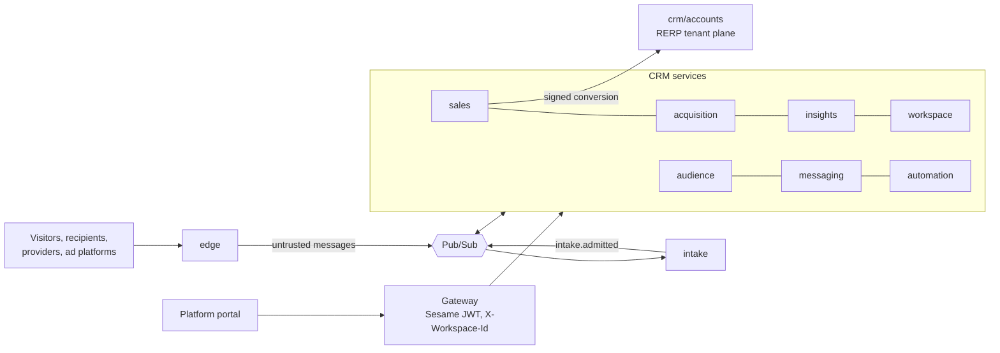

# RERP CRM

A CRM and marketing platform: contacts and consent, email and SMS campaigns, automations, deals and tasks, forms,
tracking and ads, reports and scores, for one or several brands per organisation. OpenAPI-first on BRRTRouter, Rust,
deployed per component to GKE Autopilot. Its first user is the PriceWhisperer platform portal (Epic 55).

**Read first:** [DESIGN.md](DESIGN.md) for the design in one page, then
[docs/08-service-decomposition.md](docs/08-service-decomposition.md) for why it is split this way.

## Services

| Service | What it is for | Operations | Publishes | Store |
|---|---|---|---|---|
| [audience](audience/) | Who we can reach: contacts, organisations, tags, segments, lists, subscriptions and consent, suppressions | 52 | 13 events | CRM store, `audience` |
| [messaging](messaging/) | What we send: templates, campaigns, senders and domains, transactional, 1:1 mailboxes, social posts | 78 | 14 | CRM store, `messaging` |
| [automation](automation/) | What happens next: workflows, triggers, steps, recipes, enrolments | 47 | 9 | CRM store, `automation` |
| [sales](sales/) | Selling: leads, pipelines, deals, tasks, teams, conversion to customer | 110 | 13 | CRM store, `sales` |
| [acquisition](acquisition/) | Where contacts come from: forms, tracking, conversions and goals, ad accounts, audiences, buys, attribution | 96 | 8 | CRM store, `acquisition` |
| [insights](insights/) | What it adds up to: reports, dashboards, named scores | 56 | 2 | analytics database |
| [workspace](workspace/) | How the workspace is run: workspaces and roles, custom fields, API keys, webhooks, compliance, data requests, jobs, audit | 49 | 5 | CRM store, `workspace` |
| [edge](edge/) | The public surface: form submit, confirm, tracking, pixels, unsubscribe, provider and ad webhooks, OAuth callbacks | 19 | 14 | none (publishes only) |
| [intake](intake/) | The quarantine: anonymous submissions wait here until confirmed or screened (ADR 004) | 4 | 3 | intake database |

Each folder holds `openapi.yaml` (HTTP), `asyncapi.yaml` (events) and a README. Tables are in
[`docs/data-model/<service>.yaml`](docs/data-model/). Crates are in `microservices/crm/<service>/` (`gen/` generated,
`impl/` implementation, today a stub per operation returning its contract example). Operation counts and event counts come from the contracts; the checker below keeps
them honest.

Also here, and still in use:

| Folder | What it is |
|---|---|
| [accounts](accounts/) | RERP's customer master: a customer exists only because a deal converted (ADR 003). Implemented. |
| [pipeline](pipeline/) | Today's leads and triage service against the website's Supabase. Implemented; becomes part of sales. |

Deprecated, kept until the service that replaces each is implemented ([08 §10.5](docs/08-service-decomposition.md)):
`contacts`, `outreach`, `social`, `platform`, `teams`, `tasks`, `marketing`, `reporting`, `intelligence` (scoring
moved to insights; enrichment deferred), `engagement` and `livechat` (parked). The old gateway spec `openapi.yaml` in
this folder describes that earlier layout.

## How it fits together



- The internet reaches only the edge, which holds no database credentials and only publishes.
- Nothing unconfirmed reaches the CRM store: intake admits a subscription after double opt-in and an enquiry after
  screening.
- Every call names its workspace; every table is isolated by row-level security on `workspace_id`.
- Services talk through events; the few synchronous calls are in [08 §5.2](docs/08-service-decomposition.md).

## Documents

| Document | Status | What it is |
|---|---|---|
| [DESIGN.md](DESIGN.md) | Current | The design on one page, and the reading order |
| [docs/08-service-decomposition.md](docs/08-service-decomposition.md) | Accepted | The split into services: operations, entities, flows, state machines, decisions |
| [docs/09-api-conventions.md](docs/09-api-conventions.md) | Normative | Rules every contract follows |
| [docs/10-events.md](docs/10-events.md) | Generated | The event catalogue and transport |
| [docs/11-permissions.md](docs/11-permissions.md) | Generated | Who may call what |
| [docs/12-portal-migration.md](docs/12-portal-migration.md) | Work list | Moving the portal and mock to the new contracts, with the full path map |
| [docs/13-implementation-plan.md](docs/13-implementation-plan.md) | Plan | Platform, shared crates, build order, definition of done, open questions |
| [docs/14-data-model.md](docs/14-data-model.md) | Generated | Tables per service with ERDs, from [docs/data-model/](docs/data-model/) (128 tables) |
| [docs/crm/](../../docs/crm/README.md) (repository docs) | Work list | The 58 implementation stories, the coding-agent brief and the supervision checklist |
| [docs/06-marketing-feature-map.md](docs/06-marketing-feature-map.md) | Reference | Feature inventory the v1 scope was curated from |
| [docs/07-ad-buying-landscape.md](docs/07-ad-buying-landscape.md) | Reference | Ad platforms and DSPs, and how acquisition hooks in |
| [ADR 003](../../docs/adrs/003-crm-funnel-conversion-boundary.md), [ADR 004](../../docs/adrs/004-crm-capture-intake-and-workspaces.md) | Accepted | The funnel boundary; capture, intake, workspaces and runtime |
| docs/01 to 05, `crm_*` audits, [CRM_ANALYSIS](CRM_ANALYSIS/), [reference](reference/) | Historical | The earlier 11/13-service design and the Odoo and vendor analyses behind it |

## Working on the contracts

```bash
# check conventions, examples and events; rewrite the generated docs
python3 openapi/crm/tools/check_specs.py --docs

# check the data model, rewrite 14-data-model.md, compare LifeModels with it
python3 openapi/crm/tools/data_model.py --docs --models

# validate every RERP spec, ports, and lint one CRM spec as codegen sees it
tooling/.venv/bin/rerp openapi validate
tooling/.venv/bin/rerp ports validate
../BRRTRouter/target/debug/brrtrouter-gen lint --spec openapi/crm/audience/openapi.yaml --fail-on-error

# regenerate a service's crate and check it compiles cleanly
tooling/.venv/bin/rerp gen suite crm --service audience
(cd microservices && cargo clippy -p rerp_crm_audience_gen -- -D warnings)
```

The rules behind these checks are in [docs/09-api-conventions.md](docs/09-api-conventions.md) §10.
