# 08 — CRM service decomposition

> **Status:** Accepted 2026-11-09, with the store, tenancy, edge and runtime decisions recorded in ADR 004. **Decides:** which microservices the CRM becomes and which operations each
> one owns, before any OpenAPI spec is written or rewritten. **Inputs:** every API operation the platform portal calls
> (PriceWhisperer `ui/platform`, Epic 55), the 14 specs under `openapi/crm/`, ADR 003 (the funnel stays outside RERP),
> `06-marketing-feature-map.md` and `07-ad-buying-landscape.md`.
>
> **Output:** the categorised operation tables in §9, which are the work list for producing the specs (§10).

---

## 0. Summary

The portal's CRM screens make **237 distinct API operations** (233 through the CRM client plus 4 on the website-leads
board). Today they are spread over 11 of the 14 spec folders, and 53 of them are in no spec at all. Grouping them by
what data they own, how they run and which trust boundary they sit behind gives **seven services, a public edge and an
intake worker**, down from fourteen folders:

| Service | Owns | Ops | Runs as |
|---|---|---|---|
| **crm/audience** | Who we can reach: contacts, organisations, tags, segments, lists, subscriptions and consent, suppressions, contact timeline | 27 | API (OLTP) |
| **crm/messaging** | What we send: templates, snippets, assets, campaigns, sends, senders and domains, SMS, 1:1 mailboxes, social posts | 45 | API + send workers |
| **crm/automation** | What happens next: workflows, steps, triggers, enrolments | 15 | API + durable step engine |
| **crm/sales** | Selling: leads, pipelines, stages, deals, deal roles, tasks and task settings, the conversion to customer | 45 | API (OLTP) |
| **crm/acquisition** | Where contacts come from and what they are worth: forms, site tracking, conversions and goals, ad accounts, audiences, buys, tracking, attribution | 51 | API + platform adapters |
| **crm/insights** | What it adds up to: reports, dashboards, rule-based scores | 30 | read models + jobs |
| **crm/workspace** | How the workspace is run: custom field definitions, API keys, webhooks, notifications, compliance, data requests, brand kit, import / export jobs | 24 | API + job runner |
| **crm/edge** | Every unauthenticated request (form submits, confirmation clicks, tracking, pixels, clicks, unsubscribe, provider and ad-platform webhooks), validated and turned into messages | — | stateless, no database |
| **crm/intake** | Anonymous submissions until they are confirmed (subscriptions) or validated (enquiries); confirmation emails; admission into the CRM store (ADR 004) | 4 | worker + quarantine database |

`crm/accounts` stays where ADR 003 put it: the customer master inside RERP's tenant database, reached only by signed
conversion messages. `crm/livechat` and `crm/engagement` have no consumer yet and are parked (§10.5).

Every service is scoped to a **workspace** (one per brand), named on each call by `X-Workspace-Id` (ADR 004).

Seven is more than the three or four first expected. §3 shows the smaller cuts and why each one forces a shared
database, a shared failure domain or an unauthenticated path into a service that holds personal data.

---

## 1. Scope and method

**What was counted.** Every call the portal makes, extracted from the page source (`crm.list|get|post|put|patch|del`
including nested generics, plus `utils/crm-api.ts` for the leads board), normalised to method plus path template, then
de-duplicated across pages. A call made by several pages is one operation. Calls that build a verb into the path
(`/workflows/{id}/${verb}`) are one operation each, with their verbs listed.

**What each operation is tagged with.**

| Tag | Meaning |
|---|---|
| **Proposed service** | The service that will own it (§4). |
| **From (today)** | The spec folder and path the portal calls today. |
| **Kind** | **Query** — read one or a page. **Command (CRUD)** — create, update or delete a resource. **Command (verb)** — a state change or side effect named by a verb (`schedule`, `activate`, `undo`). **Compute** — a read that calculates something not stored (segment count, audience preview, render, explain). **Report** — an aggregate over a period. |
| **Resource** | The collection it acts on. |
| **In a spec today** | ✅ in a spec, or ❌ a gap that exists only in `crm-mock`. |
| **Called from** | The portal pages that make the call. |

**What was not counted.** Public endpoints the portal never calls (pixels, unsubscribe, form submit, webhooks). They
are in §4.8 with the edge, because they decide the edge's shape. Spec paths nobody calls yet (about 200 of the 344) are
not in the tables; §10 says what happens to them.

---

## 2. Forces that shape the split

1. **Two planes (ADR 003).** Prospects, consent, marketing history and pipeline triage live in the **marketing store**,
   outside RERP's tenant database. Only converted customers cross, as a signed message on `crm-conversions`. Almost
   every CRM screen works on the funnel side; only the customer master (`crm/accounts`) is on the RERP side. No
   service may span both.
2. **Untrusted input.** Forms, tracking, pixels, unsubscribe links and provider webhooks are anonymous internet
   traffic. They must not reach a process that holds database credentials (the same rule PriceWhisperer applied to
   Stripe: a keyless relay that publishes, and services that pull and re-validate).
3. **Ownership and consistency.** "Can we contact this person?" (subscription, consent, suppression, erasure) must have
   one owner and be answered in one transaction. Campaign sends, automation steps and ad audience syncs all ask it.
4. **Runtime profile.** Sending is bursty and throughput-bound; automation needs durable timers and exactly-once steps;
   ad adapters call rate-limited third-party APIs with long-lived secrets; reporting scans history. Mixing them puts a
   send burst or a slow report in the same pool as a contact save.
5. **What RERP already has.** Users, roles and sign-in belong to the identity plane (Sesame, EPIC-31; RERP `auth/idam`,
   `auth/rbac`). Subscriptions and recurring billing belong to RERP `sales/subscription` and PriceWhisperer billing.
   The CRM should consume these, not re-implement them.
6. **Cost of running it.** One person operates this. Each service is a BRRTRouter crate, a Helm release and a set of
   dashboards, so a split has to earn its keep.

---

## 3. Options considered

| Option | Services | What goes wrong |
|---|---|---|
| **A. Three** | Marketing, Sales, Platform | "Marketing" holds contacts, sends, automation, forms, ads and reports: one database, one deploy, one failure domain for ~150 operations. A send burst or an ad-platform outage slows contact saves. Public ingest lands in the service with the most personal data. |
| **B. Four** | Audience + Messaging, Automation, Sales, Insights + Workspace | Better, but the ad adapters (third-party secrets, rate limits, external outages) sit with either sending or reporting, and settings / data requests (which orchestrate erasure across all services) sit inside a read-model service. Still no edge. |
| **C. Seven + edge (recommended)** | §4 | Each service has one reason to change, one runtime profile and its own schema; the edge keeps anonymous traffic away from data. |
| **D. Fourteen (today)** | the current folders | Splits along screens rather than data: lists and consent in `outreach`, contacts in `contacts`, so "can we contact this person?" needs two services; `intelligence`, `reporting` and `engagement` overlap; `tasks` and `teams` are separate from the pipeline they serve. |

Option C can still be **deployed** more cheaply at first: crm/insights and crm/workspace are low-traffic and can share a
node pool, and the edge is a small stateless deployment. The spec and code boundaries are what matter; deployment can
be consolidated later without changing an API.

---

## 4. Proposed services

### 4.1 crm/audience — who we can reach

| | |
|---|---|
| **Owns** | Contacts (with custom field values), organisations (prospect companies), tags, segments and the shared condition tree, lists, subscriptions with their consent history, suppressions, contact notes, the contact timeline projection, bulk jobs on contacts. |
| **Answers** | "Who matches this segment?", "Can we email / text this person on this list?", "What has happened to this person?" |
| **Does not own** | Engagement facts (they arrive as events and are projected), customers (RERP `crm/accounts`), field definitions (`crm/workspace`). |
| **Consumes** | Facts from every other service, projected into a per-contact **facts** table (last open / click, pages visited, events, deal stages, score bands, enrolments) so segment evaluation is one query in one schema. |
| **Publishes** | `contact.created / updated / merged / erased`, `subscription.changed`, `suppression.added / removed`, `tag.added / removed`, `segment.saved`. |
| **Runtime** | Synchronous API; segment evaluation p95 ≤ 700 ms on 100 k contacts. |

### 4.2 crm/messaging — what we send

| | |
|---|---|
| **Owns** | Templates (versioned), snippets, assets, merge-field catalogue, campaigns (one-time, A/B, RSS, recurring, reminder; email and SMS), the per-recipient send ledger and engagement events, senders and sending domains, SMS senders, tracking domains, postal addresses, list exclusions, provider configuration, connected mailboxes (1:1 email), social accounts and posts, campaign and deliverability reports. |
| **Asks audience** | To resolve an audience (lists − exclusions − unsubscribed − suppressed, ∩ segment), paged, at send time. |
| **Publishes** | `campaign.scheduled / sending / sent`, `message.sent / delivered / opened / clicked / bounced / complained / replied`, `social.post.published / failed`, `mailbox.message.synced`. |
| **Runtime** | API plus send workers (≥ 100 k recipients / hour / workspace), throttled per provider; idempotent per recipient. |

### 4.3 crm/automation — what happens next

| | |
|---|---|
| **Owns** | Workflows and their step graphs (with versions), the trigger and action catalogue, recipes, enrolments with step history, durable timers. |
| **Calls** | Audience (evaluate a condition for one contact), messaging (send a template to one contact), sales (create a deal or task), acquisition (add to / remove from an ad audience). |
| **Consumes** | Every trigger event (`subscription.changed`, `tag.added`, `form.submitted`, `site.visited`, `deal.stage_changed`, `ad.clicked`, `conversion.recorded`, ...). |
| **Publishes** | `enrolment.started / step_completed / goal_reached / completed / stopped / failed`. |
| **Runtime** | API plus a step engine: exactly-once per enrolment step, timers released within 60 s of due. |

### 4.4 crm/sales — selling

| | |
|---|---|
| **Owns** | Website leads and their triage (the EPIC-32 board), pipelines and stages, deals with contacts and roles, notes, files and emails, deal settings, task types, outcomes and settings, tasks, calendar feeds, saved responses, sales teams and assignment (from `crm/teams`), and the **conversion** to customer. |
| **Publishes** | `lead.created / stage_changed`, `deal.created / stage_changed / won / lost`, `task.created / completed`, and the signed conversion on `crm-conversions` (ADR 003). |
| **Runtime** | Synchronous API. Already partly implemented as `crm/pipeline` (leads, stages, convert). |

### 4.5 crm/acquisition — where contacts come from and what they are worth

| | |
|---|---|
| **Owns** | Forms (definition, embed, submissions), tracked sites and event types, the visitor / click store, conversions and business goals, ad accounts and adapters, ad audiences and sync runs, creatives and buys, tracking settings and link-decoration rules, conversion relay rules and the relay log, attribution models, touchpoints, LTV cohorts. |
| **Publishes** | `form.submitted`, `site.visited`, `event.recorded`, `ad.clicked`, `conversion.recorded`, `ad_audience.synced`, `ad_buy.changed`. |
| **Runtime** | API plus adapter workers (platform rate limits, retries, secrets in the secrets service). An ad-platform outage stays inside this service. |

### 4.6 crm/insights — what it adds up to

| | |
|---|---|
| **Owns** | Read models for every report (deals, contacts, email trends, automations, revenue, analytics hub), dashboards and widgets with their saved queries, the metric catalogue, rule-based named scores with their rules, distributions and explanations (replacing the single implicit score in `crm/intelligence`). |
| **Consumes** | Events from every service; never reads another service's tables. |
| **Publishes** | `score.changed` (with band), which audience projects for segments and automation triggers on. |
| **Runtime** | Event consumers and scheduled jobs; reports p95 ≤ 800 ms over 12 months; read models at most 5 minutes behind. Its own database, so a heavy report never touches an OLTP pool. |

### 4.7 crm/workspace — how the workspace is run

| | |
|---|---|
| **Owns** | Workspaces (one per brand) and memberships with a role per workspace, custom field definitions and groups (values live with the owning entity), API keys, outgoing webhooks and delivery logs, notification rules, compliance settings, data requests (access and erasure) and their orchestration, brand kit, import / export jobs, the audit log, a read facade over team members and roles. |
| **Does not own** | Users and roles (identity plane). |
| **Publishes** | `field.defined / changed`, `erasure.requested` (each service erases and replies `erasure.completed`), `webhook.delivery.failed`. |
| **Runtime** | API plus a job runner (imports, exports, webhook delivery, erasure saga). |

### 4.8 crm/edge — the public surface

The only CRM component reachable without a session. It holds **no database credentials**: it validates, rate-limits,
signs or verifies tokens, and publishes to Pub/Sub. The owning service pulls and re-validates (ADR 003's pattern).

| Public operation | Today | Becomes a message for |
|---|---|---|
| `POST /forms/{id}/submit` | ❌ gap | intake (quarantined until confirmed or validated), then audience and acquisition |
| `GET /confirm/{token}` (double opt-in) | outreach `/public/confirm` ✅ | intake, which admits the contact |
| `POST /track` (page view, custom event) | marketing `POST /analytics/track` | acquisition |
| `POST /ads/clicks` (landing with click ids) | marketing ✅ | acquisition; edge sets the first-party cookie |
| `POST /ads/conversions` (server-side events) | marketing ✅ | acquisition |
| `POST /ads/calls` (call tracking) | marketing ✅ | acquisition |
| `GET /o/{token}` open pixel · `GET /c/{token}` click redirect · `GET /view/{token}` | outreach `/public/*` ✅ | messaging |
| `GET` / `POST /u/{token}` one-click unsubscribe · `GET` / `POST /p/{token}` preferences | outreach `/public/*` ✅ | audience |
| `POST /webhooks/provider/{provider}` (bounces, complaints, inbound SMS STOP) | outreach ✅ | messaging, audience |
| `GET /calendars/{token}.ics` | tasks ✅ | served from a signed snapshot sales publishes |
| `POST /surveys/submit`, `POST /events/register` | marketing ✅ | acquisition (parked features) |
| OAuth callbacks (mailboxes, ad accounts, social) | platform `POST /mailboxes/oauth/callback` ✅, others ❌ | the service that started the flow (state is signed) |
| `POST /webhooks/ads/{platform}` (lead forms and other ad-platform pushes) | ❌ new | acquisition (lead forms go through intake like any other form) |

### 4.9 crm/intake — the quarantine (ADR 004)

| | |
|---|---|
| **Owns** | Pending submissions in their own small database: the fields, consent text shown, form and workspace, submission IP and time, the confirmation token and its expiry; the decision (admitted, rejected, expired). |
| **Does** | Consumes `form.submission.received` from the edge; screens (honeypot, rate per address and IP, syntax and disposable domains); sends the double opt-in email for subscriptions; on `confirmation.received` (or immediately, for an enquiry) publishes `intake.admitted` with the submission and its evidence. Until the website's forms post to the edge, it also reads the EPIC-32 Supabase capture tables. |
| **Never** | Writes to the CRM store, or keeps anything past 7 days pending or 30 days decided. |
| **API** | Staff-only, workspace-scoped: list pending submissions, re-send a confirmation, discard one. Nothing on the internet. |

Click redirects and the preference page must answer immediately: the edge resolves them from the signed token alone (the
token carries the target URL or the subscription id), never by asking a service.

---

## 5. Architecture

### 5.1 Planes and services

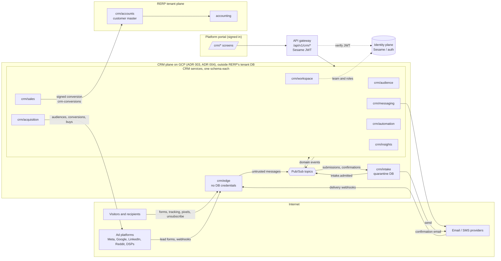

### 5.2 Synchronous dependencies

Only these calls are synchronous; everything else is an event. No cycles.

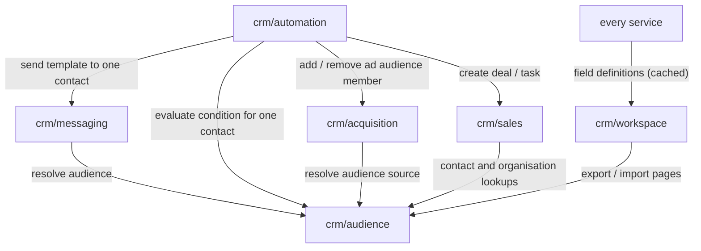

### 5.3 Gateway routes

Every route except the edge requires `X-Workspace-Id`; the gateway checks it against the caller's memberships.

| Prefix | Service | Auth |
|---|---|---|
| `/api/v1/crm/audience/*` | crm/audience | Sesame JWT |
| `/api/v1/crm/messaging/*` | crm/messaging | Sesame JWT |
| `/api/v1/crm/automation/*` | crm/automation | Sesame JWT |
| `/api/v1/crm/sales/*` | crm/sales | Sesame JWT |
| `/api/v1/crm/acquisition/*` | crm/acquisition | Sesame JWT |
| `/api/v1/crm/insights/*` | crm/insights | Sesame JWT |
| `/api/v1/crm/workspace/*` | crm/workspace | Sesame JWT or API key |
| `https://t.<workspace domain>/*` | crm/edge | none (signed tokens, rate limits, origin checks) |

### 5.4 Data stores

| Store | Schemas | Notes |
|---|---|---|
| CRM store, OLTP (Postgres on GCP, Crossplane) | `audience`, `messaging`, `automation`, `sales`, `acquisition`, `workspace` | ADR 003's marketing store, on GCP (ADR 004). One schema per service, owned by its role; no cross-schema reads. Row-level security on `workspace_id` in every table. |
| CRM store, analytics (Postgres on GCP) | `insights` | Read models only; rebuildable from events. |
| Intake store (Postgres on GCP) | `intake` | Pending submissions only; 7-day expiry. Written only by crm/intake. |
| RERP tenant database | `crm_accounts` | Customer master and the conversion ledger (ADR 003). |
| Object storage | assets, deal files, exports | Signed, expiring URLs. |
| Secrets service | provider keys, OAuth tokens, ad developer tokens, webhook secrets | Never in a table. |

---

## 6. Entity relationships

Within a service, relationships are foreign keys. Across services, only ids cross (shown in §6.8), and each service
keeps what it needs from others as a projection fed by events.

### 6.1 crm/audience

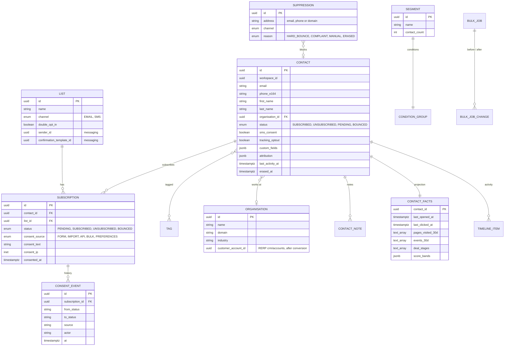

### 6.2 crm/messaging

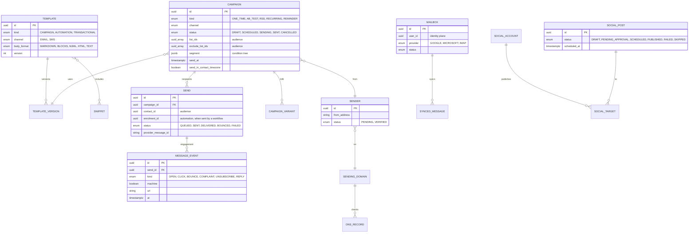

### 6.3 crm/automation

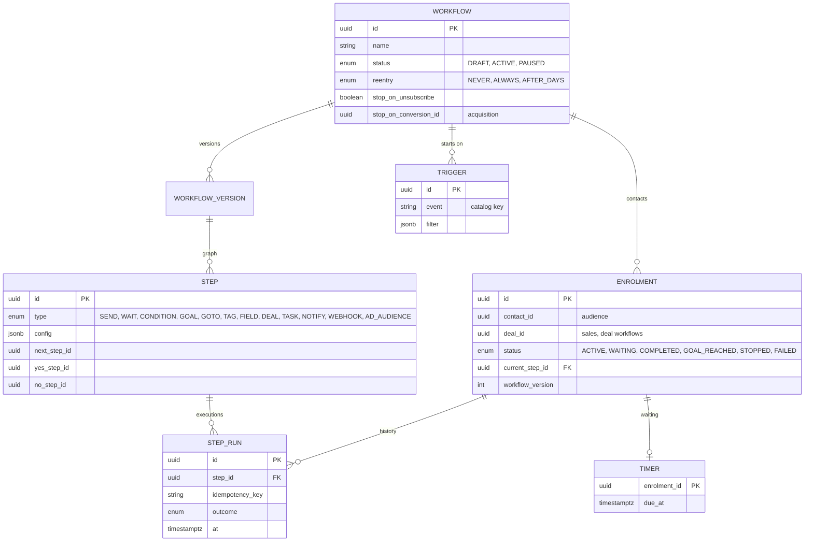

### 6.4 crm/sales

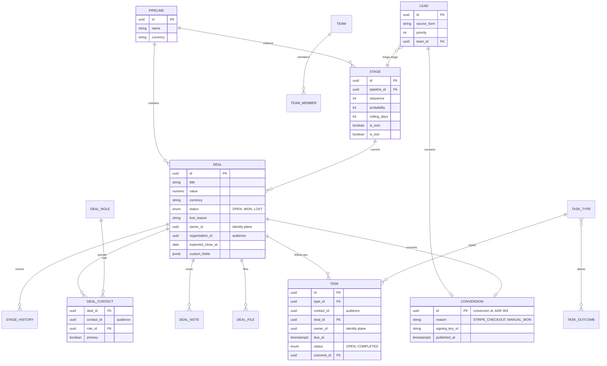

### 6.5 crm/acquisition

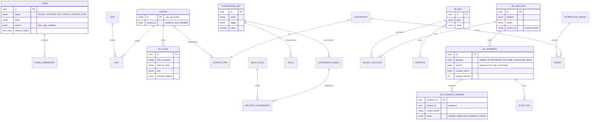

### 6.6 crm/insights

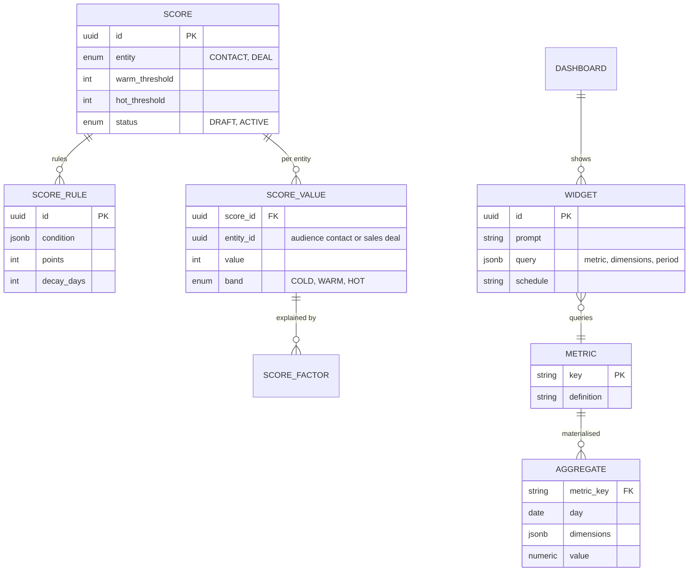

### 6.7 crm/workspace

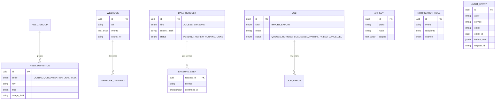

### 6.8 References that cross services

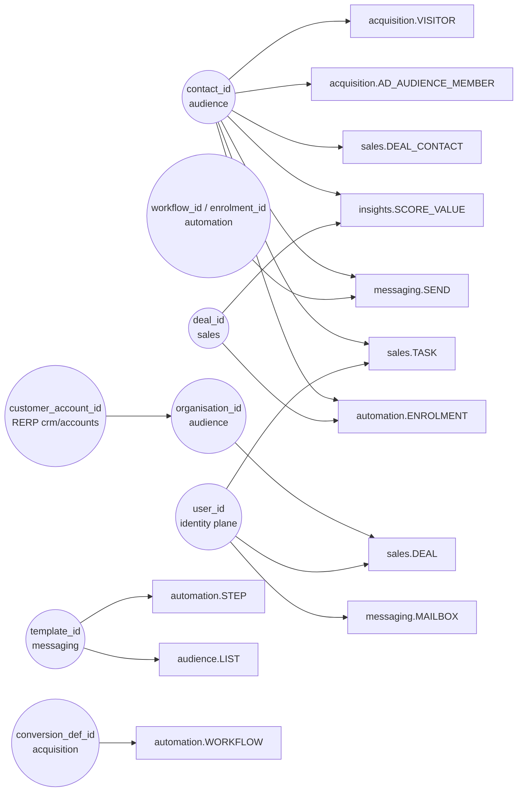

---

## 7. Flows

### 7.1 Marketing funnel lifecycle

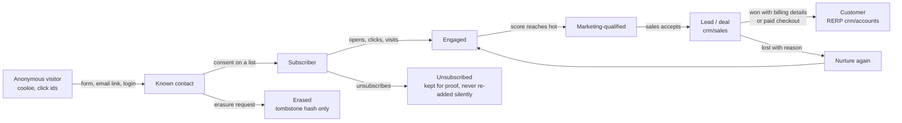

### 7.2 Sales flow

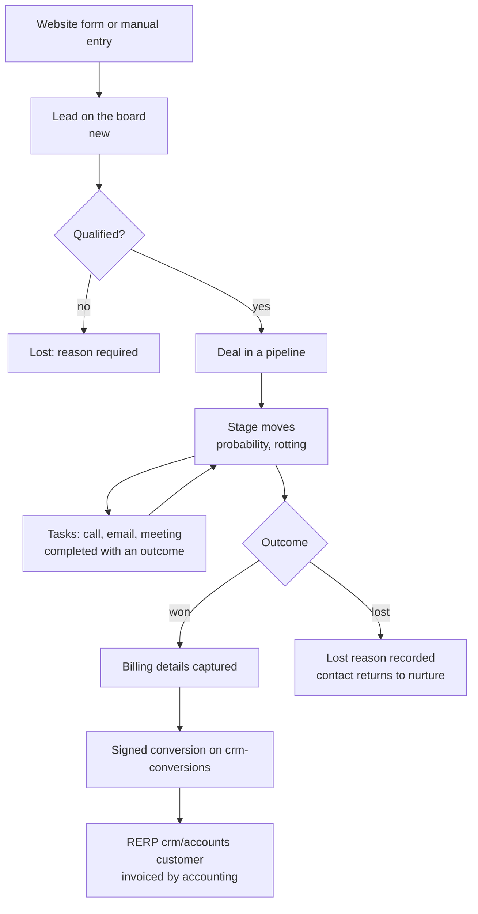

### 7.3 Form submission, confirmation and welcome email (ADR 004)

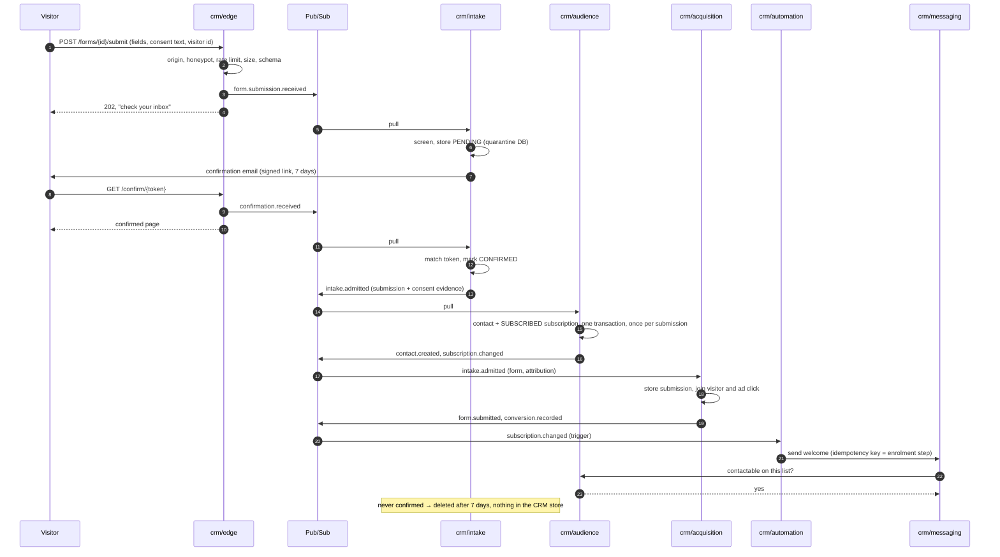

### 7.4 Campaign send

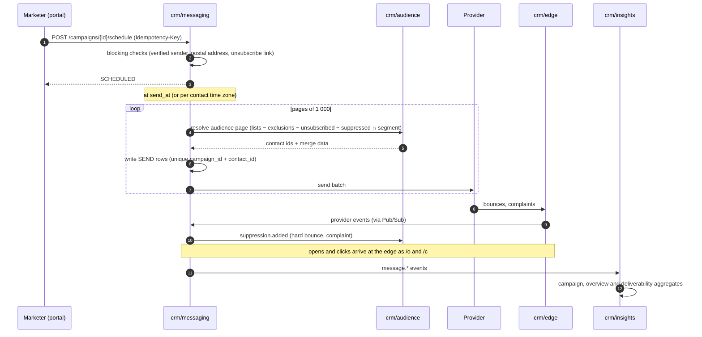

### 7.5 Automation runtime

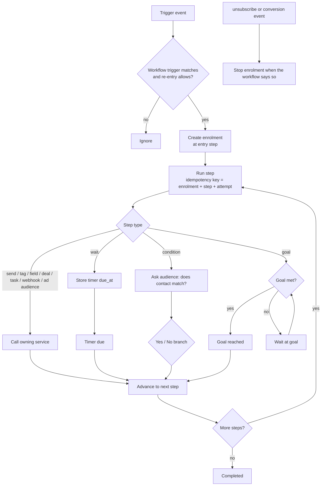

### 7.6 Deal won to customer (ADR 003)

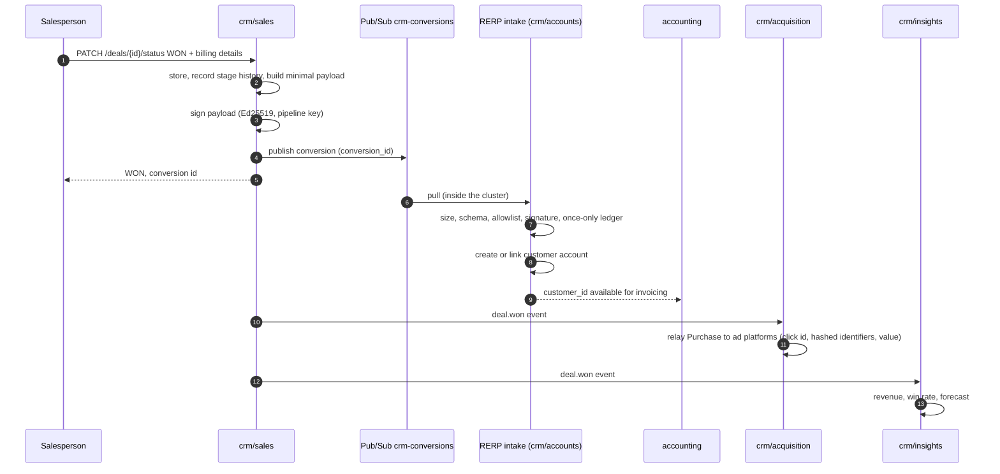

### 7.7 Ad click to conversion relay

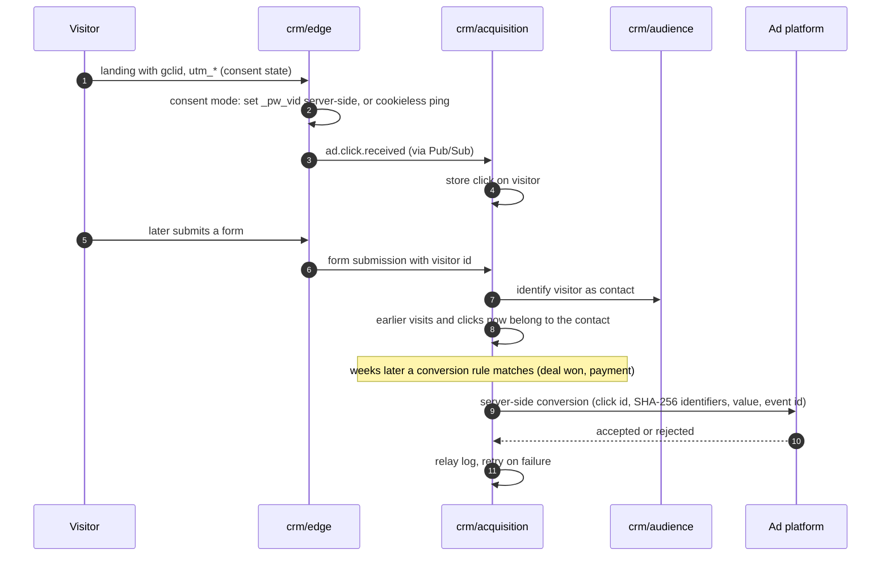

### 7.8 Warm-up before a campaign

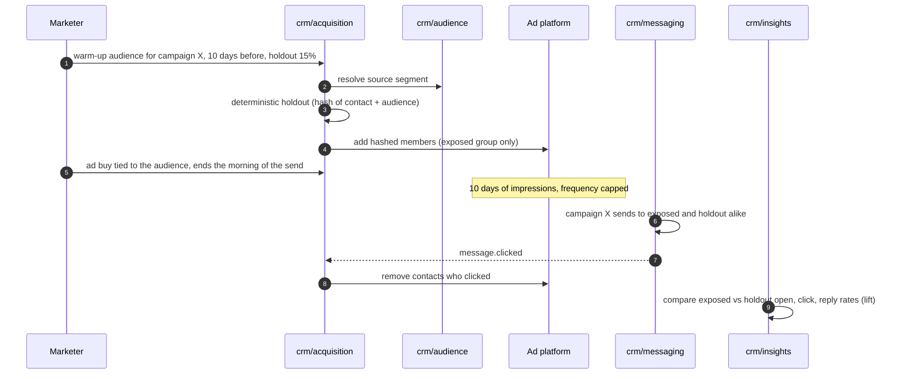

### 7.9 Erasure request

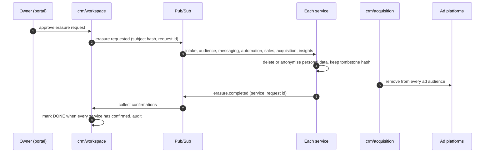

### 7.10 State machines

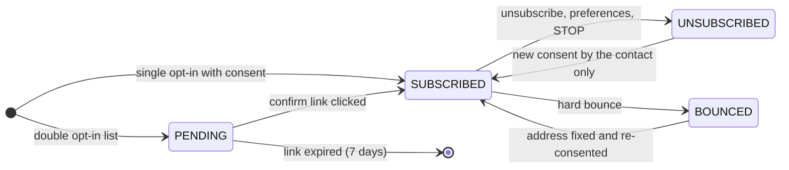

```mermaid
stateDiagram-v2
    direction LR
    [*] --> DRAFT
    DRAFT --> SCHEDULED: schedule (checks pass)
    SCHEDULED --> DRAFT: cancel
    SCHEDULED --> SENDING: send_at reached
    SENDING --> SENT: every recipient processed
    SENDING --> SENDING: worker restart resumes
    SENT --> [*]
```

```mermaid
stateDiagram-v2
    direction LR
    [*] --> OPEN
    OPEN --> OPEN: stage move
    OPEN --> WON: won + billing details → conversion
    OPEN --> LOST: lost + reason
    WON --> OPEN: reopen (owner / admin)
    LOST --> OPEN: reopen (owner / admin)
```

```mermaid
stateDiagram-v2
    direction LR
    [*] --> ACTIVE: enrolled
    ACTIVE --> WAITING: wait step
    WAITING --> ACTIVE: timer due
    ACTIVE --> GOAL_REACHED: goal met
    GOAL_REACHED --> ACTIVE: continue after goal
    ACTIVE --> COMPLETED: last step
    ACTIVE --> STOPPED: stopped by user, unsubscribe or conversion
    WAITING --> STOPPED
    ACTIVE --> FAILED: step error
    FAILED --> ACTIVE: retry from failing step
```

---

## 8. Event catalogue

Topics are per publishing service (`crm.<service>.v1`); every message carries `workspace_id`, `event_id`, `occurred_at`
and the entity id. Consumers are idempotent on `event_id`.

| Event | Publisher | Main consumers |
|---|---|---|
| `contact.created / updated / merged / erased` | audience | automation, insights, acquisition, sales |
| `subscription.changed` | audience | automation (trigger), messaging (cache), insights |
| `suppression.added / removed` | audience | messaging, acquisition (ad audience removal) |
| `tag.added / removed` | audience | automation (trigger), insights (scores) |
| `campaign.scheduled / sending / sent` | messaging | insights |
| `message.sent / delivered / opened / clicked / bounced / complained / replied` | messaging | audience (facts), automation (goals, conditions), insights, acquisition (warm-up removal) |
| `social.post.published / failed` | messaging | insights |
| `enrolment.started / step_completed / goal_reached / completed / stopped / failed` | automation | audience (facts, timeline), insights |
| `lead.created / stage_changed` | sales | automation, insights |
| `deal.created / stage_changed / won / lost` | sales | automation (trigger), audience (facts), insights, acquisition (relay) |
| `task.created / completed` | sales | automation, audience (timeline), insights |
| conversion (signed, `crm-conversions`) | sales, PriceWhisperer billing | RERP crm/accounts intake |
| `form.submitted` | acquisition | automation (trigger), insights |
| `site.visited`, `event.recorded` | acquisition | audience (facts), automation, insights |
| `ad.clicked`, `conversion.recorded` | acquisition | automation, insights |
| `ad_audience.synced`, `ad_buy.changed` | acquisition | insights |
| `score.changed` | insights | audience (facts), automation (trigger) |
| `field.defined / changed` | workspace | every service (cache) |
| `erasure.requested` / `erasure.completed` | workspace / every service | every service / workspace |
| `*.received` (form, click, track, provider event, unsubscribe) | edge | acquisition, messaging, audience |

---

## 9. Tabulation

### 9.1 Summary

| Service | Operations | Query | Command (CRUD) | Command (verb) | Compute | Report | Gaps today |
|---|---|---|---|---|---|---|---|
| **crm/audience** | 27 | 13 | 12 | 1 | 1 | 0 | 6 |
| **crm/messaging** | 45 | 19 | 13 | 7 | 2 | 4 | 13 |
| **crm/automation** | 15 | 8 | 4 | 2 | 1 | 0 | 3 |
| **crm/sales** | 45 | 19 | 20 | 5 | 1 | 0 | 4 |
| **crm/acquisition** | 51 | 21 | 20 | 5 | 2 | 3 | 6 |
| **crm/insights** | 30 | 2 | 4 | 1 | 1 | 22 | 7 |
| **crm/workspace** | 24 | 11 | 10 | 3 | 0 | 0 | 14 |
| **Total** | **237** | 93 | 83 | 24 | 8 | 29 | 53 |

```mermaid
pie showData title Portal operations by proposed service
    "audience" : 27
    "messaging" : 45
    "automation" : 15
    "sales" : 45
    "acquisition" : 51
    "insights" : 30
    "workspace" : 24
```

### 9.2 Where today's operations go

| Today's spec folder | Operations called | → Proposed service(s) |
|---|---|---|
| crm/accounts | 2 | audience (2) |
| crm/automation | 15 | automation (15) |
| crm/contacts | 18 | audience (18) |
| crm/intelligence | 5 | insights (5) |
| crm/marketing | 51 | acquisition (51) |
| crm/outreach | 38 | messaging (31), audience (7) |
| crm/pipeline | 29 | sales (29) |
| crm/platform | 31 | workspace (24), messaging (7) |
| crm/reporting | 25 | insights (25) |
| crm/social | 7 | messaging (7) |
| crm/tasks | 16 | sales (16) |

`crm/accounts`' two calls (the Companies page) move to audience as **organisations**: prospect companies belong to the
funnel; the customer master stays in RERP and an organisation links to it by `customer_account_id` after conversion
(decision D1).

### 9.3 crm/audience

| # | Proposed operation | From (today) | Kind | Resource | In a spec today | Called from |
|---|---|---|---|---|---|---|
| 1 | `GET /bulk-jobs` | crm/contacts `GET /bulk-jobs` | Query | bulk-jobs | ❌ gap | Settings |
| 2 | `POST /bulk-jobs` | crm/contacts `POST /bulk-jobs` | Command (CRUD) | bulk-jobs | ❌ gap | Settings |
| 3 | `POST /bulk-jobs/{id}/undo` | crm/contacts `POST /bulk-jobs/{id}/undo` | Command (verb) | bulk-jobs | ❌ gap | Settings |
| 4 | `GET /contacts` | crm/contacts `GET /contacts` | Query | contacts | ✅ | AdAttribution, Companies, Contacts, Deal, Scoring, Tasks, Templates |
| 5 | `GET /contacts/counts` | crm/contacts `GET /contacts/counts` | Query | contacts | ❌ gap | Contacts |
| 6 | `GET /contacts/{id}` | crm/contacts `GET /contacts/{id}` | Query | contacts | ✅ | Contact |
| 7 | `PATCH /contacts/{id}` | crm/contacts `PATCH /contacts/{id}` | Command (CRUD) | contacts | ❌ gap | Contact |
| 8 | `GET /contacts/{id}/activity` | crm/contacts `GET /contacts/{id}/activity` | Query | contacts | ✅ | Contact |
| 9 | `POST /contacts/{id}/notes` | crm/contacts `POST /contacts/{id}/notes` | Command (CRUD) | contacts | ✅ | Contact |
| 10 | `GET /contacts/{id}/subscriptions` | crm/outreach `GET /contacts/{id}/subscriptions` | Query | contacts/*/subscriptions | ✅ | Contact |
| 11 | `POST /contacts/{id}/tags` | crm/contacts `POST /contacts/{id}/tags` | Command (CRUD) | contacts | ✅ | Contact, Contacts |
| 12 | `GET /lists` | crm/outreach `GET /lists` | Query | lists | ✅ | AdAudiences, CampaignWizard, Contacts, Forms, Lists |
| 13 | `POST /lists` | crm/outreach `POST /lists` | Command (CRUD) | lists | ✅ | Lists |
| 14 | `GET /organisations` | crm/accounts `GET /accounts` | Query | accounts | ✅ | Companies, Deals |
| 15 | `GET /organisations/{id}` | crm/accounts `GET /accounts/{id}` | Query | accounts | ✅ | Companies |
| 16 | `GET /segments` | crm/contacts `GET /segments` | Query | segments | ✅ | AdAudiences, CampaignWizard, Contacts, Segments, Settings |
| 17 | `POST /segments` | crm/contacts `POST /segments` | Command (CRUD) | segments | ✅ | Segments |
| 18 | `POST /segments/evaluate` | crm/contacts `POST /segments/evaluate` | Compute | segments | ✅ | Segments |
| 19 | `GET /segments/{id}` | crm/contacts `GET /segments/{id}` | Query | segments | ✅ | Segments |
| 20 | `PUT /segments/{id}` | crm/contacts `PUT /segments/{id}` | Command (CRUD) | segments | ✅ | Segments |
| 21 | `POST /subscriptions` | crm/outreach `POST /subscriptions` | Command (CRUD) | subscriptions | ✅ | Contacts |
| 22 | `GET /suppressions` | crm/outreach `GET /suppressions` | Query | suppressions | ✅ | Settings |
| 23 | `POST /suppressions` | crm/outreach `POST /suppressions` | Command (CRUD) | suppressions | ✅ | Settings |
| 24 | `DELETE /suppressions/{id}` | crm/outreach `DELETE /suppressions/{id}` | Command (CRUD) | suppressions | ✅ | Settings |
| 25 | `GET /tags` | crm/contacts `GET /tags` | Query | tags | ✅ | AdAudiences, Contacts, Settings |
| 26 | `POST /tags` | crm/contacts `POST /tags` | Command (CRUD) | tags | ✅ | Settings |
| 27 | `PATCH /tags/{id}` | crm/contacts `PATCH /tags/{id}` | Command (CRUD) | tags | ❌ gap | Settings |

### 9.4 crm/messaging

| # | Proposed operation | From (today) | Kind | Resource | In a spec today | Called from |
|---|---|---|---|---|---|---|
| 1 | `GET /accounts` | crm/social `GET /accounts` | Query | accounts | ✅ | CrmSocial |
| 2 | `GET /assets` | crm/outreach `GET /assets` | Query | assets | ❌ gap | AdBuys, Templates |
| 3 | `GET /calendar` | crm/social `GET /calendar` | Query | calendar | ✅ | CrmSocial |
| 4 | `GET /campaigns` | crm/outreach `GET /campaigns` | Query | campaigns | ✅ | AdAudiences, CampaignWizard, Campaigns, Overview, Reports |
| 5 | `POST /campaigns` | crm/outreach `POST /campaigns` | Command (CRUD) | campaigns | ✅ | CampaignWizard |
| 6 | `GET /campaigns/{id}` | crm/outreach `GET /campaigns/{id}` | Query | campaigns | ✅ | CampaignReport, CampaignWizard |
| 7 | `PUT /campaigns/{id}` | crm/outreach `PUT /campaigns/{id}` | Command (CRUD) | campaigns | ✅ | CampaignWizard |
| 8 | `GET /campaigns/{id}/audience` | crm/outreach `GET /campaigns/{id}/audience` | Compute | campaigns | ✅ | CampaignWizard |
| 9 | `POST /campaigns/{id}/duplicate` | crm/outreach `POST /campaigns/{id}/duplicate` | Command (verb) | campaigns | ✅ | CampaignReport |
| 10 | `GET /campaigns/{id}/report` | crm/outreach `GET /campaigns/{id}/report` | Report | campaigns | ✅ | CampaignReport |
| 11 | `POST /campaigns/{id}/schedule` | crm/outreach `POST /campaigns/{id}/schedule` | Command (verb) | campaigns | ✅ | CampaignWizard |
| 12 | `GET /campaigns/{id}/sends` | crm/outreach `GET /campaigns/{id}/sends` | Query | campaigns | ✅ | CampaignReport |
| 13 | `POST /campaigns/{id}/test-send` | crm/outreach `POST /campaigns/{id}/test-send` | Command (verb) | campaigns | ❌ gap | CampaignWizard |
| 14 | `GET /engagement` | crm/social `GET /engagement` | Report | engagement | ❌ gap | CrmSocial |
| 15 | `GET /list-exclusions` | crm/outreach `GET /list-exclusions` | Query | list-exclusions | ❌ gap | Settings |
| 16 | `POST /list-exclusions` | crm/outreach `POST /list-exclusions` | Command (CRUD) | list-exclusions | ❌ gap | Settings |
| 17 | `GET /mailboxes` | crm/platform `GET /mailboxes` | Query | mailboxes | ✅ | Mailboxes |
| 18 | `POST /mailboxes` | crm/platform `POST /mailboxes` | Command (CRUD) | mailboxes | ✅ | Mailboxes |
| 19 | `DELETE /mailboxes/{id}` | crm/platform `DELETE /mailboxes/{id}` | Command (CRUD) | mailboxes | ✅ | Mailboxes |
| 20 | `PATCH /mailboxes/{id}` | crm/platform `PATCH /mailboxes/{id}` | Command (CRUD) | mailboxes | ✅ | Mailboxes |
| 21 | `GET /mailboxes/{id}/messages` | crm/platform `GET /mailboxes/{id}/messages` | Query | mailboxes | ✅ | Mailboxes |
| 22 | `POST /mailboxes/{id}/sync` | crm/platform `POST /mailboxes/{id}/sync` | Command (verb) | mailboxes | ✅ | Mailboxes |
| 23 | `GET /merge-fields` | crm/outreach `GET /merge-fields` | Query | merge-fields | ✅ | Templates |
| 24 | `GET /postal-addresses` | crm/outreach `GET /postal-addresses` | Query | postal-addresses | ❌ gap | Settings |
| 25 | `POST /postal-addresses` | crm/outreach `POST /postal-addresses` | Command (CRUD) | postal-addresses | ❌ gap | Settings |
| 26 | `GET /posts` | crm/social `GET /posts` | Query | posts | ✅ | CrmSocial |
| 27 | `POST /posts` | crm/social `POST /posts` | Command (CRUD) | posts | ✅ | CrmSocial |
| 28 | `PUT /posts/{id}` | crm/social `PUT /posts/{id}` | Command (CRUD) | posts | ✅ | CrmSocial |
| 29 | `POST /posts/{id}/{verb}` (approve, skip) | crm/social `POST /posts/{id}/{id}` | Command (verb) | posts | ✅ | CrmSocial |
| 30 | `GET /providers` | crm/platform `GET /providers` | Query | providers | ❌ gap | Settings |
| 31 | `GET /reports/deliverability` | crm/outreach `GET /reports/deliverability` | Report | reports | ❌ gap | Reports |
| 32 | `GET /reports/overview` | crm/outreach `GET /reports/overview` | Report | reports | ✅ | Overview, Reports |
| 33 | `GET /senders` | crm/outreach `GET /senders` | Query | senders | ✅ | CampaignWizard, Lists, Settings |
| 34 | `POST /senders` | crm/outreach `POST /senders` | Command (CRUD) | senders | ✅ | Settings |
| 35 | `POST /senders/{id}/verify` | crm/outreach `POST /senders/{id}/verify` | Command (verb) | senders | ✅ | Settings |
| 36 | `GET /sms/senders` | crm/outreach `GET /sms/senders` | Query | sms | ❌ gap | CampaignWizard |
| 37 | `GET /snippets` | crm/outreach `GET /snippets` | Query | snippets | ❌ gap | Templates |
| 38 | `POST /snippets` | crm/outreach `POST /snippets` | Command (CRUD) | snippets | ❌ gap | Templates |
| 39 | `GET /templates` | crm/outreach `GET /templates` | Query | templates | ✅ | AutomationBuilder, CampaignWizard, Lists, Templates |
| 40 | `POST /templates` | crm/outreach `POST /templates` | Command (CRUD) | templates | ✅ | Templates |
| 41 | `GET /templates/{id}` | crm/outreach `GET /templates/{id}` | Query | templates | ✅ | Templates |
| 42 | `PUT /templates/{id}` | crm/outreach `PUT /templates/{id}` | Command (CRUD) | templates | ✅ | Templates |
| 43 | `POST /templates/{id}/render` | crm/outreach `POST /templates/{id}/render` | Compute | templates | ✅ | Templates |
| 44 | `POST /templates/{id}/test-send` | crm/outreach `POST /templates/{id}/test-send` | Command (verb) | templates | ✅ | Templates |
| 45 | `GET /tracking-domains` | crm/outreach `GET /tracking-domains` | Query | tracking-domains | ❌ gap | Settings |

### 9.5 crm/automation

| # | Proposed operation | From (today) | Kind | Resource | In a spec today | Called from |
|---|---|---|---|---|---|---|
| 1 | `GET /catalog` | crm/automation `GET /catalog` | Query | catalog | ❌ gap | AutomationBuilder |
| 2 | `GET /contacts/{id}/enrolments` | crm/automation `GET /contacts/{id}/enrolments` | Query | contacts/*/enrolments | ✅ | Contact |
| 3 | `GET /deals/{id}/enrolments` | crm/automation `GET /deals/{id}/enrolments` | Query | deals/*/enrolments | ❌ gap | Deal |
| 4 | `POST /enrolments/{id}/stop` | crm/automation `POST /enrolments/{id}/stop` | Command (verb) | enrolments | ✅ | AutomationMap |
| 5 | `GET /recipes` | crm/automation `GET /recipes` | Query | recipes | ✅ | Automations |
| 6 | `GET /workflows` | crm/automation `GET /workflows` | Query | workflows | ✅ | Automations, Contacts, Forms, Overview |
| 7 | `POST /workflows` | crm/automation `POST /workflows` | Command (CRUD) | workflows | ✅ | Automations |
| 8 | `GET /workflows/{id}` | crm/automation `GET /workflows/{id}` | Query | workflows | ✅ | AutomationBuilder, AutomationMap, AutomationReport |
| 9 | `PATCH /workflows/{id}` | crm/automation `PATCH /workflows/{id}` | Command (CRUD) | workflows | ❌ gap | AutomationBuilder |
| 10 | `GET /workflows/{id}/enrolments` | crm/automation `GET /workflows/{id}/enrolments` | Query | workflows | ✅ | AutomationMap |
| 11 | `POST /workflows/{id}/enrolments` | crm/automation `POST /workflows/{id}/enrolments` | Command (CRUD) | workflows | ✅ | Contacts |
| 12 | `GET /workflows/{id}/map` | crm/automation `GET /workflows/{id}/map` | Compute | workflows | ✅ | AutomationBuilder, AutomationMap |
| 13 | `GET /workflows/{id}/steps` | crm/automation `GET /workflows/{id}/steps` | Query | workflows | ✅ | AutomationBuilder |
| 14 | `PUT /workflows/{id}/steps` | crm/automation `PUT /workflows/{id}/steps` | Command (CRUD) | workflows | ✅ | AutomationBuilder |
| 15 | `POST /workflows/{id}/{verb}` (activate, pause) | crm/automation `POST /workflows/{id}/{id}` | Command (verb) | workflows | ✅ | AutomationBuilder |

### 9.6 crm/sales

| # | Proposed operation | From (today) | Kind | Resource | In a spec today | Called from |
|---|---|---|---|---|---|---|
| 1 | `GET /calendars` | crm/tasks `GET /calendars` | Query | calendars | ✅ | TaskSettings |
| 2 | `POST /calendars` | crm/tasks `POST /calendars` | Command (CRUD) | calendars | ✅ | TaskSettings |
| 3 | `POST /calendars/{id}/regenerate` | crm/tasks `POST /calendars/{id}/regenerate` | Command (verb) | calendars | ✅ | TaskSettings |
| 4 | `GET /deal-roles` | crm/pipeline `GET /deal-roles` | Query | deal-roles | ✅ | Deal, Pipelines |
| 5 | `POST /deal-roles` | crm/pipeline `POST /deal-roles` | Command (CRUD) | deal-roles | ✅ | Pipelines |
| 6 | `GET /deals` | crm/pipeline `GET /deals` | Query | deals | ✅ | Companies, Contact, Deals, Tasks |
| 7 | `POST /deals` | crm/pipeline `POST /deals` | Command (CRUD) | deals | ✅ | Deals |
| 8 | `GET /deals/{id}` | crm/pipeline `GET /deals/{id}` | Query | deals | ✅ | Deal |
| 9 | `PATCH /deals/{id}` | crm/pipeline `PATCH /deals/{id}` | Command (CRUD) | deals | ✅ | Deal |
| 10 | `GET /deals/{id}/activity` | crm/pipeline `GET /deals/{id}/activity` | Query | deals | ✅ | Deal |
| 11 | `GET /deals/{id}/contacts` | crm/pipeline `GET /deals/{id}/contacts` | Query | deals | ❌ gap | Deal |
| 12 | `POST /deals/{id}/contacts` | crm/pipeline `POST /deals/{id}/contacts` | Command (CRUD) | deals | ✅ | Deal |
| 13 | `GET /deals/{id}/emails` | crm/pipeline `GET /deals/{id}/emails` | Query | deals | ✅ | Deal |
| 14 | `GET /deals/{id}/files` | crm/pipeline `GET /deals/{id}/files` | Query | deals | ✅ | Deal |
| 15 | `POST /deals/{id}/files` | crm/pipeline `POST /deals/{id}/files` | Command (CRUD) | deals | ✅ | Deal |
| 16 | `GET /deals/{id}/notes` | crm/pipeline `GET /deals/{id}/notes` | Query | deals | ✅ | Deal |
| 17 | `POST /deals/{id}/notes` | crm/pipeline `POST /deals/{id}/notes` | Command (CRUD) | deals | ✅ | Deal |
| 18 | `PATCH /deals/{id}/stage` | crm/pipeline `PATCH /deals/{id}/stage` | Command (CRUD) | deals | ✅ | Deal, Deals |
| 19 | `PATCH /deals/{id}/status` (win, lose) | crm/pipeline `POST /deals/{id}/win, lose` | Command (verb) | deals | ❌ gap | Deal |
| 20 | `GET /deals/{id}/suggestions` | crm/pipeline `GET /deals/{id}/suggestions` | Compute | deals | ❌ gap | Deal |
| 21 | `GET /leads` | crm/pipeline `GET /leads` | Query | leads | ✅ | CrmBoard (leads) |
| 22 | `PUT /leads/{id}` | crm/pipeline `PUT /leads/{id}` | Command (CRUD) | leads | ✅ | CrmBoard (leads) |
| 23 | `POST /leads/{id}/convert` | crm/pipeline `POST /leads/{id}/convert` | Command (verb) | leads | ✅ | CrmBoard (leads) |
| 24 | `PATCH /leads/{id}/stage` | crm/pipeline `PATCH /leads/{id}/stage` | Command (CRUD) | leads | ✅ | CrmBoard (leads) |
| 25 | `GET /pipelines` | crm/pipeline `GET /pipelines` | Query | pipelines | ✅ | Deal, Deals, Pipelines |
| 26 | `POST /pipelines` | crm/pipeline `POST /pipelines` | Command (CRUD) | pipelines | ✅ | Pipelines |
| 27 | `GET /pipelines/summary` | crm/pipeline `GET /pipeline/summary` | Query | pipeline | ✅ | Deals |
| 28 | `PATCH /pipelines/{id}` | crm/pipeline `PATCH /pipelines/{id}` | Command (CRUD) | pipelines | ✅ | Pipelines |
| 29 | `GET /saved-response-categories` | crm/tasks `GET /saved-response-categories` | Query | saved-response-categories | ✅ | TaskSettings |
| 30 | `GET /saved-responses` | crm/tasks `GET /saved-responses` | Query | saved-responses | ✅ | TaskSettings |
| 31 | `PATCH /saved-responses/{id}` | crm/tasks `PATCH /saved-responses/{id}` | Command (CRUD) | saved-responses | ✅ | TaskSettings |
| 32 | `GET /stages` | crm/pipeline `GET /stages` | Query | stages | ✅ | Deal, Deals, Pipelines |
| 33 | `POST /stages` | crm/pipeline `POST /stages` | Command (CRUD) | stages | ✅ | Pipelines |
| 34 | `DELETE /stages/{id}` | crm/pipeline `DELETE /stages/{id}` | Command (CRUD) | stages | ✅ | Pipelines |
| 35 | `PATCH /stages/{id}` | crm/pipeline `PATCH /stages/{id}` | Command (CRUD) | stages | ❌ gap | Pipelines |
| 36 | `GET /task-outcomes` | crm/tasks `GET /outcomes` | Query | outcomes | ✅ | TaskSettings |
| 37 | `GET /task-settings` | crm/tasks `GET /settings` | Query | settings | ✅ | TaskSettings |
| 38 | `PUT /task-settings` | crm/tasks `PUT /settings` | Command (CRUD) | settings | ✅ | TaskSettings |
| 39 | `GET /task-types` | crm/tasks `GET /types` | Query | types | ✅ | Pipelines, TaskSettings, Tasks |
| 40 | `POST /task-types` | crm/tasks `POST /types` | Command (CRUD) | types | ✅ | Pipelines |
| 41 | `GET /tasks` | crm/tasks `GET /tasks` | Query | tasks | ✅ | Deal, Tasks |
| 42 | `POST /tasks` | crm/tasks `POST /tasks` | Command (CRUD) | tasks | ✅ | Tasks |
| 43 | `PATCH /tasks/{id}` | crm/tasks `PATCH /tasks/{id}` | Command (CRUD) | tasks | ✅ | Tasks |
| 44 | `POST /tasks/{id}/complete` | crm/tasks `POST /tasks/{id}/complete` | Command (verb) | tasks | ✅ | Deal |
| 45 | `POST /tasks/{id}/{verb}` (complete, reopen) | crm/tasks `POST /tasks/{id}/{id}` | Command (verb) | tasks | ✅ | Tasks |

`POST /tasks/{id}/complete` (deal page) and `POST /tasks/{id}/{verb}` (tasks page) are the same operation called two
ways; the spec has one.

### 9.7 crm/acquisition

| # | Proposed operation | From (today) | Kind | Resource | In a spec today | Called from |
|---|---|---|---|---|---|---|
| 1 | `GET /ads/accounts` | crm/marketing `GET /ads/accounts` | Query | ads/accounts | ✅ | AdAccounts, AdAudiences, AdBuys, AdTracking |
| 2 | `POST /ads/accounts` | crm/marketing `POST /ads/accounts` | Command (CRUD) | ads/accounts | ✅ | AdAccounts |
| 3 | `DELETE /ads/accounts/{id}` | crm/marketing `DELETE /ads/accounts/{id}` | Command (CRUD) | ads/accounts | ✅ | AdAccounts |
| 4 | `POST /ads/accounts/{id}/import-spend` | crm/marketing `POST /ads/accounts/{id}/import-spend` | Command (verb) | ads/accounts | ✅ | AdAccounts |
| 5 | `POST /ads/accounts/{id}/reconnect` | crm/marketing `POST /ads/accounts/{id}/reconnect` | Command (verb) | ads/accounts | ✅ | AdAccounts |
| 6 | `GET /ads/adapters` | crm/marketing `GET /ads/adapters` | Query | ads/adapters | ✅ | AdAccounts |
| 7 | `GET /ads/attribution` | crm/marketing `GET /ads/attribution` | Report | ads/attribution | ✅ | AdAttribution |
| 8 | `GET /ads/attribution/models` | crm/marketing `GET /ads/attribution/models` | Query | ads/attribution | ✅ | AdAttribution |
| 9 | `POST /ads/attribution/models` | crm/marketing `POST /ads/attribution/models` | Command (CRUD) | ads/attribution | ✅ | AdAttribution |
| 10 | `PATCH /ads/attribution/models/{id}` | crm/marketing `PATCH /ads/attribution/models/{id}` | Command (CRUD) | ads/attribution | ✅ | AdAttribution |
| 11 | `GET /ads/audiences` | crm/marketing `GET /ads/audiences` | Query | ads/audiences | ✅ | AdAudiences, AdBuys |
| 12 | `POST /ads/audiences` | crm/marketing `POST /ads/audiences` | Command (CRUD) | ads/audiences | ✅ | AdAudiences |
| 13 | `POST /ads/audiences/preview` | crm/marketing `POST /ads/audiences/preview` | Compute | ads/audiences | ✅ | AdAudiences |
| 14 | `DELETE /ads/audiences/{id}` | crm/marketing `DELETE /ads/audiences/{id}` | Command (CRUD) | ads/audiences | ✅ | AdAudiences |
| 15 | `PATCH /ads/audiences/{id}` | crm/marketing `PATCH /ads/audiences/{id}` | Command (CRUD) | ads/audiences | ✅ | AdAudiences |
| 16 | `GET /ads/audiences/{id}/members` | crm/marketing `GET /ads/audiences/{id}/members` | Query | ads/audiences | ✅ | AdAudiences |
| 17 | `GET /ads/audiences/{id}/runs` | crm/marketing `GET /ads/audiences/{id}/runs` | Query | ads/audiences | ✅ | AdAudiences |
| 18 | `POST /ads/audiences/{id}/{verb}` (sync, pause, resume) | crm/marketing `POST /ads/audiences/{id}/{id}` | Command (verb) | ads/audiences | ✅ | AdAudiences |
| 19 | `GET /ads/buys` | crm/marketing `GET /ads/buys` | Query | ads/buys | ✅ | AdAttribution, AdBuys |
| 20 | `POST /ads/buys` | crm/marketing `POST /ads/buys` | Command (CRUD) | ads/buys | ✅ | AdBuys |
| 21 | `DELETE /ads/buys/{id}` | crm/marketing `DELETE /ads/buys/{id}` | Command (CRUD) | ads/buys | ✅ | AdBuys |
| 22 | `PATCH /ads/buys/{id}` | crm/marketing `PATCH /ads/buys/{id}` | Command (CRUD) | ads/buys | ✅ | AdBuys |
| 23 | `POST /ads/buys/{id}/apply-recommendation` | crm/marketing `POST /ads/buys/{id}/apply-recommendation` | Command (verb) | ads/buys | ✅ | AdAttribution, AdBuys |
| 24 | `GET /ads/buys/{id}/delivery` | crm/marketing `GET /ads/buys/{id}/delivery` | Query | ads/buys | ✅ | AdBuys |
| 25 | `POST /ads/buys/{id}/{verb}` (pause, resume) | crm/marketing `POST /ads/buys/{id}/{id}` | Command (verb) | ads/buys | ✅ | AdBuys |
| 26 | `GET /ads/clicks` | crm/marketing `GET /ads/clicks` | Query | ads/clicks | ✅ | AdTracking |
| 27 | `GET /ads/contacts/{id}/journey` | crm/marketing `GET /ads/contacts/{id}/journey` | Compute | ads/contacts | ✅ | AdAttribution |
| 28 | `GET /ads/conversion-rules` | crm/marketing `GET /ads/conversion-rules` | Query | ads/conversion-rules | ✅ | AdTracking |
| 29 | `POST /ads/conversion-rules` | crm/marketing `POST /ads/conversion-rules` | Command (CRUD) | ads/conversion-rules | ✅ | AdTracking |
| 30 | `DELETE /ads/conversion-rules/{id}` | crm/marketing `DELETE /ads/conversion-rules/{id}` | Command (CRUD) | ads/conversion-rules | ✅ | AdTracking |
| 31 | `PATCH /ads/conversion-rules/{id}` | crm/marketing `PATCH /ads/conversion-rules/{id}` | Command (CRUD) | ads/conversion-rules | ✅ | AdTracking |
| 32 | `GET /ads/creatives` | crm/marketing `GET /ads/creatives` | Query | ads/creatives | ✅ | AdBuys |
| 33 | `POST /ads/creatives` | crm/marketing `POST /ads/creatives` | Command (CRUD) | ads/creatives | ✅ | AdBuys |
| 34 | `GET /ads/link-tags` | crm/marketing `GET /ads/link-tags` | Query | ads/link-tags | ✅ | AdTracking |
| 35 | `PATCH /ads/link-tags/{id}` | crm/marketing `PATCH /ads/link-tags/{id}` | Command (CRUD) | ads/link-tags | ✅ | AdTracking |
| 36 | `GET /ads/ltv` | crm/marketing `GET /ads/ltv` | Report | ads/ltv | ✅ | AdAttribution |
| 37 | `GET /ads/settings` | crm/marketing `GET /ads/settings` | Query | ads/settings | ✅ | AdTracking |
| 38 | `PUT /ads/settings` | crm/marketing `PUT /ads/settings` | Command (CRUD) | ads/settings | ✅ | AdTracking |
| 39 | `GET /attribution/overview` | crm/marketing `GET /attribution/overview` | Report | attribution | ✅ | Reports |
| 40 | `GET /conversions` | crm/marketing `GET /conversions` | Query | conversions | ❌ gap | Conversions |
| 41 | `POST /conversions` | crm/marketing `POST /conversions` | Command (CRUD) | conversions | ❌ gap | Conversions |
| 42 | `GET /forms` | crm/marketing `GET /forms` | Query | forms | ✅ | Forms |
| 43 | `POST /forms` | crm/marketing `POST /forms` | Command (CRUD) | forms | ✅ | Forms |
| 44 | `GET /forms/submissions` | crm/marketing `GET /forms/submissions` | Query | forms | ❌ gap | Forms |
| 45 | `GET /forms/{id}` | crm/marketing `GET /forms/{id}` | Query | forms | ❌ gap | Forms |
| 46 | `PUT /forms/{id}` | crm/marketing `PUT /forms/{id}` | Command (CRUD) | forms | ✅ | Forms |
| 47 | `GET /goals` | crm/marketing `GET /goals` | Query | goals | ❌ gap | Conversions |
| 48 | `GET /tracking/event-types` | crm/marketing `GET /tracking/event-types` | Query | tracking | ✅ | Tracking |
| 49 | `GET /tracking/live` | crm/marketing `GET /tracking/live` | Query | tracking | ❌ gap | Tracking |
| 50 | `GET /tracking/sites` | crm/marketing `GET /tracking/sites` | Query | tracking | ✅ | Tracking |
| 51 | `POST /tracking/sites` | crm/marketing `POST /tracking/sites` | Command (CRUD) | tracking | ✅ | Tracking |

### 9.8 crm/insights

| # | Proposed operation | From (today) | Kind | Resource | In a spec today | Called from |
|---|---|---|---|---|---|---|
| 1 | `GET /analytics/automations` | crm/reporting `GET /analytics/automations` | Report | analytics | ❌ gap | Reports |
| 2 | `GET /analytics/forecast/monthly` | crm/reporting `GET /analytics/forecast/monthly` | Report | analytics | ✅ | Reports |
| 3 | `GET /analytics/funnel` | crm/reporting `GET /analytics/funnel` | Report | analytics | ✅ | Reports |
| 4 | `GET /analytics/list-growth` | crm/reporting `GET /analytics/list-growth` | Report | analytics | ❌ gap | Reports |
| 5 | `GET /analytics/rep-performance` | crm/reporting `GET /analytics/rep-performance` | Report | analytics | ✅ | Reports |
| 6 | `GET /automations/{id}/contacts` | crm/reporting `GET /automations/{id}/contacts` | Report | automations | ✅ | AutomationReport |
| 7 | `GET /automations/{id}/goals` | crm/reporting `GET /automations/{id}/goals` | Report | automations | ✅ | AutomationReport |
| 8 | `GET /automations/{id}/overview` | crm/reporting `GET /automations/{id}/overview` | Report | automations | ✅ | AutomationReport |
| 9 | `GET /contacts/field-breakdown` | crm/reporting `GET /contacts/field-breakdown` | Report | contacts/*/field-breakdown | ✅ | ContactReports |
| 10 | `GET /contacts/nearby` | crm/reporting `GET /contacts/nearby` | Report | contacts/*/nearby | ✅ | ContactReports |
| 11 | `GET /contacts/performance` | crm/reporting `GET /contacts/performance` | Report | contacts/*/performance | ✅ | ContactReports |
| 12 | `GET /contacts/tag-trends` | crm/reporting `GET /contacts/tag-trends` | Report | contacts/*/tag-trends | ✅ | ContactReports |
| 13 | `GET /dashboards` | crm/reporting `GET /dashboards` | Query | dashboards | ✅ | DashboardWidgets |
| 14 | `POST /dashboards/{id}/widgets` | crm/reporting `POST /dashboards/{id}/widgets` | Command (CRUD) | dashboards | ✅ | DashboardWidgets |
| 15 | `DELETE /dashboards/{id}/widgets/{id}` | crm/reporting `DELETE /dashboards/{id}/widgets/{id}` | Command (CRUD) | dashboards | ✅ | DashboardWidgets |
| 16 | `GET /dashboards/{id}/widgets/{id}/data` | crm/reporting `GET /dashboards/{id}/widgets/{id}/data` | Report | dashboards | ✅ | DashboardWidgets |
| 17 | `GET /deals/forecast` | crm/reporting `GET /deals/forecast` | Report | deals | ✅ | DealReports |
| 18 | `GET /deals/funnel` | crm/reporting `GET /deals/funnel` | Report | deals | ✅ | DealReports |
| 19 | `GET /deals/overview` | crm/reporting `GET /deals/overview` | Report | deals | ✅ | DealReports |
| 20 | `GET /deals/sales-performance` | crm/reporting `GET /deals/sales-performance` | Report | deals | ✅ | DealReports |
| 21 | `GET /email/client-trends` | crm/reporting `GET /email/client-trends` | Report | email | ✅ | EmailTrends |
| 22 | `GET /email/open-trends` | crm/reporting `GET /email/open-trends` | Report | email | ✅ | EmailTrends |
| 23 | `GET /email/predictive-content` | crm/reporting `GET /email/predictive-content` | Report | email | ✅ | EmailTrends |
| 24 | `GET /revenue/marketing` | crm/reporting `GET /revenue/marketing` | Report | revenue | ✅ | MarketingRevenue |
| 25 | `GET /scores` | crm/intelligence `GET /scores` | Query | scores | ❌ gap | AdAudiences, Scoring, Settings |
| 26 | `POST /scores` | crm/intelligence `POST /scores` | Command (CRUD) | scores | ❌ gap | Scoring |
| 27 | `PATCH /scores/{id}` | crm/intelligence `PATCH /scores/{id}` | Command (CRUD) | scores | ❌ gap | Scoring |
| 28 | `GET /scores/{id}/explain` | crm/intelligence `GET /scores/{id}/explain` | Compute | scores | ❌ gap | Scoring |
| 29 | `POST /scores/{id}/recalculate` | crm/intelligence `POST /scores/{id}/recalculate` | Command (verb) | scores | ❌ gap | Scoring |
| 30 | `GET /tasks/overview` | crm/reporting `GET /tasks/overview` | Report | tasks | ✅ | DealReports |

### 9.9 crm/workspace

| # | Proposed operation | From (today) | Kind | Resource | In a spec today | Called from |
|---|---|---|---|---|---|---|
| 1 | `GET /api-keys` | crm/platform `GET /api-keys` | Query | api-keys | ✅ | Settings |
| 2 | `POST /api-keys` | crm/platform `POST /api-keys` | Command (CRUD) | api-keys | ✅ | Settings |
| 3 | `GET /brand-kit` | crm/platform `GET /brand-kit` | Query | brand-kit | ❌ gap | Settings |
| 4 | `PUT /brand-kit/{id}` | crm/platform `PUT /brand-kit/{id}` | Command (CRUD) | brand-kit | ❌ gap | Settings |
| 5 | `GET /compliance` | crm/platform `GET /compliance` | Query | compliance | ❌ gap | Settings |
| 6 | `PUT /compliance` | crm/platform `PUT /compliance` | Command (CRUD) | compliance | ❌ gap | Settings |
| 7 | `GET /custom-fields` | crm/platform `GET /custom-fields` | Query | custom-fields | ✅ | ContactReports, Pipelines, Settings |
| 8 | `POST /custom-fields` | crm/platform `POST /custom-fields` | Command (CRUD) | custom-fields | ✅ | Settings |
| 9 | `PATCH /custom-fields/{id}` | crm/platform `PATCH /custom-fields/{id}` | Command (CRUD) | custom-fields | ❌ gap | Settings |
| 10 | `GET /data-requests` | crm/platform `GET /data-requests` | Query | data-requests | ❌ gap | Settings |
| 11 | `POST /data-requests` | crm/platform `POST /data-requests` | Command (CRUD) | data-requests | ❌ gap | Settings |
| 12 | `POST /data-requests/{id}/approve` | crm/platform `POST /data-requests/{id}/approve` | Command (verb) | data-requests | ❌ gap | Settings |
| 13 | `GET /field-groups` | crm/platform `GET /field-groups` | Query | field-groups | ❌ gap | Settings |
| 14 | `POST /field-groups` | crm/platform `POST /field-groups` | Command (CRUD) | field-groups | ❌ gap | Settings |
| 15 | `GET /jobs` | crm/platform `GET /jobs` | Query | jobs | ✅ | Jobs |
| 16 | `POST /jobs/export` | crm/platform `POST /jobs/export` | Command (verb) | jobs | ✅ | CampaignReport, Contacts, Jobs, Segments |
| 17 | `POST /jobs/{id}/cancel` | crm/platform `POST /jobs/{id}/cancel` | Command (verb) | jobs | ✅ | Jobs |
| 18 | `GET /jobs/{id}/errors` | crm/platform `GET /jobs/{id}/errors` | Query | jobs | ✅ | Jobs |
| 19 | `GET /notification-rules` | crm/platform `GET /notification-rules` | Query | notification-rules | ❌ gap | Settings |
| 20 | `POST /notification-rules` | crm/platform `POST /notification-rules` | Command (CRUD) | notification-rules | ❌ gap | Settings |
| 21 | `PATCH /notification-rules/{id}` | crm/platform `PATCH /notification-rules/{id}` | Command (CRUD) | notification-rules | ❌ gap | Settings |
| 22 | `GET /team` | crm/platform `GET /team` | Query | team | ❌ gap | Settings, Tasks |
| 23 | `GET /webhooks` | crm/platform `GET /webhooks` | Query | webhooks | ✅ | Settings |
| 24 | `POST /webhooks` | crm/platform `POST /webhooks` | Command (CRUD) | webhooks | ✅ | Settings |

---

## 10. Producing the specs

### 10.1 Conventions every new spec follows

- OpenAPI 3.1, one file per service at `openapi/crm/<service>/openapi.yaml`, header comment
  `x-brrtrouter-stack-size: 128KiB`, `x-brrtrouter-impl: true` on every operation.
- Base path `/api/v1/crm/<service>`; resources plural; ids are UUIDs; verbs as `POST /<resource>/{id}/<verb>`.
- `X-Workspace-Id` (UUID) required on every operation except the edge's; a foreign workspace is 403, a record in
  another workspace is 404 (ADR 004).
- Paging `page`, `limit` (≤ 100) → `items`, `total`, `page`, `limit`; filters `field=value`; free text `search`.
- Errors: one shared `Error` schema (`code`, `message`, `request_id`, `fields[]`) for 400, 401, 403, 404, 409, 422,
  429, 5xx; `X-Request-Id` on every response.
- `Idempotency-Key` header on every command with a side effect outside the database (send, schedule, sync, push,
  import, export, conversion).
- `x-required-role` on every operation (owner, admin, marketer, sales, read-only), so the permission matrix is
  generated, not written twice.
- The shared condition tree (`ConditionGroup`) is defined once (audience) and referenced by messaging, automation,
  acquisition and insights.
- Events in an AsyncAPI document per service next to its OpenAPI file, so the catalogue in §8 is checked too.

### 10.2 Source material per new spec

| New spec | Built from | Gaps to add | Renamed paths |
|---|---|---|---|
| audience | `contacts`; lists, subscriptions, suppressions from `outreach`; companies from `accounts` | contact counts, `PATCH /contacts/{id}`, tag update, bulk jobs (list, create, undo); internally the contact facts projection | `/contacts/contacts` → `/contacts`; `/accounts/accounts` → `/organisations`; `/outreach/lists` → `/lists` |
| messaging | `outreach` (minus lists / consent), `social`, mailboxes and providers from `platform` | test-send, SMS senders, snippets, assets, tracking domains, postal addresses, list exclusions, providers, deliverability report, social engagement | `/platform/mailboxes` → `/mailboxes`; `/social/*` → `/social/*` |
| automation | `automation` | catalog, `PATCH /workflows/{id}`, deal enrolments, enrolment retry | none |
| sales | `pipeline`, `tasks`, `teams` | deal contacts listing, suggestions, `PATCH /stages/{id}`; the portal moves from the mock's win / lose verbs to `PATCH /deals/{id}/status` | `/tasks/types` → `/task-types`; `/tasks/outcomes` → `/task-outcomes`; `/tasks/settings` → `/task-settings` |
| acquisition | `marketing` | conversions (list, create), goals, form detail, submissions across forms, live visitors; form submit goes to the edge | none beyond the base path |
| insights | `reporting`, `intelligence` (scoring) | named scores (5 operations), automations analytics, list growth | `/intelligence/scores` → `/scores` |
| workspace | `platform` (minus mailboxes, providers) | team facade, field groups, custom field update, notification rules, compliance, data requests, brand kit | none beyond the base path |
| edge | public paths from `outreach`, `marketing`, `tasks`, `platform` | form submit, OAuth callbacks for ad accounts and social, ad-platform webhooks | `/public/o/{token}` → `/o/{token}` (short links on the tracking domain) |
| intake | new (ADR 004) | staff view of pending submissions | none |

### 10.3 Order

1. **audience** (everything else reads it; the condition tree lives here) and **workspace** (field definitions, roles
   facade, audit).
2. **edge** and **intake** (so no public endpoint is ever served by a data-holding service, and nothing unconfirmed
   reaches the CRM store).
3. **messaging**, then **automation** (depends on audience and messaging).
4. **sales** (extends the implemented `crm/pipeline`).
5. **acquisition**, then **insights** (both consume events from the others).

### 10.4 Moving the portal and the mock

The portal's CRM client keeps its call sites; a path map in `utils/crm/api.ts` (old prefix → new service and path)
moves every page at once, and `crm-mock`'s seed `path` fields move with it. The contract check from Epic 55
(US_55_36) runs against the new specs, so a missed path fails CI. No aliases are kept on the server: nothing is live
yet.

### 10.5 What happens to the current folders

| Folder | Becomes |
|---|---|
| contacts | audience |
| accounts | unchanged: RERP customer master and conversion intake (ADR 003) |
| outreach | split: lists, subscriptions, suppressions → audience; the rest → messaging; public paths → edge |
| social | messaging |
| automation | automation (kept) |
| pipeline, tasks, teams | sales |
| marketing | acquisition; public paths → edge |
| reporting | insights |
| intelligence | insights (rule-based scores); enrichment, verification and ICP mining stay specified there as a later insights capability, not built now |
| platform | workspace; mailboxes and providers → messaging; OAuth callback → edge |
| engagement | parked; subscriptions, renewals and MRR belong with RERP `sales/subscription` and PriceWhisperer billing, not the CRM |
| livechat | parked; a future messaging channel when there is a screen for it |

---

## 11. Decisions and open questions

| ID | Decision | Status |
|---|---|---|
| D1 | Prospect companies are **organisations** in audience; RERP `crm/accounts` stays the customer master; an organisation gains `customer_account_id` on conversion. | Accepted |
| D2 | Audience owns every "can we contact this person?" fact: subscriptions, consent history, suppressions, erasure tombstones. Messaging and acquisition ask; they never decide. | Accepted |
| D3 | Field **definitions** live in workspace; **values** live with the entity's owner (contact fields in audience, deal fields in sales). | Accepted |
| D4 | Team members and roles come from the identity plane; workspace exposes a read facade (`GET /team`) and never stores users. | Accepted |
| D5 | Rule-based named scores (insights) replace the single implicit score; Bayesian scoring and enrichment in `intelligence` are deferred. | Accepted |
| D6 | All anonymous traffic goes through `crm/edge`, which has no database credentials and publishes to Pub/Sub. | Accepted |
| D7 | Insights keeps read models in their own analytics database, rebuilt from events. | Accepted |
| D8 | Deals are won or lost with `PATCH /deals/{id}/status`; the portal drops the mock's `win` / `lose` verbs. | Accepted |
| D9 | `engagement` and `livechat` are parked until a screen needs them. | Accepted |
| D10 | The CRM store is Postgres on GCP, provisioned through Crossplane, separate from RERP's tenant database (ADR 004). | Accepted |
| D11 | Anonymous submissions are quarantined in `crm/intake` until confirmed (subscriptions) or validated (enquiries); only then are they admitted to the CRM store (ADR 004). | Accepted |
| D12 | Several workspaces (brands) per organisation; `workspace_id` with RLS everywhere; `X-Workspace-Id` on every call (ADR 004). | Accepted |
| D13 | The edge receives all public traffic, including ad-platform webhooks, and only publishes to Pub/Sub. | Accepted |
| D14 | Every component is its own Deployment on GKE Autopilot; the edge scales on request rate, workers on subscription backlog. | Accepted |
