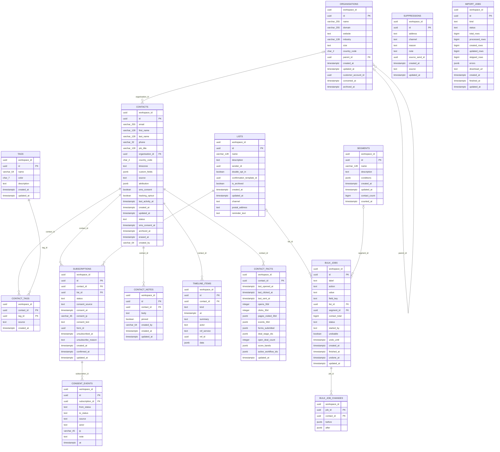
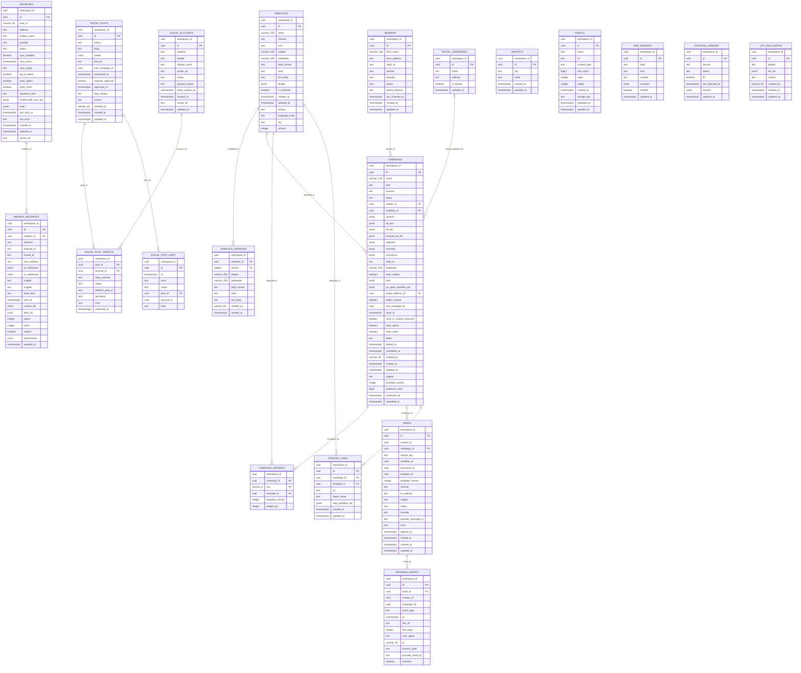
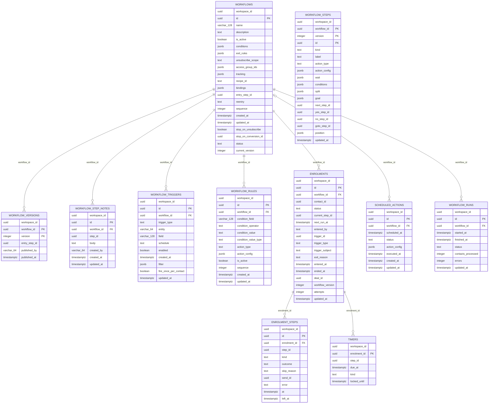
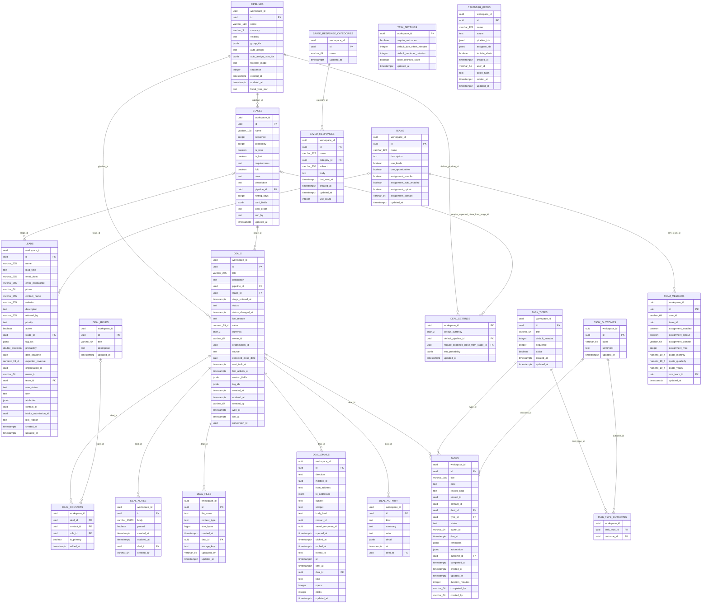
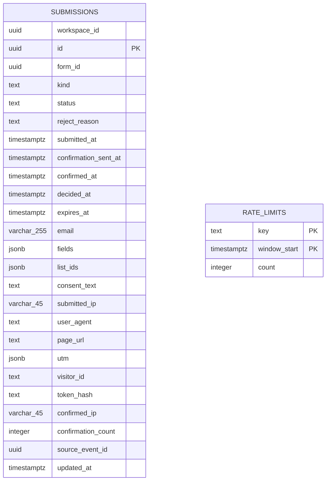

# 14 — CRM data model

> Generated by `openapi/crm/tools/data_model.py --docs` from `docs/data-model/<service>.yaml`; edit those, not
> this. **Status:** Design for implementation, 2026-11-09. **Derived from:** the service contracts (every
> entity schema), [08 §6](08-service-decomposition.md), [ADR 004](../../../docs/adrs/004-crm-capture-intake-and-workspaces.md).

## 1. Rules

| Rule | Detail |
|---|---|
| Stores | Database `crm`: one schema per service (audience, messaging, automation, sales, acquisition, workspace) plus `audience`-style infrastructure tables in each. Database `crm_insights`: schema `insights`. Database `crm_intake`: schema `intake`. Schema `audit` in `crm` holds the audit log. |
| Ownership | One LifeModel per table, in the owning service's `impl/src/models/` with `#[schema_name = "<service>"]`. No foreign key crosses a schema: other services' ids are plain uuid columns. |
| Workspaces | Every table has `workspace_id uuid not null`, and row-level security: `USING (workspace_id = current_setting('crm.workspace_id')::uuid)`, forced, for the service role. Exceptions are marked (`workspaces`, `memberships`: membership-based; `intake.rate_limits`: none). |
| Keys | `id uuid` generated by the service (UUID v7 for time order). Composite keys where a row is a pair. |
| Time | `timestamptz` everywhere (Rust `chrono::DateTime<chrono::Utc>`); `*_at` is a timestamp, `*_date` a date. |
| Money | `numeric(19,4)` (Rust `rust_decimal::Decimal`); the API sends it as a decimal string. |
| Enums | `text` with a CHECK of the allowed values (Lifeguard `#[check = "..."]`), matching the contract's enum. |
| Lists | JSON arrays in `jsonb` (Lifeguard has no array mapping); a list someone queries by member is a join table instead (`contact_tags`, `deal_contacts`, `task_type_outcomes`). |
| Users | Sesame user ids are `varchar(64)`, never uuid. |
| Personal data | Erasure blanks personal columns and sets `erased_at`; append-only tables are erased by contact id. |
| Names | No column is a Rust keyword or SQL reserved word (`from_address`, `field_values`, `event_type`, ...). The API field name may differ; the handler maps it. |
| API-only fields | Listed per table: computed by the handler (counts, names of related records, rates), never stored. |

## 2. From model to migration

1. Write the LifeModels for a service from its YAML (`impl/src/models/<table>.rs`, one file per table; types per
   the table below).
2. `python3 openapi/crm/tools/data_model.py --models` must report nothing for that service.
3. `cargo run -p rerp_migrator --features crm -- generate --suite crm` writes
   `microservices/crm/migrations/<service>/0001_generated_entities.sql` and `apply_order.txt`.
4. The authored `microservices/crm/migrations/<service>/0002_rls_and_infrastructure.sql` (from
   `microservices/crm/migrations/templates/rls_and_infrastructure.sql`) enables RLS on every table and creates
   `outbox`, `processed_events` and `idempotency_keys` in the schema.
5. Apply to a local Postgres and run the service's isolation test.

| Model type | Rust type | Lifeguard attribute |
|---|---|---|
| uuid | `uuid::Uuid` | |
| text | `String` | |
| varchar(n) / char(n) | `String` | `#[column_type = "VARCHAR(n)"]` |
| integer / bigint | `i32` / `i64` | |
| boolean | `bool` | |
| timestamptz | `chrono::DateTime<chrono::Utc>` | `#[column_type = "TIMESTAMPTZ"]` |
| date | `chrono::NaiveDate` | |
| numeric(19,4) | `rust_decimal::Decimal` | `#[column_type = "NUMERIC(19,4)"]` |
| double precision | `f64` | |
| jsonb | `serde_json::Value` | `#[column_type = "JSONB"]` |
| null | `Option<T>` | |
| default now() | | `#[default_expr = "now()"]` |
| fk t(c) on delete x | | `#[foreign_key = "t(c) ON DELETE X"]`, `#[indexed]` |
| check(a,b) | | `#[check = "col IN ('a','b')"]` |

## 3. Services

128 tables. Infrastructure tables (per schema, authored SQL):

outbox (authored SQL, every schema): id uuid pk, event_type text, entity_id text, payload jsonb, occurred_at
timestamptz, published_at timestamptz null, attempts int, last_error text null — written in the same transaction as the
change, relayed to Pub/Sub after commit (crm-events).
processed_events (authored SQL, every schema): event_id uuid pk, event_type text, processed_at timestamptz — the
idempotent consumer's ledger.
idempotency_keys (authored SQL, every schema with side-effecting commands): workspace_id, key varchar(128), request_hash
text, status int, response jsonb, created_at, expires_at (24 h); primary key (workspace_id, key).

### 3.1 workspace — database `crm`, schema `workspace`

```mermaid
erDiagram
    WORKSPACES ||--o{ MEMBERSHIPS : "workspace_id"
    FIELD_GROUPS |o--o{ CUSTOM_FIELDS : "field_group_id"
    WEBHOOKS ||--o{ WEBHOOK_DELIVERY_LOGS : "webhook_id"
    DATA_REQUESTS ||--o{ DATA_REQUEST_STEPS : "data_request_id"
    INTEGRATIONS |o--o{ JOBS : "integration_id"
    JOBS ||--o{ JOB_ERRORS : "job_id"
    WORKSPACES {
        uuid id PK
        uuid organisation_id
        text name
        text slug
        text brand_domain
        text default_currency
        text timezone
        timestamptz created_at
        timestamptz updated_at
        timestamptz archived_at
    }
    MEMBERSHIPS {
        uuid workspace_id PK
        varchar_64 user_id PK
        text role
        varchar_64 added_by
        timestamptz added_at
        timestamptz last_active_at
    }
    INVITATIONS {
        uuid workspace_id
        uuid id PK
        varchar_255 email
        text role
        varchar_64 invited_by
        text token_hash
        timestamptz expires_at
        timestamptz accepted_at
        timestamptz created_at
        timestamptz updated_at
    }
    CUSTOM_FIELDS {
        uuid workspace_id
        uuid id PK
        varchar_64 entity
        varchar_128 key
        varchar_255 label
        text field_type
        jsonb options
        boolean required
        boolean visible
        boolean searchable
        text default_value
        varchar_64 created_by
        timestamptz created_at
        varchar_128 group_name
        integer sequence
        boolean show_on_card
        text hint
        text required_at_stage
        uuid field_group_id FK
        timestamptz updated_at
    }
    FIELD_GROUPS {
        uuid workspace_id
        uuid id PK
        text entity
        text name
        integer sequence
        timestamptz updated_at
    }
    API_KEYS {
        uuid workspace_id
        uuid id PK
        varchar_128 name
        jsonb scopes
        integer rate_limit
        jsonb ip_whitelist
        boolean is_active
        timestamptz created_at
        timestamptz expires_at
        timestamptz last_used_at
        text key_hash
        varchar_12 prefix
        varchar_64 created_by
        timestamptz updated_at
    }
    WEBHOOKS {
        uuid workspace_id
        uuid id PK
        varchar_128 name
        varchar_512 url
        jsonb events
        boolean is_active
        jsonb headers
        text last_status
        timestamptz created_at
        text secret_ref
        timestamptz updated_at
    }
    WEBHOOK_DELIVERY_LOGS {
        uuid workspace_id
        uuid id PK
        uuid webhook_id FK
        text event
        jsonb request_body
        integer response_status
        text response_body
        timestamptz delivered_at
        integer attempt
    }
    NOTIFICATION_RULES {
        uuid workspace_id
        uuid id PK
        text event
        jsonb filter
        jsonb recipients
        jsonb channels
        boolean enabled
        timestamptz updated_at
    }
    COMPLIANCE_SETTINGS {
        uuid workspace_id PK
        boolean double_opt_in_default
        jsonb double_opt_in_regions
        boolean legitimate_interest_allowed
        boolean require_unsubscribe_links
        boolean one_click_unsubscribe
        integer anonymous_retention_days
        integer pending_signup_expiry_days
        text cookie_consent_mode
        text footer_postal_address
        timestamptz updated_at
    }
    DATA_REQUESTS {
        uuid workspace_id
        uuid id PK
        text kind
        text subject_hash
        text contact_email
        varchar_64 requested_by
        text source
        text status
        text note
        timestamptz created_at
        timestamptz completed_at
        timestamptz updated_at
    }
    DATA_REQUEST_STEPS {
        uuid workspace_id
        uuid data_request_id PK
        text service PK
        bigint rows_erased
        timestamptz confirmed_at
    }
    BRAND_KITS {
        uuid workspace_id
        uuid id PK
        text logo_url
        jsonb colors
        text heading_font
        text body_font
        text button_style
        jsonb social_links
        timestamptz updated_at
    }
    INTEGRATIONS {
        uuid workspace_id
        uuid id PK
        varchar_128 name
        text integration_type
        boolean is_active
        text sync_direction
        timestamptz last_sync
        text sync_status
        timestamptz created_at
        jsonb config
        text secret_ref
        timestamptz updated_at
    }
    JOBS {
        uuid workspace_id
        uuid id PK
        text kind
        text entity
        text status
        text source
        text file_name
        uuid integration_id FK
        jsonb options
        integer total_rows
        integer processed_rows
        integer created_rows
        integer updated_rows
        integer skipped_rows
        integer error_rows
        text result_url
        timestamptz result_expires_at
        varchar_64 requested_by
        text message
        timestamptz queued_at
        timestamptz started_at
        timestamptz finished_at
        timestamptz updated_at
    }
    JOB_ERRORS {
        uuid workspace_id
        uuid id PK
        uuid job_id FK
        integer row_number
        text message
        jsonb raw
    }
    AUDIT_ENTRIES {
        uuid workspace_id
        uuid id PK
        text service
        varchar_64 entity
        text entity_id
        text action
        text actor_kind
        varchar_64 actor_id
        jsonb changes
        text request_id
        varchar_45 ip_address
        text user_agent
        timestamptz created_at
    }
```

#### `workspace.workspaces`

Workspaces (brands). Not row-level-secured by workspace: membership decides. API schema: `Workspace`.

| Column | Type | Null | Default | References / check |
|---|---|---|---|---|
| `id` (PK) | uuid |  |  |  |
| `organisation_id` | uuid |  |  |  |
| `name` | text |  |  |  |
| `slug` | text | yes |  |  |
| `brand_domain` | text | yes |  |  |
| `default_currency` | text | yes |  |  |
| `timezone` | text | yes |  |  |
| `created_at` | timestamptz |  | now() |  |
| `updated_at` | timestamptz |  | now() |  |
| `archived_at` | timestamptz | yes |  |  |

- Unique: `(organisation_id, slug)`
- Row-level security: membership.

#### `workspace.memberships`

Who belongs to a workspace, with which role. API schema: `Membership`.

| Column | Type | Null | Default | References / check |
|---|---|---|---|---|
| `workspace_id` (PK) | uuid |  |  | → workspaces(id) on delete cascade |
| `user_id` (PK) | varchar(64) |  |  |  |
| `role` | text |  |  | in owner, admin, marketer, sales, read-only |
| `added_by` | varchar(64) | yes |  |  |
| `added_at` | timestamptz |  | now() |  |
| `last_active_at` | timestamptz | yes |  |  |

- Indexes: `(user_id)`
- Row-level security: membership.

#### `workspace.invitations`

Pending invitations by email.

| Column | Type | Null | Default | References / check |
|---|---|---|---|---|
| `workspace_id` | uuid |  |  |  |
| `id` (PK) | uuid |  |  |  |
| `email` | varchar(255) |  |  |  |
| `role` | text |  |  | in owner, admin, marketer, sales, read-only |
| `invited_by` | varchar(64) | yes |  |  |
| `token_hash` (unique) | text |  |  |  |
| `expires_at` | timestamptz |  |  |  |
| `accepted_at` | timestamptz | yes |  |  |
| `created_at` | timestamptz |  | now() |  |
| `updated_at` | timestamptz |  | now() |  |

- Unique: `(workspace_id, lower(email))`

#### `workspace.custom_fields`

Custom field definitions (values live with the owning entity). API schema: `CustomField`.

| Column | Type | Null | Default | References / check |
|---|---|---|---|---|
| `workspace_id` | uuid |  |  |  |
| `id` (PK) | uuid |  |  |  |
| `entity` | varchar(64) |  |  |  |
| `key` | varchar(128) |  |  |  |
| `label` | varchar(255) |  |  |  |
| `field_type` | text |  |  | in STRING, INTEGER, FLOAT, BOOLEAN, DATE, DATETIME, EMAIL, PHONE, URL, TEXT, HTML, SELECT, MANY2ONE, MANY2MANY, MONEY, MULTISELECT, TEXTAREA |
| `options` | jsonb | yes |  |  |
| `required` | boolean | yes |  |  |
| `visible` | boolean |  |  |  |
| `searchable` | boolean | yes |  |  |
| `default_value` | text | yes |  |  |
| `created_by` | varchar(64) | yes |  |  |
| `created_at` | timestamptz |  | now() |  |
| `group_name` | varchar(128) | yes |  |  |
| `sequence` | integer | yes |  |  |
| `show_on_card` | boolean | yes |  |  |
| `hint` | text | yes |  |  |
| `required_at_stage` | text | yes |  |  |
| `field_group_id` | uuid | yes |  | → field_groups(id) on delete set null |
| `updated_at` | timestamptz |  | now() |  |

- Unique: `(workspace_id, entity, key)`

#### `workspace.field_groups`

Groups of custom fields. API schema: `FieldGroup`.

| Column | Type | Null | Default | References / check |
|---|---|---|---|---|
| `workspace_id` | uuid |  |  |  |
| `id` (PK) | uuid |  |  |  |
| `entity` | text |  |  | in contact, organisation, deal, task |
| `name` | text |  |  |  |
| `sequence` | integer | yes |  |  |
| `updated_at` | timestamptz |  | now() |  |

#### `workspace.api_keys`

API keys (stored hashed). API schema: `ApiKey`.

| Column | Type | Null | Default | References / check |
|---|---|---|---|---|
| `workspace_id` | uuid |  |  |  |
| `id` (PK) | uuid |  |  |  |
| `name` | varchar(128) |  |  |  |
| `scopes` | jsonb | yes |  |  |
| `rate_limit` | integer | yes |  |  |
| `ip_whitelist` | jsonb | yes |  |  |
| `is_active` | boolean |  |  |  |
| `created_at` | timestamptz |  | now() |  |
| `expires_at` | timestamptz | yes |  |  |
| `last_used_at` | timestamptz | yes |  |  |
| `key_hash` (unique) | text |  |  |  |
| `prefix` | varchar(12) |  |  |  |
| `created_by` | varchar(64) | yes |  |  |
| `updated_at` | timestamptz |  | now() |  |

#### `workspace.webhooks`

Outgoing webhooks (secret in Secret Manager). API schema: `Webhook`.

| Column | Type | Null | Default | References / check |
|---|---|---|---|---|
| `workspace_id` | uuid |  |  |  |
| `id` (PK) | uuid |  |  |  |
| `name` | varchar(128) |  |  |  |
| `url` | varchar(512) |  |  |  |
| `events` | jsonb |  |  |  |
| `is_active` | boolean |  |  |  |
| `headers` | jsonb | yes |  |  |
| `last_status` | text | yes |  | in PENDING, SUCCESS, FAILED, RETRYING |
| `created_at` | timestamptz |  | now() |  |
| `secret_ref` | text | yes |  |  |
| `updated_at` | timestamptz |  | now() |  |

- API-only (computed): `retry_count`, `last_triggered`, `failures`, `detail`

#### `workspace.webhook_delivery_logs` (append-only)

Webhook deliveries. API schema: `WebhookDeliveryLog`.

| Column | Type | Null | Default | References / check |
|---|---|---|---|---|
| `workspace_id` | uuid |  |  |  |
| `id` (PK) | uuid |  |  |  |
| `webhook_id` | uuid |  |  | → webhooks(id) on delete cascade |
| `event` | text |  |  |  |
| `request_body` | jsonb | yes |  |  |
| `response_status` | integer |  |  |  |
| `response_body` | text |  |  |  |
| `delivered_at` | timestamptz |  |  |  |
| `attempt` | integer |  | 1 |  |

- Indexes: `(webhook_id, delivered_at desc)`
- API-only (computed): `retry_count`

#### `workspace.notification_rules`

Notification rules. API schema: `NotificationRule`.

| Column | Type | Null | Default | References / check |
|---|---|---|---|---|
| `workspace_id` | uuid |  |  |  |
| `id` (PK) | uuid |  |  |  |
| `event` | text |  |  |  |
| `filter` | jsonb | yes |  |  |
| `recipients` | jsonb | yes |  |  |
| `channels` | jsonb | yes |  |  |
| `enabled` | boolean |  |  |  |
| `updated_at` | timestamptz |  | now() |  |

#### `workspace.compliance_settings` (singleton)

Consent, retention and cookie settings, one row per workspace. API schema: `ComplianceSettings`.

| Column | Type | Null | Default | References / check |
|---|---|---|---|---|
| `workspace_id` (PK) | uuid |  |  |  |
| `double_opt_in_default` | boolean |  | true |  |
| `double_opt_in_regions` | jsonb | yes |  |  |
| `legitimate_interest_allowed` | boolean |  | false |  |
| `require_unsubscribe_links` | boolean |  | true |  |
| `one_click_unsubscribe` | boolean |  | true |  |
| `anonymous_retention_days` | integer |  | 395 |  |
| `pending_signup_expiry_days` | integer |  | 7 |  |
| `cookie_consent_mode` | text |  | REGION | in ALWAYS, AFTER_CONSENT, REGION |
| `footer_postal_address` | text | yes |  |  |
| `updated_at` | timestamptz |  | now() |  |

#### `workspace.data_requests`

Access and erasure requests. API schema: `DataRequest`.

| Column | Type | Null | Default | References / check |
|---|---|---|---|---|
| `workspace_id` | uuid |  |  |  |
| `id` (PK) | uuid |  |  |  |
| `kind` | text |  |  | in ACCESS, ERASURE |
| `subject_hash` | text | yes |  |  |
| `contact_email` | text | yes |  |  |
| `requested_by` | varchar(64) | yes |  |  |
| `source` | text | yes |  | in PREFERENCE_PAGE, EMAIL, STAFF, API |
| `status` | text |  |  | in PENDING_REVIEW, RUNNING, DONE, REJECTED |
| `note` | text | yes |  |  |
| `created_at` | timestamptz |  | now() |  |
| `completed_at` | timestamptz | yes |  |  |
| `updated_at` | timestamptz |  | now() |  |

#### `workspace.data_request_steps`

Each service confirming its part of a data request.

| Column | Type | Null | Default | References / check |
|---|---|---|---|---|
| `workspace_id` | uuid |  |  |  |
| `data_request_id` (PK) | uuid |  |  | → data_requests(id) on delete cascade |
| `service` (PK) | text |  |  |  |
| `rows_erased` | bigint | yes |  |  |
| `confirmed_at` | timestamptz | yes |  |  |

#### `workspace.brand_kits`

Brand kit, one per workspace. API schema: `BrandKit`.

| Column | Type | Null | Default | References / check |
|---|---|---|---|---|
| `workspace_id` | uuid |  |  |  |
| `id` (PK) | uuid |  |  |  |
| `logo_url` | text | yes |  |  |
| `colors` | jsonb | yes |  |  |
| `heading_font` | text | yes |  |  |
| `body_font` | text | yes |  |  |
| `button_style` | text | yes |  | in ROUNDED_FILLED, SQUARE_FILLED, OUTLINE, PILL |
| `social_links` | jsonb | yes |  |  |
| `updated_at` | timestamptz |  | now() |  |

- Unique: `(workspace_id)`

#### `workspace.integrations`

Third-party integrations (credentials in Secret Manager). API schema: `Integration`.

| Column | Type | Null | Default | References / check |
|---|---|---|---|---|
| `workspace_id` | uuid |  |  |  |
| `id` (PK) | uuid |  |  |  |
| `name` | varchar(128) |  |  |  |
| `integration_type` | text |  |  | in ERP, ACCOUNTING, MARKETING, SUPPORT, CUSTOM |
| `is_active` | boolean | yes |  |  |
| `sync_direction` | text | yes |  | in CRM_TO_EXTERNAL, EXTERNAL_TO_CRM, BIDIRECTIONAL |
| `last_sync` | timestamptz | yes |  |  |
| `sync_status` | text | yes |  | in IDLE, SYNCING, ERROR |
| `created_at` | timestamptz | yes |  |  |
| `config` | jsonb | yes |  |  |
| `secret_ref` | text | yes |  |  |
| `updated_at` | timestamptz |  | now() |  |

#### `workspace.jobs`

Import and export jobs. API schema: `Job`.

| Column | Type | Null | Default | References / check |
|---|---|---|---|---|
| `workspace_id` | uuid |  |  |  |
| `id` (PK) | uuid |  |  |  |
| `kind` | text |  |  | in IMPORT, EXPORT |
| `entity` | text |  |  | in CONTACTS, ACCOUNTS, DEALS, TASKS, LISTS, TAGS, CUSTOM_FIELDS |
| `status` | text |  |  | in QUEUED, RUNNING, SUCCEEDED, PARTIAL, FAILED, CANCELLED |
| `source` | text | yes |  | in FILE, INTEGRATION, API, UI |
| `file_name` | text | yes |  |  |
| `integration_id` | uuid | yes |  | → integrations(id) on delete set null |
| `options` | jsonb | yes |  |  |
| `total_rows` | integer | yes |  |  |
| `processed_rows` | integer | yes |  |  |
| `created_rows` | integer | yes |  |  |
| `updated_rows` | integer | yes |  |  |
| `skipped_rows` | integer | yes |  |  |
| `error_rows` | integer | yes |  |  |
| `result_url` | text | yes |  |  |
| `result_expires_at` | timestamptz | yes |  |  |
| `requested_by` | varchar(64) |  |  |  |
| `message` | text | yes |  |  |
| `queued_at` | timestamptz |  |  |  |
| `started_at` | timestamptz | yes |  |  |
| `finished_at` | timestamptz | yes |  |  |
| `updated_at` | timestamptz |  | now() |  |

- API-only (computed): `requested_by_name`

#### `workspace.job_errors` (append-only)

Rows a job could not process.

| Column | Type | Null | Default | References / check |
|---|---|---|---|---|
| `workspace_id` | uuid |  |  |  |
| `id` (PK) | uuid |  |  |  |
| `job_id` | uuid |  |  | → jobs(id) on delete cascade |
| `row_number` | integer |  |  |  |
| `message` | text |  |  |  |
| `raw` | jsonb | yes |  |  |

- Indexes: `(job_id)`

#### `audit.audit_entries` (append-only)

The audit log. Every CRM service inserts here in its own transaction (crm-audit); only crm/workspace reads it. API schema: `AuditLogEntry`.

| Column | Type | Null | Default | References / check |
|---|---|---|---|---|
| `workspace_id` | uuid |  |  |  |
| `id` (PK) | uuid |  |  |  |
| `service` | text |  |  |  |
| `entity` | varchar(64) |  |  |  |
| `entity_id` | text |  |  |  |
| `action` | text |  |  | in CREATE, UPDATE, DELETE, STATE_CHANGE, ERASE, LOGIN, EXPORT |
| `actor_kind` | text |  |  | in USER, API_KEY, SYSTEM |
| `actor_id` | varchar(64) |  |  |  |
| `changes` | jsonb | yes |  |  |
| `request_id` | text | yes |  |  |
| `ip_address` | varchar(45) | yes |  |  |
| `user_agent` | text | yes |  |  |
| `created_at` | timestamptz |  | now() |  |

- Indexes: `(entity, entity_id, created_at desc)`; `(created_at)`
- Lives in schema `audit`: INSERT granted to every service role, SELECT only to crm/workspace. Retained 2 years (US_55_39).

### 3.2 audience — database `crm`, schema `audience`

#### `audience.contacts`

People the workspace can reach. Email unique per workspace (case-insensitive). API schema: `Contact`.

| Column | Type | Null | Default | References / check |
|---|---|---|---|---|
| `workspace_id` | uuid |  |  |  |
| `id` (PK) | uuid |  |  |  |
| `email` | varchar(255) |  |  |  |
| `first_name` | varchar(128) | yes |  |  |
| `last_name` | varchar(128) | yes |  |  |
| `phone` | varchar(32) | yes |  |  |
| `job_title` | varchar(128) | yes |  |  |
| `organisation_id` | uuid | yes |  | → organisations(id) on delete set null |
| `country_code` | char(2) | yes |  |  |
| `timezone` | text | yes |  |  |
| `custom_fields` | jsonb |  | '{}' |  |
| `source` | text | yes |  |  |
| `attribution` | jsonb | yes |  |  |
| `sms_consent` | boolean |  | false |  |
| `tracking_optout` | boolean |  | false |  |
| `last_activity_at` | timestamptz | yes |  |  |
| `created_at` | timestamptz |  | now() |  |
| `updated_at` | timestamptz |  | now() |  |
| `status` | text |  | PENDING | in SUBSCRIBED, UNSUBSCRIBED, PENDING, BOUNCED |
| `sms_consent_at` | timestamptz | yes |  |  |
| `archived_at` | timestamptz | yes |  |  |
| `erased_at` | timestamptz | yes |  |  |
| `created_by` | varchar(64) | yes |  |  |

- Unique: `(workspace_id, lower(email))`
- Indexes: `(organisation_id)`; `(status)`; `(last_activity_at)`; `(created_at)`
- API-only (computed): `organisation_name`, `list_ids`, `list_names`, `score`, `message_stats`
- `status` is maintained from subscriptions (any SUBSCRIBED list → SUBSCRIBED). Tags live in contact_tags. Erasure blanks personal columns and sets erased_at (tombstone kept for suppression).

#### `audience.organisations`

Prospect companies. A customer exists only in RERP crm/accounts (ADR 003). API schema: `Organisation`.

| Column | Type | Null | Default | References / check |
|---|---|---|---|---|
| `workspace_id` | uuid |  |  |  |
| `id` (PK) | uuid |  |  |  |
| `name` | varchar(255) |  |  |  |
| `domain` | varchar(255) | yes |  |  |
| `website` | text | yes |  |  |
| `industry` | varchar(128) | yes |  |  |
| `size` | text | yes |  | in 1-10, 11-50, 51-200, 201-1000, 1001-5000, 5000+ |
| `country_code` | char(2) | yes |  |  |
| `parent_id` | uuid | yes |  | → organisations(id) on delete set null |
| `created_at` | timestamptz |  | now() |  |
| `updated_at` | timestamptz |  | now() |  |
| `customer_account_id` | uuid | yes |  |  |
| `converted_at` | timestamptz | yes |  |  |
| `archived_at` | timestamptz | yes |  |  |

- Unique: `(workspace_id, lower(domain))`
- Indexes: `(parent_id)`; `(name)`
- API-only (computed): `contact_count`, `open_deal_count`, `converted`

#### `audience.tags`

Tag definitions; names unique per workspace. API schema: `Tag`.

| Column | Type | Null | Default | References / check |
|---|---|---|---|---|
| `workspace_id` | uuid |  |  |  |
| `id` (PK) | uuid |  |  |  |
| `name` | varchar(64) |  |  |  |
| `color` | char(7) | yes |  |  |
| `description` | text | yes |  |  |
| `created_at` | timestamptz |  | now() |  |
| `updated_at` | timestamptz |  | now() |  |

- Unique: `(workspace_id, lower(name))`

#### `audience.contact_tags`

Which contacts carry which tags.

| Column | Type | Null | Default | References / check |
|---|---|---|---|---|
| `workspace_id` | uuid |  |  |  |
| `contact_id` (PK) | uuid |  |  | → contacts(id) on delete cascade |
| `tag_id` (PK) | uuid |  |  | → tags(id) on delete cascade |
| `source` | text |  | USER | in USER, AUTOMATION, BULK_JOB, IMPORT, FORM |
| `created_at` | timestamptz |  | now() |  |

- Indexes: `(tag_id)`

#### `audience.lists`

Mailing lists (email or SMS) with their consent settings. API schema: `MailingList`.

| Column | Type | Null | Default | References / check |
|---|---|---|---|---|
| `workspace_id` | uuid |  |  |  |
| `id` (PK) | uuid |  |  |  |
| `name` | varchar(128) |  |  |  |
| `description` | text | yes |  |  |
| `sender_id` | uuid |  |  |  |
| `double_opt_in` | boolean |  |  |  |
| `confirmation_template_id` | uuid | yes |  |  |
| `is_archived` | boolean |  | false |  |
| `created_at` | timestamptz |  | now() |  |
| `updated_at` | timestamptz |  | now() |  |
| `channel` | text |  | EMAIL | in EMAIL, SMS |
| `postal_address` | text | yes |  |  |
| `reminder_text` | text | yes |  |  |

- Unique: `(workspace_id, lower(name))`
- API-only (computed): `subscriber_count`, `unsubscribed_count`, `pending_count`, `growth_30d`

#### `audience.subscriptions`

One contact on one list, with the consent that put them there. API schema: `Subscription`.

| Column | Type | Null | Default | References / check |
|---|---|---|---|---|
| `workspace_id` | uuid |  |  |  |
| `id` (PK) | uuid |  |  |  |
| `contact_id` | uuid |  |  | → contacts(id) on delete cascade |
| `list_id` | uuid |  |  | → lists(id) on delete cascade |
| `status` | text |  |  | in PENDING, SUBSCRIBED, UNSUBSCRIBED, BOUNCED, COMPLAINED |
| `consent_source` | text | yes |  | in WEB_FORM, DOUBLE_OPT_IN, IMPORT, STAFF, API, PREFERENCE_PAGE, CHECKOUT |
| `consent_at` | timestamptz | yes |  |  |
| `consent_ip` | varchar(45) | yes |  |  |
| `consent_text` | text | yes |  |  |
| `form_id` | uuid | yes |  |  |
| `unsubscribed_at` | timestamptz | yes |  |  |
| `unsubscribe_reason` | text | yes |  |  |
| `created_at` | timestamptz |  | now() |  |
| `confirmed_at` | timestamptz | yes |  |  |
| `updated_at` | timestamptz |  | now() |  |

- Unique: `(list_id, contact_id)`
- Indexes: `(contact_id)`; `(status)`
- API-only (computed): `list_name`, `history`

#### `audience.consent_events` (append-only)

Append-only history of each subscription status change (the consent evidence). API schema: `ConsentEvent`.

| Column | Type | Null | Default | References / check |
|---|---|---|---|---|
| `workspace_id` | uuid |  |  |  |
| `id` (PK) | uuid |  |  |  |
| `subscription_id` | uuid |  |  | → subscriptions(id) on delete cascade |
| `from_status` | text | yes |  |  |
| `to_status` | text |  |  | in PENDING, SUBSCRIBED, UNSUBSCRIBED, BOUNCED |
| `source` | text |  |  |  |
| `actor` | text | yes |  |  |
| `ip` | varchar(45) | yes |  |  |
| `note` | text | yes |  |  |
| `at` | timestamptz |  | now() |  |

- Indexes: `(subscription_id, at)`

#### `audience.suppressions`

Addresses no list may message (hard bounce, complaint, manual, erased). API schema: `Suppression`.

| Column | Type | Null | Default | References / check |
|---|---|---|---|---|
| `workspace_id` | uuid |  |  |  |
| `id` (PK) | uuid |  |  |  |
| `address` | text |  |  |  |
| `channel` | text |  | EMAIL | in EMAIL, SMS |
| `reason` | text |  |  | in HARD_BOUNCE, COMPLAINT, MANUAL, GLOBAL_UNSUBSCRIBE |
| `note` | text | yes |  |  |
| `source_send_id` | uuid | yes |  |  |
| `created_at` | timestamptz |  | now() |  |
| `source` | text | yes |  |  |
| `updated_at` | timestamptz |  | now() |  |

- Unique: `(workspace_id, channel, lower(address))`

#### `audience.segments`

Saved segments: a two-level condition tree over the contact facts. API schema: `Segment`.

| Column | Type | Null | Default | References / check |
|---|---|---|---|---|
| `workspace_id` | uuid |  |  |  |
| `id` (PK) | uuid |  |  |  |
| `name` | varchar(128) |  |  |  |
| `description` | text | yes |  |  |
| `conditions` | jsonb |  |  |  |
| `created_at` | timestamptz |  | now() |  |
| `updated_at` | timestamptz |  | now() |  |
| `contact_count` | bigint | yes |  |  |
| `counted_at` | timestamptz | yes |  |  |

#### `audience.contact_notes`

Notes on a contact.

| Column | Type | Null | Default | References / check |
|---|---|---|---|---|
| `workspace_id` | uuid |  |  |  |
| `id` (PK) | uuid |  |  |  |
| `contact_id` | uuid |  |  | → contacts(id) on delete cascade |
| `body` | text |  |  |  |
| `pinned` | boolean |  | false |  |
| `created_by` | varchar(64) | yes |  |  |
| `created_at` | timestamptz |  | now() |  |
| `updated_at` | timestamptz |  | now() |  |

- Indexes: `(contact_id, created_at)`

#### `audience.timeline_items` (append-only)

The contact timeline, projected from events of every service. API schema: `Activity`.

| Column | Type | Null | Default | References / check |
|---|---|---|---|---|
| `workspace_id` | uuid |  |  |  |
| `id` (PK) | uuid |  |  |  |
| `contact_id` | uuid |  |  | → contacts(id) on delete cascade |
| `kind` | text |  |  | in MESSAGE_SENT, MESSAGE_OPENED, MESSAGE_CLICKED, MESSAGE_BOUNCED, UNSUBSCRIBED, SUBSCRIBED, FORM_SUBMITTED, PAGE_VIEW, SITE_EVENT, WORKFLOW_ENTERED, WORKFLOW_STEP, WORKFLOW_ENDED, TAG_ADDED, TAG_REMOVED, FIELD_CHANGED, SCORE_CHANGED, DEAL_CREATED, DEAL_STAGE_CHANGED, NOTE, CHAT |
| `at` | timestamptz |  |  |  |
| `summary` | text |  |  |  |
| `actor` | text | yes |  |  |
| `ref_service` | text | yes |  |  |
| `ref_id` | uuid | yes |  |  |
| `data` | jsonb | yes |  |  |

- Indexes: `(contact_id, at desc)`
- API-only (computed): `detail`

#### `audience.contact_facts`

Per-contact projection of facts from other services, so a segment is one query.

| Column | Type | Null | Default | References / check |
|---|---|---|---|---|
| `workspace_id` | uuid |  |  |  |
| `contact_id` (PK) | uuid |  |  | → contacts(id) on delete cascade |
| `last_opened_at` | timestamptz | yes |  |  |
| `last_clicked_at` | timestamptz | yes |  |  |
| `last_sent_at` | timestamptz | yes |  |  |
| `opens_30d` | integer |  | 0 |  |
| `clicks_30d` | integer |  | 0 |  |
| `pages_visited_30d` | jsonb | yes |  |  |
| `events_30d` | jsonb | yes |  |  |
| `forms_submitted` | jsonb | yes |  |  |
| `deal_stage_ids` | jsonb | yes |  |  |
| `open_deal_count` | integer |  | 0 |  |
| `score_bands` | jsonb | yes |  |  |
| `active_workflow_ids` | jsonb | yes |  |  |
| `updated_at` | timestamptz |  | now() |  |

- Rebuilt from events; never written by the API.

#### `audience.bulk_jobs`

Changes applied to many contacts; undoable for 7 days. API schema: `BulkJob`.

| Column | Type | Null | Default | References / check |
|---|---|---|---|---|
| `workspace_id` | uuid |  |  |  |
| `id` (PK) | uuid |  |  |  |
| `label` | text | yes |  |  |
| `action` | text |  |  | in ADD_TAG, REMOVE_TAG, SUBSCRIBE, UNSUBSCRIBE, SET_FIELD, ARCHIVE |
| `value` | text | yes |  |  |
| `field_key` | text | yes |  |  |
| `list_id` | uuid | yes |  | → lists(id) on delete set null |
| `segment_id` | uuid | yes |  | → segments(id) on delete set null |
| `contact_total` | bigint | yes |  |  |
| `status` | text |  |  | in QUEUED, RUNNING, DONE, FAILED, UNDONE |
| `started_by` | text | yes |  |  |
| `undoable` | boolean | yes |  |  |
| `undo_until` | timestamptz | yes |  |  |
| `created_at` | timestamptz |  | now() |  |
| `finished_at` | timestamptz | yes |  |  |
| `undone_at` | timestamptz | yes |  |  |
| `updated_at` | timestamptz |  | now() |  |

#### `audience.bulk_job_changes` (append-only)

Before and after values per contact, for undo.

| Column | Type | Null | Default | References / check |
|---|---|---|---|---|
| `workspace_id` | uuid |  |  |  |
| `job_id` (PK) | uuid |  |  | → bulk_jobs(id) on delete cascade |
| `contact_id` (PK) | uuid |  |  |  |
| `before` | jsonb |  |  |  |
| `after` | jsonb |  |  |  |

#### `audience.import_jobs`

Contact imports and exports run by audience. API schema: `ImportJob`.

| Column | Type | Null | Default | References / check |
|---|---|---|---|---|
| `workspace_id` | uuid |  |  |  |
| `id` (PK) | uuid |  |  |  |
| `kind` | text |  |  | in IMPORT, EXPORT |
| `status` | text |  |  | in QUEUED, RUNNING, DONE, FAILED |
| `total_rows` | bigint | yes |  |  |
| `processed_rows` | bigint | yes |  |  |
| `created_rows` | bigint | yes |  |  |
| `updated_rows` | bigint | yes |  |  |
| `skipped_rows` | bigint | yes |  |  |
| `errors` | jsonb | yes |  |  |
| `download_url` | text | yes |  |  |
| `created_at` | timestamptz |  | now() |  |
| `finished_at` | timestamptz | yes |  |  |
| `updated_at` | timestamptz |  | now() |  |

### 3.3 messaging — database `crm`, schema `messaging`

#### `messaging.templates`

Message templates (email and SMS); every save creates a version. API schema: `Template`.

| Column | Type | Null | Default | References / check |
|---|---|---|---|---|
| `workspace_id` | uuid |  |  |  |
| `id` (PK) | uuid |  |  |  |
| `name` | varchar(128) |  |  |  |
| `channel` | text |  |  | in EMAIL, SMS, WHATSAPP |
| `kind` | text |  |  | in CAMPAIGN, AUTOMATION, TRANSACTIONAL |
| `subject` | varchar(255) | yes |  |  |
| `preheader` | varchar(255) | yes |  |  |
| `body_format` | text |  |  | in MARKDOWN, MJML, HTML, TEXT |
| `body` | text |  |  |  |
| `text_body` | text | yes |  |  |
| `design` | jsonb | yes |  |  |
| `is_archived` | boolean |  | false |  |
| `created_at` | timestamptz |  | now() |  |
| `updated_at` | timestamptz |  | now() |  |
| `priority` | text | yes |  |  |
| `language_code` | text | yes |  |  |
| `tag` | text | yes |  |  |
| `version` | integer |  | 1 |  |

- API-only (computed): `merge_fields`, `thumbnail_url`, `versions`, `used_by`, `sent_30d`, `open_rate`, `click_rate`, `unsub_30d`, `delivered_rate`, `called_by`

#### `messaging.template_versions` (append-only)

Immutable versions of a template; sends record the version used.

| Column | Type | Null | Default | References / check |
|---|---|---|---|---|
| `workspace_id` | uuid |  |  |  |
| `template_id` (PK) | uuid |  |  | → templates(id) on delete cascade |
| `version` (PK) | integer |  |  |  |
| `subject` | varchar(255) | yes |  |  |
| `preheader` | varchar(255) | yes |  |  |
| `body_format` | text |  |  | in MARKDOWN, BLOCKS, MJML, HTML, TEXT |
| `body` | text |  |  |  |
| `text_body` | text | yes |  |  |
| `created_by` | varchar(64) | yes |  |  |
| `created_at` | timestamptz |  | now() |  |

#### `messaging.snippets`

Reusable blocks inserted as {{snippet.key}}. API schema: `Snippet`.

| Column | Type | Null | Default | References / check |
|---|---|---|---|---|
| `workspace_id` | uuid |  |  |  |
| `id` (PK) | uuid |  |  |  |
| `key` | text |  |  |  |
| `value` | text |  |  |  |
| `created_at` | timestamptz |  | now() |  |
| `updated_at` | timestamptz |  | now() |  |

- Unique: `(workspace_id, key)`

#### `messaging.assets`

Images in the asset store (bytes in object storage). API schema: `Asset`.

| Column | Type | Null | Default | References / check |
|---|---|---|---|---|
| `workspace_id` | uuid |  |  |  |
| `id` (PK) | uuid |  |  |  |
| `name` | text |  |  |  |
| `url` | text |  |  |  |
| `content_type` | text | yes |  |  |
| `size_bytes` | bigint | yes |  |  |
| `width` | integer | yes |  |  |
| `height` | integer | yes |  |  |
| `created_at` | timestamptz |  | now() |  |
| `storage_key` | text |  |  |  |
| `uploaded_at` | timestamptz | yes |  |  |
| `updated_at` | timestamptz |  | now() |  |

#### `messaging.senders`

From identities and their verification. API schema: `Sender`.

| Column | Type | Null | Default | References / check |
|---|---|---|---|---|
| `workspace_id` | uuid |  |  |  |
| `id` (PK) | uuid |  |  |  |
| `from_name` | varchar(128) |  |  |  |
| `from_address` | text |  |  |  |
| `reply_to` | text | yes |  |  |
| `domain` | text |  |  |  |
| `provider` | text | yes |  | in SES, POSTMARK, RESEND, TWILIO, META |
| `status` | text |  |  | in PENDING, VERIFIED, FAILED |
| `postal_address` | text | yes |  |  |
| `last_checked_at` | timestamptz | yes |  |  |
| `created_at` | timestamptz |  | now() |  |
| `updated_at` | timestamptz |  | now() |  |

- API-only (computed): `dns_records`, `used_by`

#### `messaging.sms_senders`

SMS sender ids and numbers. API schema: `SmsSender`.

| Column | Type | Null | Default | References / check |
|---|---|---|---|---|
| `workspace_id` | uuid |  |  |  |
| `id` (PK) | uuid |  |  |  |
| `label` | text |  |  |  |
| `kind` | text |  |  | in ALPHANUMERIC, LONG_CODE, SHORT_CODE, TOLL_FREE |
| `number` | text | yes |  |  |
| `countries` | jsonb | yes |  |  |
| `verified` | boolean | yes |  |  |
| `updated_at` | timestamptz |  | now() |  |

#### `messaging.tracking_domains`

Custom tracking domains and their DNS checks. API schema: `TrackingDomain`.

| Column | Type | Null | Default | References / check |
|---|---|---|---|---|
| `workspace_id` | uuid |  |  |  |
| `id` (PK) | uuid |  |  |  |
| `domain` | text |  |  |  |
| `status` | text |  |  | in PENDING, VERIFIED, FAILED |
| `tls` | boolean | yes |  |  |
| `last_checked_at` | timestamptz | yes |  |  |
| `records` | jsonb | yes |  |  |
| `updated_at` | timestamptz |  | now() |  |

- Unique: `(workspace_id, domain)`

#### `messaging.postal_addresses`

Postal addresses for message footers. API schema: `PostalAddress`.

| Column | Type | Null | Default | References / check |
|---|---|---|---|---|
| `workspace_id` | uuid |  |  |  |
| `id` (PK) | uuid |  |  |  |
| `name` | text |  |  |  |
| `address` | text |  |  |  |
| `is_default` | boolean | yes |  |  |
| `updated_at` | timestamptz |  | now() |  |

#### `messaging.list_exclusions`

Address patterns excluded from lists. API schema: `ListExclusion`.

| Column | Type | Null | Default | References / check |
|---|---|---|---|---|
| `workspace_id` | uuid |  |  |  |
| `id` (PK) | uuid |  |  |  |
| `pattern` | text |  |  |  |
| `list_ids` | jsonb | yes |  |  |
| `reason` | text | yes |  |  |
| `created_by` | varchar(64) | yes |  |  |
| `created_at` | timestamptz | yes |  |  |
| `updated_at` | timestamptz |  | now() |  |

#### `messaging.campaigns`

Campaigns: email or SMS, one-time, A/B, RSS, recurring or reminder. API schema: `Campaign`.

| Column | Type | Null | Default | References / check |
|---|---|---|---|---|
| `workspace_id` | uuid |  |  |  |
| `id` (PK) | uuid |  |  |  |
| `name` | varchar(128) |  |  |  |
| `kind` | text |  |  | in ONE_TIME, AB_TEST, RSS, REMINDER, RECURRING |
| `channel` | text |  |  | in EMAIL, SMS, WHATSAPP |
| `status` | text |  |  | in DRAFT, SCHEDULED, SENDING, SENT, CANCELLED, FAILED |
| `sender_id` | uuid | yes |  | → senders(id) on delete restrict |
| `template_id` | uuid | yes |  | → templates(id) on delete restrict |
| `variants` | jsonb | yes |  |  |
| `ab_test` | jsonb | yes |  |  |
| `list_ids` | jsonb |  |  |  |
| `exclude_list_ids` | jsonb | yes |  |  |
| `segment` | jsonb | yes |  |  |
| `reminder` | jsonb | yes |  |  |
| `recurrence` | jsonb | yes |  |  |
| `reply_to` | text | yes |  |  |
| `preheader` | varchar(255) | yes |  |  |
| `track_replies` | boolean | yes |  |  |
| `links` | jsonb | yes |  |  |
| `on_open_workflow_ids` | jsonb | yes |  |  |
| `postal_address_id` | uuid | yes |  | → postal_addresses(id) on delete set null |
| `public_archive` | boolean | yes |  |  |
| `utm_campaign_id` | uuid | yes |  |  |
| `send_at` | timestamptz | yes |  |  |
| `send_in_contact_timezone` | boolean | yes |  |  |
| `track_opens` | boolean | yes |  |  |
| `track_clicks` | boolean | yes |  |  |
| `folder` | text | yes |  |  |
| `started_at` | timestamptz | yes |  |  |
| `completed_at` | timestamptz | yes |  |  |
| `created_by` | varchar(64) | yes |  |  |
| `created_at` | timestamptz |  | now() |  |
| `updated_at` | timestamptz |  | now() |  |
| `subject` | text | yes |  |  |
| `template_version` | integer | yes |  |  |
| `audience_count` | bigint | yes |  |  |
| `scheduled_at` | timestamptz | yes |  |  |
| `cancelled_at` | timestamptz | yes |  |  |

- Indexes: `(status, send_at)`
- API-only (computed): `readiness`, `sent_count`, `template_name`, `list_names`, `open_rate`, `click_rate`, `unsubscribed`

#### `messaging.campaign_variants`

A/B variants of a campaign. API schema: `CampaignVariant`.

| Column | Type | Null | Default | References / check |
|---|---|---|---|---|
| `workspace_id` | uuid |  |  |  |
| `campaign_id` (PK) | uuid |  |  | → campaigns(id) on delete cascade |
| `key` (PK) | varchar(8) |  |  |  |
| `template_id` | uuid |  |  | → templates(id) on delete restrict |
| `template_version` | integer | yes |  |  |
| `weight_pct` | integer |  | 50 |  |

#### `messaging.sends`

The send ledger: one row per recipient per message. API schema: `Send`.

| Column | Type | Null | Default | References / check |
|---|---|---|---|---|
| `workspace_id` | uuid |  |  |  |
| `id` (PK) | uuid |  |  |  |
| `contact_id` | uuid |  |  |  |
| `campaign_id` | uuid | yes |  | → campaigns(id) on delete restrict |
| `variant_key` | text | yes |  |  |
| `workflow_id` | uuid | yes |  |  |
| `enrolment_id` | uuid | yes |  |  |
| `template_id` | uuid | yes |  |  |
| `template_version` | integer | yes |  |  |
| `channel` | text |  |  | in EMAIL, SMS, WHATSAPP |
| `to_address` | text | yes |  |  |
| `subject` | text | yes |  |  |
| `status` | text |  |  | in QUEUED, SENT, DELIVERED, BOUNCED, FAILED, SUPPRESSED |
| `provider` | text | yes |  | in SES, POSTMARK, RESEND, TWILIO, META |
| `provider_message_id` | text | yes |  |  |
| `error` | text | yes |  |  |
| `opened_at` | timestamptz | yes |  |  |
| `clicked_at` | timestamptz | yes |  |  |
| `created_at` | timestamptz |  | now() |  |
| `updated_at` | timestamptz |  | now() |  |

- Unique: `(campaign_id, contact_id)`
- Indexes: `(contact_id, created_at)`; `(provider_message_id)`; `(enrolment_id)`
- API-only (computed): `events`, `campaign_name`, `contact_name`, `clicked_link`, `queued`
- Unique per campaign and contact makes a resumed send idempotent; automation and transactional sends have no campaign_id and use their idempotency key instead.

#### `messaging.message_events` (append-only)

Engagement and delivery events per send (append-only). API schema: `MessageEvent`.

| Column | Type | Null | Default | References / check |
|---|---|---|---|---|
| `workspace_id` | uuid |  |  |  |
| `id` (PK) | uuid |  |  |  |
| `send_id` | uuid |  |  | → sends(id) on delete cascade |
| `contact_id` | uuid |  |  |  |
| `campaign_id` | uuid | yes |  |  |
| `event_type` | text |  |  | in QUEUED, SENT, DELIVERED, DEFERRED, OPENED, CLICKED, SOFT_BOUNCED, HARD_BOUNCED, COMPLAINED, UNSUBSCRIBED, REPLIED |
| `at` | timestamptz |  |  |  |
| `link_url` | text | yes |  |  |
| `link_index` | integer | yes |  |  |
| `user_agent` | text | yes |  |  |
| `ip` | varchar(45) | yes |  |  |
| `bounce_code` | text | yes |  |  |
| `provider_event_id` | text | yes |  |  |
| `machine` | boolean |  | false |  |

- Unique: `(provider_event_id)`
- Indexes: `(send_id)`; `(contact_id, at)`; `(campaign_id, event_type)`
- Candidate for monthly range partitioning on `at` once volume requires it (an authored migration).

#### `messaging.tracked_links`

Links rewritten for click tracking; the edge token carries the target. API schema: `TrackedLink`.

| Column | Type | Null | Default | References / check |
|---|---|---|---|---|
| `workspace_id` | uuid |  |  |  |
| `id` (PK) | uuid |  |  |  |
| `campaign_id` | uuid | yes |  | → campaigns(id) on delete cascade |
| `template_id` | uuid | yes |  | → templates(id) on delete cascade |
| `url` | text |  |  |  |
| `report_name` | text | yes |  |  |
| `start_workflow_ids` | jsonb | yes |  |  |
| `created_at` | timestamptz |  | now() |  |
| `updated_at` | timestamptz |  | now() |  |

#### `messaging.mailboxes`

Connected 1:1 mailboxes (tokens in Secret Manager, never here). API schema: `Mailbox`.

| Column | Type | Null | Default | References / check |
|---|---|---|---|---|
| `workspace_id` | uuid |  |  |  |
| `id` (PK) | uuid |  |  |  |
| `user_id` | varchar(64) |  |  |  |
| `address` | text |  |  |  |
| `display_name` | text | yes |  |  |
| `provider` | text |  |  | in GOOGLE, MICROSOFT, IMAP |
| `status` | text |  |  | in AUTHORIZING, CONNECTED, SYNCING, DISCONNECTED, ERROR |
| `sync_enabled` | boolean |  |  |  |
| `sync_since` | timestamptz | yes |  |  |
| `sync_scope` | text | yes |  | in KNOWN_CONTACTS, ALL |
| `log_to_deals` | boolean | yes |  |  |
| `track_opens` | boolean | yes |  |  |
| `track_clicks` | boolean | yes |  |  |
| `signature_html` | text | yes |  |  |
| `shared_with_user_ids` | jsonb | yes |  |  |
| `imap` | jsonb | yes |  |  |
| `last_sync_at` | timestamptz | yes |  |  |
| `last_error` | text | yes |  |  |
| `created_at` | timestamptz |  | now() |  |
| `updated_at` | timestamptz |  | now() |  |
| `secret_ref` | text | yes |  |  |

- API-only (computed): `user_name`

#### `messaging.mailbox_messages`

Messages synced from connected mailboxes. API schema: `MailboxMessage`.

| Column | Type | Null | Default | References / check |
|---|---|---|---|---|
| `workspace_id` | uuid |  |  |  |
| `id` (PK) | uuid |  |  |  |
| `mailbox_id` | uuid |  |  | → mailboxes(id) on delete cascade |
| `direction` | text |  |  | in INBOUND, OUTBOUND |
| `external_id` | text | yes |  |  |
| `thread_id` | text | yes |  |  |
| `from_address` | text |  |  |  |
| `to_addresses` | jsonb |  |  |  |
| `cc_addresses` | jsonb | yes |  |  |
| `subject` | text |  |  |  |
| `snippet` | text | yes |  |  |
| `body_html` | text | yes |  |  |
| `sent_at` | timestamptz |  |  |  |
| `contact_ids` | jsonb | yes |  |  |
| `deal_ids` | jsonb | yes |  |  |
| `opens` | integer | yes |  |  |
| `clicks` | integer | yes |  |  |
| `replied` | boolean | yes |  |  |
| `attachments` | jsonb | yes |  |  |
| `updated_at` | timestamptz |  | now() |  |

- Unique: `(mailbox_id, external_id)`
- Indexes: `(thread_id)`
- API-only (computed): `contact_name`, `deal_title`

#### `messaging.social_accounts`

Connected social accounts. API schema: `SocialAccount`.

| Column | Type | Null | Default | References / check |
|---|---|---|---|---|
| `workspace_id` | uuid |  |  |  |
| `id` (PK) | uuid |  |  |  |
| `platform` | text |  |  | in X, INSTAGRAM, THREADS, LINKEDIN, FACEBOOK, BLUESKY, MASTODON |
| `handle` | text |  |  |  |
| `display_name` | text | yes |  |  |
| `avatar_url` | text | yes |  |  |
| `status` | text |  |  | in CONNECTING, CONNECTED, PAUSED, TOKEN_EXPIRED, DISCONNECTED |
| `paused_reason` | text | yes |  |  |
| `token_expires_at` | timestamptz | yes |  |  |
| `created_at` | timestamptz |  | now() |  |
| `secret_ref` | text | yes |  |  |
| `updated_at` | timestamptz |  | now() |  |

- API-only (computed): `authorization_url`, `followers`

#### `messaging.social_posts`

Social posts and their approval. API schema: `SocialPost`.

| Column | Type | Null | Default | References / check |
|---|---|---|---|---|
| `workspace_id` | uuid |  |  |  |
| `id` (PK) | uuid |  |  |  |
| `status` | text |  |  | in DRAFT, PENDING_APPROVAL, APPROVED, SCHEDULED, PUBLISHING, PUBLISHED, PARTIAL, FAILED, SKIPPED |
| `body` | text |  |  |  |
| `media` | jsonb | yes |  |  |
| `link_url` | text | yes |  |  |
| `utm_campaign_id` | uuid | yes |  |  |
| `scheduled_at` | timestamptz | yes |  |  |
| `requires_approval` | boolean | yes |  |  |
| `approved_at` | timestamptz | yes |  |  |
| `skip_reason` | text | yes |  |  |
| `source` | text | yes |  |  |
| `created_by` | varchar(64) | yes |  |  |
| `created_at` | timestamptz |  | now() |  |
| `updated_at` | timestamptz |  | now() |  |

- API-only (computed): `approved_by`

#### `messaging.social_post_targets`

Where a post is published, per account. API schema: `PostTarget`.

| Column | Type | Null | Default | References / check |
|---|---|---|---|---|
| `workspace_id` | uuid |  |  |  |
| `post_id` (PK) | uuid |  |  | → social_posts(id) on delete cascade |
| `account_id` (PK) | uuid |  |  | → social_accounts(id) on delete cascade |
| `body_override` | text | yes |  |  |
| `status` | text |  |  | in DRAFT, PENDING_APPROVAL, SCHEDULED, PUBLISHED, FAILED, SKIPPED |
| `platform_post_id` | text | yes |  |  |
| `permalink` | text | yes |  |  |
| `error` | text | yes |  |  |
| `published_at` | timestamptz | yes |  |  |

#### `messaging.social_post_audit` (append-only)

Approval and publishing audit for social posts. API schema: `AuditEntry`.

| Column | Type | Null | Default | References / check |
|---|---|---|---|---|
| `workspace_id` | uuid |  |  |  |
| `id` (PK) | uuid |  |  |  |
| `at` | timestamptz |  |  |  |
| `actor` | text |  |  |  |
| `action` | text |  |  | in CREATED, UPDATED, APPROVED, SKIPPED, PUBLISHED, FAILED, PAUSED, RESUMED, CONNECTED, DISCONNECTED |
| `post_id` | uuid | yes |  | → social_posts(id) on delete cascade |
| `account_id` | uuid | yes |  |  |
| `note` | text | yes |  |  |

### 3.4 automation — database `crm`, schema `automation`

#### `automation.workflows`

Workflows; the step graph lives in versions. API schema: `Workflow`.

| Column | Type | Null | Default | References / check |
|---|---|---|---|---|
| `workspace_id` | uuid |  |  |  |
| `id` (PK) | uuid |  |  |  |
| `name` | varchar(128) |  |  |  |
| `description` | text | yes |  |  |
| `is_active` | boolean |  |  |  |
| `conditions` | jsonb | yes |  |  |
| `exit_rules` | jsonb | yes |  |  |
| `unsubscribe_scope` | text | yes |  | in TRIGGER_LISTS, ALL_LISTS, NONE |
| `access_group_ids` | jsonb | yes |  |  |
| `tracking` | jsonb | yes |  |  |
| `recipe_id` | text | yes |  |  |
| `bindings` | jsonb | yes |  |  |
| `entry_step_id` | uuid | yes |  |  |
| `reentry` | text | yes |  | in ONCE, MULTIPLE, CONCURRENT, RESTART |
| `sequence` | integer |  |  |  |
| `created_at` | timestamptz |  | now() |  |
| `updated_at` | timestamptz |  | now() |  |
| `stop_on_unsubscribe` | boolean | yes |  |  |
| `stop_on_conversion_id` | uuid | yes |  |  |
| `status` | text |  | DRAFT | in DRAFT, ACTIVE, PAUSED |
| `current_version` | integer |  | 0 |  |

- API-only (computed): `unbound_parameters`, `active_enrolments`, `completed_enrolments`, `run_count`, `last_run`, `step_count`, `goal_rate`

#### `automation.workflow_versions` (append-only)

Published versions of a workflow graph; enrolments keep their version.

| Column | Type | Null | Default | References / check |
|---|---|---|---|---|
| `workspace_id` | uuid |  |  |  |
| `workflow_id` (PK) | uuid |  |  | → workflows(id) on delete cascade |
| `version` (PK) | integer |  |  |  |
| `entry_step_id` | uuid | yes |  |  |
| `published_by` | varchar(64) | yes |  |  |
| `published_at` | timestamptz |  | now() |  |

#### `automation.workflow_steps`

Steps of a workflow version. API schema: `WorkflowStep`.

| Column | Type | Null | Default | References / check |
|---|---|---|---|---|
| `workspace_id` | uuid |  |  |  |
| `workflow_id` (PK) | uuid |  |  |  |
| `version` (PK) | integer |  |  |  |
| `id` (PK) | uuid |  |  |  |
| `kind` | text |  |  | in ACTION, WAIT, IF_ELSE, SPLIT, GOAL, GOTO, END |
| `label` | text | yes |  |  |
| `action_type` | text | yes |  |  |
| `action_config` | jsonb | yes |  |  |
| `wait` | jsonb | yes |  |  |
| `conditions` | jsonb | yes |  |  |
| `split` | jsonb | yes |  |  |
| `goal` | jsonb | yes |  |  |
| `next_step_id` | uuid | yes |  |  |
| `yes_step_id` | uuid | yes |  |  |
| `no_step_id` | uuid | yes |  |  |
| `goto_step_id` | uuid | yes |  |  |
| `position` | jsonb | yes |  |  |
| `updated_at` | timestamptz |  | now() |  |

- Foreign keys: `(workflow_id, version) references workflow_versions(workflow_id, version) on delete cascade`

#### `automation.workflow_step_notes`

Notes pinned to steps in the builder. API schema: `StepNote`.

| Column | Type | Null | Default | References / check |
|---|---|---|---|---|
| `workspace_id` | uuid |  |  |  |
| `id` (PK) | uuid |  |  |  |
| `workflow_id` | uuid |  |  | → workflows(id) on delete cascade |
| `step_id` | uuid |  |  |  |
| `body` | text |  |  |  |
| `created_by` | varchar(64) | yes |  |  |
| `created_at` | timestamptz |  | now() |  |
| `updated_at` | timestamptz |  | now() |  |

#### `automation.workflow_triggers`

What starts a workflow. API schema: `Trigger`.

| Column | Type | Null | Default | References / check |
|---|---|---|---|---|
| `workspace_id` | uuid |  |  |  |
| `id` (PK) | uuid |  |  |  |
| `workflow_id` | uuid |  |  | → workflows(id) on delete cascade |
| `trigger_type` | text |  |  | in STAGE_CHANGE, FIELD_CHANGE, TIME_BASED, WEBHOOK, MANUAL, ON_CREATE, ON_UPDATE, ON_DELETE, SUBSCRIBED_TO_LIST, UNSUBSCRIBED_FROM_LIST, TAG_ADDED, TAG_REMOVED, FORM_SUBMITTED, MESSAGE_OPENED, MESSAGE_CLICKED, MESSAGE_REPLIED, MESSAGE_BOUNCED, SITE_VISIT, CUSTOM_EVENT, SCORE_CHANGED, DATE_FIELD, DEAL_CREATED, DEAL_STAGE_CHANGE, DEAL_WON, DEAL_LOST, DEAL_VALUE_CHANGED, DEAL_STATUS_CHANGED, DEAL_FIELD_CHANGED, ENTERED_PIPELINE, ACCOUNT_FIELD_CHANGED, TASK_COMPLETED, MESSAGE_FORWARDED, MESSAGE_SHARED, FILE_DOWNLOADED, RSS_ITEM, JUMPED_TO, GOAL_REACHED, AD_CLICKED |
| `entity` | varchar(64) |  |  |  |
| `field` | varchar(128) | yes |  |  |
| `schedule` | text | yes |  |  |
| `enabled` | boolean |  |  |  |
| `created_at` | timestamptz | yes |  |  |
| `filter` | jsonb | yes |  |  |
| `fire_once_per_contact` | boolean |  | true |  |
| `updated_at` | timestamptz |  | now() |  |

- Indexes: `(trigger_type)`
- API-only (computed): `last_fired`

#### `automation.workflow_rules`

Field rules evaluated by the rules engine. API schema: `Rule`.

| Column | Type | Null | Default | References / check |
|---|---|---|---|---|
| `workspace_id` | uuid |  |  |  |
| `id` (PK) | uuid |  |  |  |
| `workflow_id` | uuid |  |  | → workflows(id) on delete cascade |
| `condition_field` | varchar(128) |  |  |  |
| `condition_operator` | text |  |  | in EQUALS, NOT_EQUALS, GREATER_THAN, LESS_THAN, CONTAINS, NOT_CONTAINS, IS_EMPTY, IS_NOT_EMPTY, IN, NOT_IN |
| `condition_value` | text | yes |  |  |
| `condition_value_type` | text | yes |  | in TEXT, INTEGER, FLOAT, BOOLEAN, DATE, ENTITY |
| `action_type` | text | yes |  | in SEND_EMAIL, SEND_MESSAGE, CREATE_TASK, UPDATE_FIELD, ASSIGN_LEAD, CALL_WEBHOOK, CREATE_RECORD, SET_VALUE, ESCALATE, ADD_TAG, REMOVE_TAG, SUBSCRIBE_LIST, UNSUBSCRIBE_LIST, ADJUST_SCORE, NOTIFY, CREATE_DEAL, UPDATE_DEAL_STAGE, ADD_NOTE, START_WORKFLOW, STOP_WORKFLOW, SEND_1TO1_EMAIL, SEND_TRANSACTIONAL, INTERNAL_NOTIFICATION, CONVERT, ARCHIVE_CONTACT, COMPLETE_TASK, UPDATE_DEAL_OWNER, UPDATE_DEAL_VALUE, UPDATE_DEAL_STATUS, UPDATE_DEAL_TITLE, UPDATE_DEAL_FIELD, ADD_TO_AD_AUDIENCE, REMOVE_FROM_AD_AUDIENCE, ADD_DEAL_NOTE, ADJUST_DEAL_SCORE, UPDATE_ACCOUNT_FIELD, UPDATE_ACCOUNT_OWNER, ADD_ACCOUNT_NOTE, ADD_TO_ACCOUNT, FORMAT_DATA, END |
| `action_config` | jsonb | yes |  |  |
| `is_active` | boolean |  |  |  |
| `sequence` | integer |  |  |  |
| `created_at` | timestamptz | yes |  |  |
| `updated_at` | timestamptz |  | now() |  |

#### `automation.enrolments`

A contact (or deal) moving through a workflow. API schema: `Enrolment`.

| Column | Type | Null | Default | References / check |
|---|---|---|---|---|
| `workspace_id` | uuid |  |  |  |
| `id` (PK) | uuid |  |  |  |
| `workflow_id` | uuid |  |  | → workflows(id) on delete cascade |
| `contact_id` | uuid |  |  |  |
| `status` | text |  |  | in ACTIVE, WAITING, COMPLETED, GOAL_REACHED, EXITED, RESTARTED, STOPPED, FAILED |
| `current_step_id` | uuid | yes |  |  |
| `next_run_at` | timestamptz | yes |  |  |
| `entered_by` | text | yes |  |  |
| `trigger_id` | uuid | yes |  |  |
| `trigger_type` | text | yes |  | in STAGE_CHANGE, FIELD_CHANGE, TIME_BASED, WEBHOOK, MANUAL, ON_CREATE, ON_UPDATE, ON_DELETE, SUBSCRIBED_TO_LIST, UNSUBSCRIBED_FROM_LIST, TAG_ADDED, TAG_REMOVED, FORM_SUBMITTED, MESSAGE_OPENED, MESSAGE_CLICKED, MESSAGE_REPLIED, MESSAGE_BOUNCED, SITE_VISIT, CUSTOM_EVENT, SCORE_CHANGED, DATE_FIELD, DEAL_CREATED, DEAL_STAGE_CHANGE, DEAL_WON, DEAL_LOST, DEAL_VALUE_CHANGED, DEAL_STATUS_CHANGED, DEAL_FIELD_CHANGED, ENTERED_PIPELINE, ACCOUNT_FIELD_CHANGED, TASK_COMPLETED, MESSAGE_FORWARDED, MESSAGE_SHARED, FILE_DOWNLOADED, RSS_ITEM, JUMPED_TO, GOAL_REACHED, AD_CLICKED |
| `trigger_subject` | text | yes |  |  |
| `exit_reason` | text | yes |  | in UNSUBSCRIBED, CONVERTED, GOAL_REACHED, DATE_PASSED, ARCHIVED, STOPPED_BY_WORKFLOW, STOPPED_BY_USER, WORKFLOW_ARCHIVED, RESTARTED |
| `entered_at` | timestamptz |  |  |  |
| `ended_at` | timestamptz | yes |  |  |
| `deal_id` | uuid | yes |  |  |
| `workflow_version` | integer |  |  |  |
| `attempts` | integer |  | 0 |  |
| `updated_at` | timestamptz |  | now() |  |

- Indexes: `(workflow_id, status)`; `(contact_id)`; `(next_run_at)`
- API-only (computed): `workflow_name`, `contact_email`, `split_paths`, `goal_step_id`, `history`, `contact_name`

#### `automation.enrolment_steps` (append-only)

Step history of an enrolment. API schema: `EnrolmentStepRecord`.

| Column | Type | Null | Default | References / check |
|---|---|---|---|---|
| `workspace_id` | uuid |  |  |  |
| `id` (PK) | uuid |  |  |  |
| `enrolment_id` | uuid |  |  | → enrolments(id) on delete cascade |
| `step_id` | uuid |  |  |  |
| `kind` | text |  |  |  |
| `outcome` | text |  |  | in DONE, SKIPPED, WAITING, FAILED |
| `skip_reason` | text | yes |  |  |
| `send_id` | uuid | yes |  |  |
| `error` | text | yes |  |  |
| `at` | timestamptz |  | now() |  |
| `left_at` | timestamptz | yes |  |  |

- Indexes: `(enrolment_id, at)`

#### `automation.timers`

Durable timers: due enrolment steps released by the scheduler.

| Column | Type | Null | Default | References / check |
|---|---|---|---|---|
| `workspace_id` | uuid |  |  |  |
| `enrolment_id` (PK) | uuid |  |  | → enrolments(id) on delete cascade |
| `step_id` | uuid |  |  |  |
| `due_at` | timestamptz |  |  |  |
| `kind` | text |  |  | in WAIT, GOAL_TIMEOUT, RETRY |
| `locked_until` | timestamptz | yes |  |  |

- Indexes: `(due_at)`

#### `automation.scheduled_actions`

One-off and recurring scheduled actions. API schema: `ScheduledAction`.

| Column | Type | Null | Default | References / check |
|---|---|---|---|---|
| `workspace_id` | uuid |  |  |  |
| `id` (PK) | uuid |  |  |  |
| `workflow_id` | uuid | yes |  | → workflows(id) on delete cascade |
| `scheduled_at` | timestamptz |  |  |  |
| `status` | text |  |  | in PENDING, RUNNING, SUCCESS, FAILED, CANCELLED |
| `action_config` | jsonb | yes |  |  |
| `executed_at` | timestamptz | yes |  |  |
| `created_at` | timestamptz | yes |  |  |
| `updated_at` | timestamptz |  | now() |  |

#### `automation.workflow_runs`

Batch runs of a workflow. API schema: `WorkflowRun`.

| Column | Type | Null | Default | References / check |
|---|---|---|---|---|
| `workspace_id` | uuid |  |  |  |
| `id` (PK) | uuid |  |  |  |
| `workflow_id` | uuid |  |  | → workflows(id) on delete cascade |
| `started_at` | timestamptz |  |  |  |
| `finished_at` | timestamptz | yes |  |  |
| `status` | text | yes |  | in PENDING, RUNNING, SUCCESS, FAILED, CANCELLED |
| `contacts_processed` | integer | yes |  |  |
| `errors` | integer | yes |  |  |
| `updated_at` | timestamptz |  | now() |  |

### 3.5 sales — database `crm`, schema `sales`

#### `sales.pipelines`

Sales pipelines. API schema: `Pipeline`.

| Column | Type | Null | Default | References / check |
|---|---|---|---|---|
| `workspace_id` | uuid |  |  |  |
| `id` (PK) | uuid |  |  |  |
| `name` | varchar(128) |  |  |  |
| `currency` | varchar(3) |  |  |  |
| `visibility` | text | yes |  | in ALL, GROUPS |
| `group_ids` | jsonb | yes |  |  |
| `auto_assign` | text | yes |  | in OFF, ROUND_ROBIN, BY_STAGE |
| `auto_assign_user_ids` | jsonb | yes |  |  |
| `forecast_mode` | text | yes |  | in STAGE_PROBABILITY, LEARNED |
| `sequence` | integer | yes |  |  |
| `created_at` | timestamptz |  | now() |  |
| `updated_at` | timestamptz |  | now() |  |
| `fiscal_year_start` | text | yes |  |  |

- API-only (computed): `open_deals`, `open_value`, `closed_deals`

#### `sales.stages`

Stages of a pipeline. API schema: `Stage`.

| Column | Type | Null | Default | References / check |
|---|---|---|---|---|
| `workspace_id` | uuid |  |  |  |
| `id` (PK) | uuid |  |  |  |
| `name` | varchar(128) |  |  |  |
| `sequence` | integer |  |  |  |
| `probability` | integer |  |  |  |
| `is_won` | boolean | yes |  |  |
| `is_lost` | boolean | yes |  |  |
| `requirements` | text | yes |  |  |
| `fold` | boolean | yes |  |  |
| `color` | text | yes |  |  |
| `description` | text | yes |  |  |
| `pipeline_id` | uuid |  |  | → pipelines(id) on delete cascade |
| `rotting_days` | integer | yes |  |  |
| `card_fields` | jsonb | yes |  |  |
| `deal_order` | text | yes |  |  |
| `sort_by` | text | yes |  |  |
| `updated_at` | timestamptz |  | now() |  |

- Unique: `(pipeline_id, sequence)`
- API-only (computed): `lead_count`

#### `sales.leads`

Website leads and their triage (EPIC-32 board). API schema: `Lead`.

| Column | Type | Null | Default | References / check |
|---|---|---|---|---|
| `workspace_id` | uuid |  |  |  |
| `id` (PK) | uuid |  |  |  |
| `name` | varchar(255) |  |  |  |
| `lead_type` | text |  |  | in LEAD, OPPORTUNITY |
| `email_from` | varchar(255) | yes |  |  |
| `email_normalized` | varchar(255) | yes |  |  |
| `phone` | varchar(64) | yes |  |  |
| `contact_name` | varchar(255) | yes |  |  |
| `website` | varchar(255) | yes |  |  |
| `description` | text | yes |  |  |
| `referred_by` | varchar(255) | yes |  |  |
| `priority` | text | yes |  | in LOW, NORMAL, HIGH, URGENT |
| `active` | boolean |  |  |  |
| `stage_id` | uuid | yes |  | → stages(id) on delete set null |
| `tag_ids` | jsonb | yes |  |  |
| `probability` | double precision | yes |  |  |
| `date_deadline` | date | yes |  |  |
| `expected_revenue` | numeric(19,4) | yes |  |  |
| `organisation_id` | uuid | yes |  |  |
| `owner_id` | varchar(64) | yes |  |  |
| `team_id` | uuid | yes |  | → teams(id) on delete set null |
| `won_status` | text | yes |  | in PENDING, WON, LOST |
| `form` | text | yes |  |  |
| `attribution` | jsonb | yes |  |  |
| `contact_id` | uuid | yes |  |  |
| `intake_submission_id` | uuid | yes |  |  |
| `lost_reason` | text | yes |  |  |
| `created_at` | timestamptz |  | now() |  |
| `updated_at` | timestamptz |  | now() |  |

- Unique: `(intake_submission_id)`
- Indexes: `(stage_id)`; `(owner_id)`; `(email_normalized)`
- API-only (computed): `organisation_name`, `date_open`, `date_closed`, `date_last_stage_update`, `day_open`, `day_close`, `prorated_revenue`, `recurring_revenue_monthly`, `duplicate_lead_count`, `create_date`, `write_date`, `stage_name`, `stage_probability`, `stage_color`, `is_rotting`

#### `sales.deals`

Deals. API schema: `Deal`.

| Column | Type | Null | Default | References / check |
|---|---|---|---|---|
| `workspace_id` | uuid |  |  |  |
| `id` (PK) | uuid |  |  |  |
| `title` | varchar(255) |  |  |  |
| `description` | text | yes |  |  |
| `pipeline_id` | uuid |  |  | → pipelines(id) on delete restrict |
| `stage_id` | uuid |  |  | → stages(id) on delete restrict |
| `stage_entered_at` | timestamptz | yes |  |  |
| `status` | text |  |  | in OPEN, WON, LOST |
| `status_changed_at` | timestamptz | yes |  |  |
| `lost_reason` | text | yes |  |  |
| `value` | numeric(19,4) |  |  |  |
| `currency` | char(3) |  |  |  |
| `owner_id` | varchar(64) | yes |  |  |
| `organisation_id` | uuid | yes |  |  |
| `source` | text | yes |  |  |
| `expected_close_date` | date | yes |  |  |
| `next_task_at` | timestamptz | yes |  |  |
| `last_activity_at` | timestamptz | yes |  |  |
| `custom_fields` | jsonb | yes |  |  |
| `tag_ids` | jsonb | yes |  |  |
| `created_at` | timestamptz |  | now() |  |
| `updated_at` | timestamptz |  | now() |  |
| `created_by` | varchar(64) | yes |  |  |
| `won_at` | timestamptz | yes |  |  |
| `lost_at` | timestamptz | yes |  |  |
| `conversion_id` | uuid | yes |  |  |

- Indexes: `(pipeline_id, stage_id)`; `(owner_id, status)`; `(organisation_id)`; `(expected_close_date)`
- API-only (computed): `pipeline_name`, `stage_name`, `days_in_stage`, `probability`, `weighted_value`, `owner_name`, `organisation_name`, `primary_contact_id`, `open_task_count`, `contact_id`, `name`, `email`, `role`, `is_primary`

#### `sales.deal_roles`

Roles a contact can have on a deal. API schema: `DealRole`.

| Column | Type | Null | Default | References / check |
|---|---|---|---|---|
| `workspace_id` | uuid |  |  |  |
| `id` (PK) | uuid |  |  |  |
| `title` | varchar(64) |  |  |  |
| `description` | text | yes |  |  |
| `updated_at` | timestamptz |  | now() |  |

#### `sales.deal_contacts`

Contacts on a deal, with their role. API schema: `DealContact`.

| Column | Type | Null | Default | References / check |
|---|---|---|---|---|
| `workspace_id` | uuid |  |  |  |
| `deal_id` (PK) | uuid |  |  | → deals(id) on delete cascade |
| `contact_id` (PK) | uuid |  |  |  |
| `role_id` | uuid | yes |  | → deal_roles(id) on delete set null |
| `is_primary` | boolean |  | false |  |
| `added_at` | timestamptz |  | now() |  |

- Indexes: `(contact_id)`

#### `sales.deal_notes`

Notes on a deal. API schema: `Note`.

| Column | Type | Null | Default | References / check |
|---|---|---|---|---|
| `workspace_id` | uuid |  |  |  |
| `id` (PK) | uuid |  |  |  |
| `body` | varchar(10000) |  |  |  |
| `pinned` | boolean | yes |  |  |
| `created_at` | timestamptz |  |  |  |
| `updated_at` | timestamptz | yes |  |  |
| `deal_id` | uuid |  |  | → deals(id) on delete cascade |
| `created_by` | varchar(64) | yes |  |  |

- Indexes: `(deal_id)`
- API-only (computed): `author`

#### `sales.deal_files`

Files on a deal (bytes in object storage). API schema: `Attachment`.

| Column | Type | Null | Default | References / check |
|---|---|---|---|---|
| `workspace_id` | uuid |  |  |  |
| `id` (PK) | uuid |  |  |  |
| `file_name` | text |  |  |  |
| `content_type` | text | yes |  |  |
| `size_bytes` | bigint |  |  |  |
| `created_at` | timestamptz |  |  |  |
| `deal_id` | uuid |  |  | → deals(id) on delete cascade |
| `storage_key` | text |  |  |  |
| `uploaded_by` | varchar(64) | yes |  |  |
| `updated_at` | timestamptz |  | now() |  |

- Indexes: `(deal_id)`
- API-only (computed): `url`

#### `sales.deal_emails`

Emails logged on a deal. API schema: `DealEmail`.

| Column | Type | Null | Default | References / check |
|---|---|---|---|---|
| `workspace_id` | uuid |  |  |  |
| `id` (PK) | uuid |  |  |  |
| `direction` | text |  |  | in OUT, IN |
| `mailbox_id` | uuid | yes |  |  |
| `from_address` | text | yes |  |  |
| `to_addresses` | jsonb | yes |  |  |
| `subject` | text |  |  |  |
| `snippet` | text | yes |  |  |
| `body_html` | text | yes |  |  |
| `contact_id` | uuid | yes |  |  |
| `saved_response_id` | uuid | yes |  |  |
| `opened_at` | timestamptz | yes |  |  |
| `clicked_at` | timestamptz | yes |  |  |
| `replied_at` | timestamptz | yes |  |  |
| `thread_id` | text | yes |  |  |
| `at` | timestamptz |  |  |  |
| `sent_at` | timestamptz | yes |  |  |
| `deal_id` | uuid |  |  | → deals(id) on delete cascade |
| `kind` | text | yes |  |  |
| `opens` | integer |  | 0 |  |
| `clicks` | integer |  | 0 |  |
| `updated_at` | timestamptz |  | now() |  |

- Indexes: `(deal_id, at)`

#### `sales.deal_activity` (append-only)

Deal activity feed (append-only). API schema: `ActivityEntry`.

| Column | Type | Null | Default | References / check |
|---|---|---|---|---|
| `workspace_id` | uuid |  |  |  |
| `id` (PK) | uuid |  |  |  |
| `kind` | text |  |  | in CREATED, STAGE_CHANGED, STATUS_CHANGED, VALUE_CHANGED, OWNER_CHANGED, FIELD_CHANGED, CONTACT_ADDED, CONTACT_REMOVED, NOTE_ADDED, FILE_ADDED, TASK_ADDED, TASK_COMPLETED, EMAIL_SENT, EMAIL_RECEIVED, WORKFLOW_ACTION |
| `summary` | text | yes |  |  |
| `actor` | text | yes |  |  |
| `detail` | jsonb | yes |  |  |
| `at` | timestamptz |  |  |  |
| `deal_id` | uuid |  |  | → deals(id) on delete cascade |

- Indexes: `(deal_id, at desc)`

#### `sales.deal_settings` (singleton)

Deal settings, one row per workspace. API schema: `DealSettings`.

| Column | Type | Null | Default | References / check |
|---|---|---|---|---|
| `workspace_id` (PK) | uuid |  |  |  |
| `default_currency` | char(3) |  | EUR |  |
| `default_pipeline_id` | uuid | yes |  | → pipelines(id) on delete set null |
| `require_expected_close_from_stage_id` | uuid | yes |  | → stages(id) on delete set null |
| `win_probability` | jsonb | yes |  |  |
| `updated_at` | timestamptz |  | now() |  |

#### `sales.task_types`

Task types. API schema: `TaskType`.

| Column | Type | Null | Default | References / check |
|---|---|---|---|---|
| `workspace_id` | uuid |  |  |  |
| `id` (PK) | uuid |  |  |  |
| `title` | varchar(64) |  |  |  |
| `default_minutes` | integer | yes |  |  |
| `sequence` | integer | yes |  |  |
| `active` | boolean |  |  |  |
| `created_at` | timestamptz |  | now() |  |
| `updated_at` | timestamptz |  | now() |  |

- API-only (computed): `outcomes`, `open_count`

#### `sales.task_outcomes`

Task outcomes. API schema: `Outcome`.

| Column | Type | Null | Default | References / check |
|---|---|---|---|---|
| `workspace_id` | uuid |  |  |  |
| `id` (PK) | uuid |  |  |  |
| `label` | varchar(64) |  |  |  |
| `sentiment` | text |  |  | in POSITIVE, NEUTRAL, NEGATIVE |
| `updated_at` | timestamptz |  | now() |  |

- API-only (computed): `used_by_type_ids`, `count_30d`

#### `sales.task_type_outcomes`

Which outcomes a task type offers.

| Column | Type | Null | Default | References / check |
|---|---|---|---|---|
| `workspace_id` | uuid |  |  |  |
| `task_type_id` (PK) | uuid |  |  | → task_types(id) on delete cascade |
| `outcome_id` (PK) | uuid |  |  | → task_outcomes(id) on delete cascade |

#### `sales.tasks`

Tasks on deals, contacts or organisations. API schema: `Task`.

| Column | Type | Null | Default | References / check |
|---|---|---|---|---|
| `workspace_id` | uuid |  |  |  |
| `id` (PK) | uuid |  |  |  |
| `title` | varchar(255) |  |  |  |
| `note` | text | yes |  |  |
| `related_kind` | text |  |  | in CONTACT, DEAL, ACCOUNT |
| `related_id` | uuid |  |  |  |
| `contact_id` | uuid | yes |  |  |
| `deal_id` | uuid | yes |  | → deals(id) on delete cascade |
| `type_id` | uuid |  |  | → task_types(id) on delete restrict |
| `status` | text |  |  | in OPEN, COMPLETED, CANCELLED |
| `owner_id` | varchar(64) | yes |  |  |
| `due_at` | timestamptz | yes |  |  |
| `reminders` | jsonb | yes |  |  |
| `automation` | jsonb | yes |  |  |
| `outcome_id` | uuid | yes |  | → task_outcomes(id) on delete set null |
| `completed_at` | timestamptz | yes |  |  |
| `created_at` | timestamptz |  | now() |  |
| `updated_at` | timestamptz |  | now() |  |
| `duration_minutes` | integer | yes |  |  |
| `completed_by` | varchar(64) | yes |  |  |
| `created_by` | varchar(64) | yes |  |  |

- Indexes: `(owner_id, status, due_at)`; `(deal_id)`; `(contact_id)`
- API-only (computed): `contact_name`, `deal_title`, `type`, `owner_name`, `overdue`, `outcome`, `outcome_sentiment`

#### `sales.task_settings` (singleton)

Task settings, one row per workspace. API schema: `TaskSettings`.

| Column | Type | Null | Default | References / check |
|---|---|---|---|---|
| `workspace_id` (PK) | uuid |  |  |  |
| `require_outcomes` | boolean |  | false |  |
| `default_due_offset_minutes` | integer |  | 1440 |  |
| `default_reminder_minutes` | integer | yes |  |  |
| `allow_unlinked_tasks` | boolean |  | true |  |
| `updated_at` | timestamptz |  | now() |  |

#### `sales.calendar_feeds`

iCalendar feeds of tasks (the token is stored hashed). API schema: `CalendarFeed`.

| Column | Type | Null | Default | References / check |
|---|---|---|---|---|
| `workspace_id` | uuid |  |  |  |
| `id` (PK) | uuid |  |  |  |
| `name` | varchar(128) |  |  |  |
| `scope` | text |  |  | in ALL, DEALS, CONTACTS |
| `pipeline_ids` | jsonb | yes |  |  |
| `assignee_ids` | jsonb | yes |  |  |
| `include_alerts` | boolean | yes |  |  |
| `created_at` | timestamptz |  |  |  |
| `user_id` | varchar(64) | yes |  |  |
| `token_hash` (unique) | text |  |  |  |
| `rotated_at` | timestamptz | yes |  |  |
| `updated_at` | timestamptz |  | now() |  |

- API-only (computed): `url`, `token`, `created_by`

#### `sales.saved_response_categories`

Saved response categories. API schema: `SavedResponseCategory`.

| Column | Type | Null | Default | References / check |
|---|---|---|---|---|
| `workspace_id` | uuid |  |  |  |
| `id` (PK) | uuid |  |  |  |
| `name` | varchar(64) |  |  |  |
| `updated_at` | timestamptz |  | now() |  |

- API-only (computed): `response_count`

#### `sales.saved_responses`

Saved email responses. API schema: `SavedResponse`.

| Column | Type | Null | Default | References / check |
|---|---|---|---|---|
| `workspace_id` | uuid |  |  |  |
| `id` (PK) | uuid |  |  |  |
| `name` | varchar(128) |  |  |  |
| `category_id` | uuid | yes |  | → saved_response_categories(id) on delete set null |
| `subject` | varchar(255) |  |  |  |
| `body` | text |  |  |  |
| `last_sent_at` | timestamptz | yes |  |  |
| `created_at` | timestamptz | yes |  |  |
| `updated_at` | timestamptz | yes |  |  |
| `use_count` | integer |  | 0 |  |

- API-only (computed): `category`, `last_sent_by`, `send_count`, `created_by`

#### `sales.teams`

Sales teams. API schema: `Team`.

| Column | Type | Null | Default | References / check |
|---|---|---|---|---|
| `workspace_id` | uuid |  |  |  |
| `id` (PK) | uuid |  |  |  |
| `name` | varchar(128) |  |  |  |
| `description` | text | yes |  |  |
| `use_leads` | boolean | yes |  |  |
| `use_opportunities` | boolean | yes |  |  |
| `assignment_enabled` | boolean |  |  |  |
| `assignment_auto_enabled` | boolean | yes |  |  |
| `assignment_optout` | boolean | yes |  |  |
| `assignment_domain` | varchar(64) | yes |  |  |
| `updated_at` | timestamptz |  | now() |  |

- API-only (computed): `assignment_max`, `create_date`, `member_count`, `active_lead_count`, `total_revenue`

#### `sales.team_members`

Members of a team and their assignment settings. API schema: `TeamMember`.

| Column | Type | Null | Default | References / check |
|---|---|---|---|---|
| `workspace_id` | uuid |  |  |  |
| `id` (PK) | uuid |  |  |  |
| `user_id` | varchar(64) |  |  |  |
| `team_id` | uuid |  |  |  |
| `assignment_enabled` | boolean |  |  |  |
| `assignment_optout` | boolean | yes |  |  |
| `assignment_domain` | varchar(64) | yes |  |  |
| `assignment_max` | integer |  |  |  |
| `quota_monthly` | numeric(19,4) | yes |  |  |
| `quota_quarterly` | numeric(19,4) | yes |  |  |
| `quota_yearly` | numeric(19,4) | yes |  |  |
| `crm_team_id` | uuid |  |  | → teams(id) on delete cascade |
| `updated_at` | timestamptz |  | now() |  |

- Unique: `(team_id, user_id)`
- API-only (computed): `lead_day_count`, `lead_month_count`, `user_name`

### 3.6 acquisition — database `crm`, schema `acquisition`

```mermaid
erDiagram
    FORMS ||--o{ FORM_SUBMISSIONS : "form_id"
    TRACKED_SITES |o--o{ PAGE_VIEWS : "site_id"
    CONVERSION_DEFINITIONS ||--o{ GOALS : "conversion_id"
    AD_ACCOUNTS ||--o{ AD_AUDIENCES : "account_id"
    AD_AUDIENCES ||--o{ AD_AUDIENCE_MEMBERS : "audience_id"
    AD_AUDIENCES ||--o{ AD_AUDIENCE_SYNC_RUNS : "audience_id"
    AD_ACCOUNTS |o--o{ AD_CLICKS : "account_id"
    AD_ACCOUNTS |o--o{ AD_CONVERSION_RULES : "account_id"
    AD_CONVERSION_RULES |o--o{ AD_CONVERSIONS : "rule_id"
    AD_ACCOUNTS |o--o{ AD_CONVERSIONS : "account_id"
    CONVERSION_DEFINITIONS |o--o{ AD_CONVERSIONS : "conversion_definition_id"
    AD_CLICKS |o--o{ TOUCHPOINTS : "click_id"
    AD_ACCOUNTS ||--o{ AD_SPEND : "account_id"
    UTM_MEDIUMS |o--o{ UTM_SOURCES : "medium_id"
    FORMS {
        uuid workspace_id
        uuid id PK
        varchar_128 name
        text description
        jsonb fields
        jsonb actions
        jsonb style
        boolean double_opt_in
        jsonb allowed_origins
        text redirect_url
        text on_submit
        boolean is_active
        boolean allow_blank_overwrite
        boolean block_free_mail
        jsonb blocked_domains
        text custom_html
        uuid team_id
        varchar_64 user_id
        uuid utm_source_id
        uuid utm_medium_id
        uuid utm_campaign_id
        boolean consent_required
        text consent_text
        timestamptz created_at
        text placement
        timestamptz updated_at
        timestamptz archived_at
    }
    FORM_SUBMISSIONS {
        uuid workspace_id
        uuid id PK
        uuid form_id FK
        uuid contact_id
        uuid lead_id
        text visitor_id
        jsonb field_values
        jsonb attribution
        varchar_45 ip
        text user_agent
        timestamptz submitted_at
        uuid intake_submission_id
    }
    TRACKED_SITES {
        uuid workspace_id
        uuid id PK
        text name
        text origin
        text kind
        boolean include_all_pages
        boolean enabled
        text tracking_key
        timestamptz last_event_at
        timestamptz created_at
        timestamptz updated_at
    }
    EVENT_TYPES {
        text name PK
        uuid workspace_id PK
        text description
        boolean declared
        boolean enabled
        timestamptz last_seen_at
    }
    VISITORS {
        uuid workspace_id
        uuid id PK
        text visitor_id
        text url_visited
        text referrer
        text user_agent
        text country
        text city
        timestamptz first_seen
        timestamptz last_seen
        integer pages_viewed
        uuid contact_id
        timestamptz updated_at
    }
    PAGE_VIEWS {
        uuid workspace_id
        uuid id PK
        text visitor_id
        uuid contact_id
        uuid site_id FK
        text kind
        text name
        text url
        text referrer
        numeric_19_4 value
        jsonb properties
        timestamptz at
    }
    CONVERSION_DEFINITIONS {
        uuid workspace_id
        uuid id PK
        text name
        jsonb trigger_def
        text value_mode
        numeric_19_4 value
        text currency
        boolean once_per_contact
        timestamptz created_at
        timestamptz updated_at
    }
    GOALS {
        uuid workspace_id
        uuid id PK
        text name
        text period
        date period_start
        date period_end
        uuid conversion_id FK
        numeric_19_4 target
        text unit
        text note
        text drivers
        timestamptz created_at
        timestamptz updated_at
    }
    AD_ACCOUNTS {
        uuid workspace_id
        uuid id PK
        text platform
        text name
        text external_account_id
        text status
        text conversion_endpoint
        text pixel_id
        text default_currency
        timestamptz last_sync_at
        timestamptz last_spend_import_at
        text connected_by
        timestamptz created_at
        text secret_ref
        timestamptz updated_at
    }
    AD_AUDIENCES {
        uuid workspace_id
        uuid id PK
        text name
        uuid account_id FK
        text platform
        text external_audience_id
        jsonb source
        text mode
        integer sync_interval_minutes
        jsonb identifiers
        text consent_basis
        jsonb suppress_on
        jsonb exclude_source
        jsonb lookalike
        text purpose
        jsonb warm_up
        text status
        varchar_64 created_by
        timestamptz created_at
        timestamptz updated_at
    }
    AD_AUDIENCE_MEMBERS {
        uuid workspace_id
        uuid audience_id PK
        uuid contact_id PK
        text identifiers_hash
        timestamptz added_at
        timestamptz removed_at
    }
    AD_AUDIENCE_SYNC_RUNS {
        uuid workspace_id
        uuid id PK
        uuid audience_id FK
        text status
        text run_trigger
        bigint added
        bigint removed
        bigint failed
        bigint uploaded_total
        bigint platform_size
        timestamptz started_at
        timestamptz finished_at
        text error
    }
    AD_BUYS {
        uuid workspace_id
        uuid id PK
        text name
        text purpose
        uuid warm_up_for_campaign_id
        jsonb spec
        text status
        jsonb accounts
        varchar_64 created_by
        timestamptz created_at
        timestamptz updated_at
        timestamptz warm_up_send_at
        integer holdout_percent
        bigint holdout_contacts
    }
    AD_CREATIVES {
        uuid workspace_id
        uuid id PK
        text kind
        text name
        uuid asset_id
        text url
        integer width
        integer height
        integer duration_seconds
        text headline
        text body
        text call_to_action
        text landing_url
        boolean brand_kit_applied
        jsonb platforms
        timestamptz created_at
        jsonb review
        timestamptz updated_at
    }
    AD_CLICKS {
        uuid workspace_id
        uuid id PK
        text visitor_id
        uuid contact_id
        text platform
        text click_id_param
        text click_id_value
        uuid account_id FK
        text campaign
        text ad_set
        text ad
        jsonb utm
        text landing_url
        text referrer
        text consent_applied
        timestamptz at
    }
    AD_LINK_TAG_RULES {
        uuid workspace_id
        uuid id PK
        text label
        text applies_to
        jsonb domains
        text utm_source
        text utm_medium
        text utm_campaign
        text utm_content
        boolean add_click_id
        boolean add_contact_token
        boolean enabled
        timestamptz updated_at
    }
    AD_CONVERSION_RULES {
        uuid workspace_id
        uuid id PK
        text name
        text event
        jsonb event_filter
        uuid account_id FK
        text external_event_name
        text value_from
        numeric_19_4 fixed_value
        text currency
        integer window_days
        boolean require_click
        text dedupe_key
        boolean consent_required
        boolean enabled
        jsonb account_ids
        text require_click_param
        timestamptz updated_at
    }
    AD_CONVERSIONS {
        uuid workspace_id
        uuid id PK
        uuid rule_id FK
        uuid account_id FK
        text platform
        text event
        text external_event_name
        uuid contact_id
        uuid deal_id
        numeric_19_4 value
        text currency
        text click_id_param
        jsonb identifiers_sent
        text status
        text platform_response
        timestamptz occurred_at
        timestamptz sent_at
        text error
        uuid conversion_definition_id FK
        text dedupe_key
        timestamptz updated_at
    }
    TOUCHPOINTS {
        uuid workspace_id
        uuid id PK
        uuid contact_id
        text kind
        text channel
        text platform
        text campaign
        text ad_set
        text ad
        text url
        uuid click_id FK
        timestamptz at
    }
    ATTRIBUTION_MODELS {
        uuid workspace_id
        uuid id PK
        text name
        text kind
        jsonb weights
        double_precision half_life_days
        integer window_days
        jsonb count_kinds
        boolean is_default
        boolean builtin
        timestamptz updated_at
    }
    AD_SPEND {
        uuid workspace_id
        uuid account_id PK
        date date PK
        text campaign PK
        numeric_19_4 spend
        char_3 currency
        bigint impressions
        bigint clicks
        timestamptz imported_at
        timestamptz updated_at
    }
    AD_SETTINGS {
        uuid workspace_id PK
        jsonb settings
        timestamptz updated_at
    }
    UTM_CAMPAIGNS {
        uuid workspace_id
        uuid id PK
        varchar_128 name
        boolean active
        integer sequence
        timestamptz updated_at
    }
    UTM_MEDIUMS {
        uuid workspace_id
        uuid id PK
        varchar_64 name
        boolean active
        timestamptz updated_at
    }
    UTM_SOURCES {
        uuid workspace_id
        uuid id PK
        varchar_64 name
        uuid medium_id FK
        boolean active
        timestamptz updated_at
    }
    EVENT_REGISTRATIONS {
        uuid workspace_id
        uuid id PK
        text event_name
        timestamptz event_date
        text attendee_name
        text attendee_email
        text attendee_company
        text attendee_phone
        text attendee_function
        text source
        boolean attended
        timestamptz registration_date
        timestamptz updated_at
    }
```

#### `acquisition.forms`

Web forms: fields, actions, style, embed. API schema: `WebForm`.

| Column | Type | Null | Default | References / check |
|---|---|---|---|---|
| `workspace_id` | uuid |  |  |  |
| `id` (PK) | uuid |  |  |  |
| `name` | varchar(128) |  |  |  |
| `description` | text | yes |  |  |
| `fields` | jsonb | yes |  |  |
| `actions` | jsonb | yes |  |  |
| `style` | jsonb | yes |  |  |
| `double_opt_in` | boolean | yes |  |  |
| `allowed_origins` | jsonb | yes |  |  |
| `redirect_url` | text | yes |  |  |
| `on_submit` | text | yes |  | in THANK_YOU, REDIRECT |
| `is_active` | boolean | yes |  |  |
| `allow_blank_overwrite` | boolean | yes |  |  |
| `block_free_mail` | boolean | yes |  |  |
| `blocked_domains` | jsonb | yes |  |  |
| `custom_html` | text | yes |  |  |
| `team_id` | uuid | yes |  |  |
| `user_id` | varchar(64) | yes |  |  |
| `utm_source_id` | uuid | yes |  |  |
| `utm_medium_id` | uuid | yes |  |  |
| `utm_campaign_id` | uuid | yes |  |  |
| `consent_required` | boolean | yes |  |  |
| `consent_text` | text | yes |  |  |
| `created_at` | timestamptz |  | now() |  |
| `placement` | text | yes |  |  |
| `updated_at` | timestamptz |  | now() |  |
| `archived_at` | timestamptz | yes |  |  |

- API-only (computed): `submission_count`, `conversion_rate`, `public_url`, `workflow_ids`, `api_endpoint`, `embed_code`, `view_count_30d`

#### `acquisition.form_submissions` (append-only)

Admitted submissions per form (from intake.admitted). API schema: `FormSubmission`.

| Column | Type | Null | Default | References / check |
|---|---|---|---|---|
| `workspace_id` | uuid |  |  |  |
| `id` (PK) | uuid |  |  |  |
| `form_id` | uuid |  |  | → forms(id) on delete cascade |
| `contact_id` | uuid | yes |  |  |
| `lead_id` | uuid | yes |  |  |
| `visitor_id` | text | yes |  |  |
| `field_values` | jsonb |  |  |  |
| `attribution` | jsonb | yes |  |  |
| `ip` | varchar(45) | yes |  |  |
| `user_agent` | text | yes |  |  |
| `submitted_at` | timestamptz |  |  |  |
| `intake_submission_id` (unique) | uuid |  |  |  |

- Indexes: `(form_id, submitted_at desc)`
- API-only (computed): `form_name`, `contact_name`, `email`, `at`, `utm_source`, `utm_medium`, `utm_campaign`

#### `acquisition.tracked_sites`

Sites carrying the tracking script. API schema: `TrackedSite`.

| Column | Type | Null | Default | References / check |
|---|---|---|---|---|
| `workspace_id` | uuid |  |  |  |
| `id` (PK) | uuid |  |  |  |
| `name` | text |  |  |  |
| `origin` | text |  |  |  |
| `kind` | text |  | SCRIPT | in SCRIPT, SERVER |
| `include_all_pages` | boolean |  | true |  |
| `enabled` | boolean |  | true |  |
| `tracking_key` (unique) | text |  |  |  |
| `last_event_at` | timestamptz | yes |  |  |
| `created_at` | timestamptz |  | now() |  |
| `updated_at` | timestamptz |  | now() |  |

#### `acquisition.event_types`

Custom event names seen or declared. API schema: `EventTypeDef`.

| Column | Type | Null | Default | References / check |
|---|---|---|---|---|
| `name` (PK) | text |  |  |  |
| `workspace_id` (PK) | uuid |  |  |  |
| `description` | text | yes |  |  |
| `declared` | boolean |  | false |  |
| `enabled` | boolean |  | true |  |
| `last_seen_at` | timestamptz | yes |  |  |

#### `acquisition.visitors`

Visitors (anonymous until identified). API schema: `VisitorTracking`.

| Column | Type | Null | Default | References / check |
|---|---|---|---|---|
| `workspace_id` | uuid |  |  |  |
| `id` (PK) | uuid |  |  |  |
| `visitor_id` | text |  |  |  |
| `url_visited` | text | yes |  |  |
| `referrer` | text | yes |  |  |
| `user_agent` | text | yes |  |  |
| `country` | text | yes |  |  |
| `city` | text | yes |  |  |
| `first_seen` | timestamptz |  |  |  |
| `last_seen` | timestamptz | yes |  |  |
| `pages_viewed` | integer | yes |  |  |
| `contact_id` | uuid | yes |  |  |
| `updated_at` | timestamptz |  | now() |  |

- Unique: `(workspace_id, visitor_id)`
- Indexes: `(contact_id)`

#### `acquisition.page_views` (append-only)

Page views and custom events (append-only, partitioned by month).

| Column | Type | Null | Default | References / check |
|---|---|---|---|---|
| `workspace_id` | uuid |  |  |  |
| `id` (PK) | uuid |  |  |  |
| `visitor_id` | text |  |  |  |
| `contact_id` | uuid | yes |  |  |
| `site_id` | uuid | yes |  | → tracked_sites(id) on delete set null |
| `kind` | text |  |  | in PAGE_VIEW, EVENT |
| `name` | text | yes |  |  |
| `url` | text | yes |  |  |
| `referrer` | text | yes |  |  |
| `value` | numeric(19,4) | yes |  |  |
| `properties` | jsonb | yes |  |  |
| `at` | timestamptz |  | now() |  |

- Indexes: `(visitor_id, at)`; `(contact_id, at)`
- Candidate for monthly range partitioning on `at` once volume requires it (an authored migration).

#### `acquisition.conversion_definitions`

Named, valued conversions. API schema: `ConversionDefinition`.

| Column | Type | Null | Default | References / check |
|---|---|---|---|---|
| `workspace_id` | uuid |  |  |  |
| `id` (PK) | uuid |  |  |  |
| `name` | text |  |  |  |
| `trigger_def` | jsonb |  |  |  |
| `value_mode` | text | yes |  | in NONE, FIXED, FROM_EVENT |
| `value` | numeric(19,4) | yes |  |  |
| `currency` | text | yes |  |  |
| `once_per_contact` | boolean | yes |  |  |
| `created_at` | timestamptz |  | now() |  |
| `updated_at` | timestamptz |  | now() |  |

#### `acquisition.goals`

Business goals against a conversion. API schema: `Goal`.

| Column | Type | Null | Default | References / check |
|---|---|---|---|---|
| `workspace_id` | uuid |  |  |  |
| `id` (PK) | uuid |  |  |  |
| `name` | text |  |  |  |
| `period` | text | yes |  |  |
| `period_start` | date | yes |  |  |
| `period_end` | date | yes |  |  |
| `conversion_id` | uuid |  |  | → conversion_definitions(id) on delete restrict |
| `target` | numeric(19,4) |  |  |  |
| `unit` | text | yes |  | in COUNT, REVENUE |
| `note` | text | yes |  |  |
| `drivers` | text | yes |  |  |
| `created_at` | timestamptz |  | now() |  |
| `updated_at` | timestamptz |  | now() |  |

- API-only (computed): `conversion_name`

#### `acquisition.ad_accounts`

Connected ad accounts (tokens in Secret Manager). API schema: `AdAccount`.

| Column | Type | Null | Default | References / check |
|---|---|---|---|---|
| `workspace_id` | uuid |  |  |  |
| `id` (PK) | uuid |  |  |  |
| `platform` | text |  |  | in META, GOOGLE_ADS, LINKEDIN, X, TIKTOK, MICROSOFT_ADS, PINTEREST, REDDIT, AMAZON_DSP, DSP_TRADE_DESK, DSP_DV360, DSP_STACKADAPT, DSP_ADFORM, DSP_ADMIXER, DSP_SMARTYADS, DSP_EPOM, BIDDER_BEESWAX, OPENRTB, LIVERAMP |
| `name` | text |  |  |  |
| `external_account_id` | text | yes |  |  |
| `status` | text |  |  | in AUTHORIZING, CONNECTED, TOKEN_EXPIRED, PAUSED, DISCONNECTED, ERROR |
| `conversion_endpoint` | text | yes |  | in META_CAPI, GOOGLE_OFFLINE, GOOGLE_ENHANCED, LINKEDIN_CAPI, TIKTOK_EVENTS, MICROSOFT_OFFLINE, NONE |
| `pixel_id` | text | yes |  |  |
| `default_currency` | text | yes |  |  |
| `last_sync_at` | timestamptz | yes |  |  |
| `last_spend_import_at` | timestamptz | yes |  |  |
| `connected_by` | text | yes |  |  |
| `created_at` | timestamptz |  | now() |  |
| `secret_ref` | text | yes |  |  |
| `updated_at` | timestamptz |  | now() |  |

- API-only (computed): `authorize_url`, `capabilities`, `match_rate_last`, `last_error`, `audience_count`, `spend_30d`

#### `acquisition.ad_audiences`

Contact audiences synced to ad platforms. API schema: `AdAudience`.

| Column | Type | Null | Default | References / check |
|---|---|---|---|---|
| `workspace_id` | uuid |  |  |  |
| `id` (PK) | uuid |  |  |  |
| `name` | text |  |  |  |
| `account_id` | uuid |  |  | → ad_accounts(id) on delete restrict |
| `platform` | text |  |  | in META, GOOGLE_ADS, LINKEDIN, X, TIKTOK, MICROSOFT_ADS, PINTEREST, REDDIT, AMAZON_DSP, DSP_TRADE_DESK, DSP_DV360, DSP_STACKADAPT, DSP_ADFORM, DSP_ADMIXER, DSP_SMARTYADS, DSP_EPOM, BIDDER_BEESWAX, OPENRTB, LIVERAMP |
| `external_audience_id` | text | yes |  |  |
| `source` | jsonb |  |  |  |
| `mode` | text | yes |  | in CONTINUOUS, ONE_OFF |
| `sync_interval_minutes` | integer | yes |  |  |
| `identifiers` | jsonb | yes |  |  |
| `consent_basis` | text | yes |  | in CONSENT, LEGITIMATE_INTEREST, CONTRACT |
| `suppress_on` | jsonb | yes |  |  |
| `exclude_source` | jsonb | yes |  |  |
| `lookalike` | jsonb | yes |  |  |
| `purpose` | text | yes |  | in WARM_UP, RETARGET, EXCLUDE, LOOKALIKE_SEED, OTHER |
| `warm_up` | jsonb | yes |  |  |
| `status` | text |  |  | in BUILDING, ACTIVE, PAUSED, ERROR |
| `created_by` | varchar(64) | yes |  |  |
| `created_at` | timestamptz |  | now() |  |
| `updated_at` | timestamptz |  | now() |  |

- API-only (computed): `stats`, `last_error`, `account_name`

#### `acquisition.ad_audience_members`

Who is in an audience and what was uploaded (hashed identifiers only).

| Column | Type | Null | Default | References / check |
|---|---|---|---|---|
| `workspace_id` | uuid |  |  |  |
| `audience_id` (PK) | uuid |  |  | → ad_audiences(id) on delete cascade |
| `contact_id` (PK) | uuid |  |  |  |
| `identifiers_hash` | text | yes |  |  |
| `added_at` | timestamptz |  | now() |  |
| `removed_at` | timestamptz | yes |  |  |

#### `acquisition.ad_audience_sync_runs` (append-only)

Sync runs of an audience. API schema: `AdAudienceSyncRun`.

| Column | Type | Null | Default | References / check |
|---|---|---|---|---|
| `workspace_id` | uuid |  |  |  |
| `id` (PK) | uuid |  |  |  |
| `audience_id` | uuid |  |  | → ad_audiences(id) on delete cascade |
| `status` | text |  |  | in QUEUED, RUNNING, DONE, FAILED |
| `run_trigger` | text | yes |  | in SCHEDULE, MANUAL, SOURCE_CHANGED, CREATED |
| `added` | bigint | yes |  |  |
| `removed` | bigint | yes |  |  |
| `failed` | bigint | yes |  |  |
| `uploaded_total` | bigint | yes |  |  |
| `platform_size` | bigint | yes |  |  |
| `started_at` | timestamptz | yes |  |  |
| `finished_at` | timestamptz | yes |  |  |
| `error` | text | yes |  |  |

#### `acquisition.ad_buys`

Ad buys (campaigns placed through adapters). API schema: `AdBuy`.

| Column | Type | Null | Default | References / check |
|---|---|---|---|---|
| `workspace_id` | uuid |  |  |  |
| `id` (PK) | uuid |  |  |  |
| `name` | text |  |  |  |
| `purpose` | text | yes |  | in WARM_UP, RETARGET, ACQUISITION, OTHER |
| `warm_up_for_campaign_id` | uuid | yes |  |  |
| `spec` | jsonb |  |  |  |
| `status` | text |  |  | in DRAFT, REVIEW, SCHEDULED, LIVE, PAUSED, ENDED, REJECTED, ERROR |
| `accounts` | jsonb | yes |  |  |
| `created_by` | varchar(64) | yes |  |  |
| `created_at` | timestamptz |  | now() |  |
| `updated_at` | timestamptz |  | now() |  |
| `warm_up_send_at` | timestamptz | yes |  |  |
| `holdout_percent` | integer | yes |  |  |
| `holdout_contacts` | bigint | yes |  |  |

- API-only (computed): `totals`, `warm_up_for_campaign_name`, `pacing_note`, `recommendation`

#### `acquisition.ad_creatives`

Creatives and their platform review state. API schema: `AdCreative`.

| Column | Type | Null | Default | References / check |
|---|---|---|---|---|
| `workspace_id` | uuid |  |  |  |
| `id` (PK) | uuid |  |  |  |
| `kind` | text |  |  | in IMAGE, VIDEO, HTML5, NATIVE, TEXT, CAROUSEL |
| `name` | text |  |  |  |
| `asset_id` | uuid | yes |  |  |
| `url` | text | yes |  |  |
| `width` | integer | yes |  |  |
| `height` | integer | yes |  |  |
| `duration_seconds` | integer | yes |  |  |
| `headline` | text | yes |  |  |
| `body` | text | yes |  |  |
| `call_to_action` | text | yes |  |  |
| `landing_url` | text | yes |  |  |
| `brand_kit_applied` | boolean | yes |  |  |
| `platforms` | jsonb | yes |  |  |
| `created_at` | timestamptz |  | now() |  |
| `review` | jsonb | yes |  |  |
| `updated_at` | timestamptz |  | now() |  |

#### `acquisition.ad_clicks` (append-only)

Landings with ad click ids. API schema: `AdClick`.

| Column | Type | Null | Default | References / check |
|---|---|---|---|---|
| `workspace_id` | uuid |  |  |  |
| `id` (PK) | uuid |  |  |  |
| `visitor_id` | text | yes |  |  |
| `contact_id` | uuid | yes |  |  |
| `platform` | text | yes |  |  |
| `click_id_param` | text | yes |  |  |
| `click_id_value` | text | yes |  |  |
| `account_id` | uuid | yes |  | → ad_accounts(id) on delete set null |
| `campaign` | text | yes |  |  |
| `ad_set` | text | yes |  |  |
| `ad` | text | yes |  |  |
| `utm` | jsonb | yes |  |  |
| `landing_url` | text | yes |  |  |
| `referrer` | text | yes |  |  |
| `consent_applied` | text | yes |  |  |
| `at` | timestamptz |  |  |  |

- Indexes: `(visitor_id)`; `(contact_id)`; `(at)`
- API-only (computed): `contact_name`

#### `acquisition.ad_link_tag_rules`

Link decoration rules (UTM and click ids). API schema: `AdLinkTagRule`.

| Column | Type | Null | Default | References / check |
|---|---|---|---|---|
| `workspace_id` | uuid |  |  |  |
| `id` (PK) | uuid |  |  |  |
| `label` | text | yes |  |  |
| `applies_to` | text |  |  |  |
| `domains` | jsonb | yes |  |  |
| `utm_source` | text | yes |  |  |
| `utm_medium` | text | yes |  |  |
| `utm_campaign` | text | yes |  |  |
| `utm_content` | text | yes |  |  |
| `add_click_id` | boolean |  | false |  |
| `add_contact_token` | boolean |  | false |  |
| `enabled` | boolean |  | true |  |
| `updated_at` | timestamptz |  | now() |  |

#### `acquisition.ad_conversion_rules`

Which conversions are relayed to which ad accounts. API schema: `AdConversionRule`.

| Column | Type | Null | Default | References / check |
|---|---|---|---|---|
| `workspace_id` | uuid |  |  |  |
| `id` (PK) | uuid |  |  |  |
| `name` | text | yes |  |  |
| `event` | text |  |  | in FORM_SUBMITTED, CONTACT_CREATED, LEAD_QUALIFIED, TRIAL_ACTIVATED, DEAL_CREATED, DEAL_STAGE_REACHED, DEAL_WON, PAYMENT, SUBSCRIPTION_RENEWED, CALL_BOOKED, CUSTOM_EVENT |
| `event_filter` | jsonb | yes |  |  |
| `account_id` | uuid | yes |  | → ad_accounts(id) on delete cascade |
| `external_event_name` | text | yes |  |  |
| `value_from` | text | yes |  | in DEAL_VALUE, PAYMENT_AMOUNT, FIXED, NONE |
| `fixed_value` | numeric(19,4) | yes |  |  |
| `currency` | text | yes |  |  |
| `window_days` | integer | yes |  |  |
| `require_click` | boolean | yes |  |  |
| `dedupe_key` | text | yes |  | in DEAL_ID, PAYMENT_ID, CONTACT_EVENT |
| `consent_required` | boolean | yes |  |  |
| `enabled` | boolean | yes |  |  |
| `account_ids` | jsonb | yes |  |  |
| `require_click_param` | text | yes |  |  |
| `updated_at` | timestamptz |  | now() |  |

- API-only (computed): `sent_30d`, `failed_30d`, `account_names`

#### `acquisition.ad_conversions`

The conversion relay log. API schema: `AdConversion`.

| Column | Type | Null | Default | References / check |
|---|---|---|---|---|
| `workspace_id` | uuid |  |  |  |
| `id` (PK) | uuid |  |  |  |
| `rule_id` | uuid | yes |  | → ad_conversion_rules(id) on delete set null |
| `account_id` | uuid | yes |  | → ad_accounts(id) on delete set null |
| `platform` | text | yes |  |  |
| `event` | text | yes |  |  |
| `external_event_name` | text | yes |  |  |
| `contact_id` | uuid | yes |  |  |
| `deal_id` | uuid | yes |  |  |
| `value` | numeric(19,4) | yes |  |  |
| `currency` | text | yes |  |  |
| `click_id_param` | text | yes |  |  |
| `identifiers_sent` | jsonb | yes |  |  |
| `status` | text |  |  | in QUEUED, SENT, FAILED, SKIPPED_NO_MATCH, SKIPPED_NO_CONSENT, SKIPPED_DUPLICATE |
| `platform_response` | text | yes |  |  |
| `occurred_at` | timestamptz | yes |  |  |
| `sent_at` | timestamptz | yes |  |  |
| `error` | text | yes |  |  |
| `conversion_definition_id` | uuid | yes |  | → conversion_definitions(id) on delete set null |
| `dedupe_key` | text | yes |  |  |
| `updated_at` | timestamptz |  | now() |  |

- Unique: `(account_id, dedupe_key)`
- Indexes: `(contact_id)`; `(status)`
- API-only (computed): `contact_name`

#### `acquisition.touchpoints` (append-only)

Attribution touchpoints per contact. API schema: `AdTouchpoint`.

| Column | Type | Null | Default | References / check |
|---|---|---|---|---|
| `workspace_id` | uuid |  |  |  |
| `id` (PK) | uuid |  |  |  |
| `contact_id` | uuid |  |  |  |
| `kind` | text |  |  |  |
| `channel` | text | yes |  |  |
| `platform` | text | yes |  |  |
| `campaign` | text | yes |  |  |
| `ad_set` | text | yes |  |  |
| `ad` | text | yes |  |  |
| `url` | text | yes |  |  |
| `click_id` | uuid | yes |  | → ad_clicks(id) on delete set null |
| `at` | timestamptz |  |  |  |

- Indexes: `(contact_id, at)`

#### `acquisition.attribution_models`

Attribution models (built-in and custom). API schema: `AttributionModel`.

| Column | Type | Null | Default | References / check |
|---|---|---|---|---|
| `workspace_id` | uuid |  |  |  |
| `id` (PK) | uuid |  |  |  |
| `name` | text |  |  |  |
| `kind` | text |  |  |  |
| `weights` | jsonb | yes |  |  |
| `half_life_days` | double precision | yes |  |  |
| `window_days` | integer |  | 90 |  |
| `count_kinds` | jsonb | yes |  |  |
| `is_default` | boolean |  | false |  |
| `builtin` | boolean |  | false |  |
| `updated_at` | timestamptz |  | now() |  |

#### `acquisition.ad_spend`

Daily spend imported from ad platforms. API schema: `AdSpendRow`.

| Column | Type | Null | Default | References / check |
|---|---|---|---|---|
| `workspace_id` | uuid |  |  |  |
| `account_id` (PK) | uuid |  |  | → ad_accounts(id) on delete cascade |
| `date` (PK) | date |  |  |  |
| `campaign` (PK) | text |  |  |  |
| `spend` | numeric(19,4) |  |  |  |
| `currency` | char(3) |  |  |  |
| `impressions` | bigint |  | 0 |  |
| `clicks` | bigint |  | 0 |  |
| `imported_at` | timestamptz |  | now() |  |
| `updated_at` | timestamptz |  | now() |  |

#### `acquisition.ad_settings` (singleton)

Ad tracking settings, one row per workspace. API schema: `AdTrackingSettings`.

| Column | Type | Null | Default | References / check |
|---|---|---|---|---|
| `workspace_id` (PK) | uuid |  |  |  |
| `settings` | jsonb |  |  |  |
| `updated_at` | timestamptz |  | now() |  |

#### `acquisition.utm_campaigns`

UTM campaigns. API schema: `UTMCampaign`.

| Column | Type | Null | Default | References / check |
|---|---|---|---|---|
| `workspace_id` | uuid |  |  |  |
| `id` (PK) | uuid |  |  |  |
| `name` | varchar(128) |  |  |  |
| `active` | boolean | yes |  |  |
| `sequence` | integer | yes |  |  |
| `updated_at` | timestamptz |  | now() |  |

#### `acquisition.utm_mediums`

UTM mediums. API schema: `UTMMedium`.

| Column | Type | Null | Default | References / check |
|---|---|---|---|---|
| `workspace_id` | uuid |  |  |  |
| `id` (PK) | uuid |  |  |  |
| `name` | varchar(64) |  |  |  |
| `active` | boolean | yes |  |  |
| `updated_at` | timestamptz |  | now() |  |

#### `acquisition.utm_sources`

UTM sources. API schema: `UTMSource`.

| Column | Type | Null | Default | References / check |
|---|---|---|---|---|
| `workspace_id` | uuid |  |  |  |
| `id` (PK) | uuid |  |  |  |
| `name` | varchar(64) |  |  |  |
| `medium_id` | uuid | yes |  | → utm_mediums(id) on delete set null |
| `active` | boolean | yes |  |  |
| `updated_at` | timestamptz |  | now() |  |

#### `acquisition.event_registrations`

Event registrations (parked feature; admitted through intake). API schema: `EventRegistration`.

| Column | Type | Null | Default | References / check |
|---|---|---|---|---|
| `workspace_id` | uuid |  |  |  |
| `id` (PK) | uuid |  |  |  |
| `event_name` | text |  |  |  |
| `event_date` | timestamptz | yes |  |  |
| `attendee_name` | text | yes |  |  |
| `attendee_email` | text |  |  |  |
| `attendee_company` | text | yes |  |  |
| `attendee_phone` | text | yes |  |  |
| `attendee_function` | text | yes |  |  |
| `source` | text | yes |  |  |
| `attended` | boolean | yes |  |  |
| `registration_date` | timestamptz | yes |  |  |
| `updated_at` | timestamptz |  | now() |  |

### 3.7 insights — database `crm_insights`, schema `insights`

```mermaid
erDiagram
    DASHBOARDS ||--o{ DASHBOARD_WIDGETS : "dashboard_id"
    SAVED_REPORTS |o--o{ REPORT_SCHEDULES : "report_id"
    DASHBOARD_WIDGETS |o--o{ REPORT_SCHEDULES : "widget_id"
    SCORES ||--o{ SCORE_RULES : "score_id"
    SCORES ||--o{ ENTITY_SCORES : "score_id"
    SCORES ||--o{ SCORE_HITS : "score_id"
    SCORE_RULES ||--o{ SCORE_HITS : "rule_id"
    DASHBOARDS {
        uuid workspace_id
        uuid id PK
        varchar_64 user_id
        text name
        boolean is_default
        timestamptz created_at
        timestamptz updated_at
    }
    DASHBOARD_WIDGETS {
        uuid workspace_id
        uuid id PK
        uuid dashboard_id FK
        text title
        text kind
        jsonb query
        text prompt
        integer position
        integer width
        timestamptz refreshed_at
        timestamptz updated_at
    }
    SAVED_REPORTS {
        uuid workspace_id
        uuid id PK
        text name
        text report_type
        jsonb filters
        timestamptz created_at
        timestamptz updated_at
    }
    REPORT_SCHEDULES {
        uuid workspace_id
        uuid id PK
        uuid report_id FK
        uuid widget_id FK
        text frequency
        jsonb recipient_ids
        boolean is_active
        timestamptz last_sent
        timestamptz updated_at
    }
    SCORES {
        uuid workspace_id
        uuid id PK
        text name
        text description
        text entity
        text status
        jsonb thresholds
        timestamptz created_at
        timestamptz updated_at
    }
    SCORE_RULES {
        uuid workspace_id
        uuid id PK
        uuid score_id FK
        text label
        text subject
        text operator
        text value
        integer points
        integer decay_days
        timestamptz updated_at
    }
    ENTITY_SCORES {
        uuid workspace_id
        uuid score_id PK
        uuid entity_id PK
        text entity
        integer score
        text band
        timestamptz updated_at
    }
    SCORE_HITS {
        uuid workspace_id
        uuid id PK
        uuid score_id FK
        uuid rule_id FK
        uuid entity_id
        integer points
        timestamptz at
        timestamptz decays_at
    }
    RM_DEALS {
        uuid workspace_id
        uuid deal_id PK
        uuid pipeline_id
        uuid stage_id
        varchar_64 owner_id
        text status
        numeric_19_4 value
        char_3 currency
        text source
        timestamptz created_at
        timestamptz stage_entered_at
        timestamptz closed_at
        date expected_close_date
    }
    RM_DEAL_STAGE_CHANGES {
        uuid workspace_id
        uuid id PK
        uuid deal_id
        uuid from_stage_id
        uuid to_stage_id
        timestamptz at
    }
    RM_CONTACTS {
        uuid workspace_id
        uuid contact_id PK
        text status
        text source
        char_2 country_code
        uuid organisation_id
        timestamptz created_at
        jsonb tags
        jsonb custom_fields
    }
    RM_MESSAGES {
        uuid workspace_id
        uuid send_id PK
        uuid contact_id
        uuid campaign_id
        uuid workflow_id
        text channel
        timestamptz sent_at
        timestamptz delivered_at
        timestamptz opened_at
        timestamptz clicked_at
        timestamptz bounced_at
        timestamptz complained_at
        timestamptz unsubscribed_at
        text client
    }
    RM_ENROLMENTS {
        uuid workspace_id
        uuid enrolment_id PK
        uuid workflow_id
        uuid contact_id
        text status
        timestamptz entered_at
        timestamptz ended_at
        timestamptz goal_reached_at
    }
    RM_TASKS {
        uuid workspace_id
        uuid task_id PK
        uuid type_id
        varchar_64 owner_id
        text status
        uuid outcome_id
        timestamptz due_at
        timestamptz completed_at
    }
    RM_CONVERSIONS {
        uuid workspace_id
        uuid id PK
        uuid definition_id
        uuid contact_id
        numeric_19_4 value
        char_3 currency
        text source
        timestamptz at
    }
    RM_LIST_DAILY {
        uuid workspace_id
        uuid list_id PK
        date date PK
        integer subscribed
        integer unsubscribed
        integer bounced
        bigint total
    }
```

#### `insights.dashboards`

Dashboards. API schema: `Dashboard`.

| Column | Type | Null | Default | References / check |
|---|---|---|---|---|
| `workspace_id` | uuid |  |  |  |
| `id` (PK) | uuid |  |  |  |
| `user_id` | varchar(64) |  |  |  |
| `name` | text |  |  |  |
| `is_default` | boolean | yes |  |  |
| `created_at` | timestamptz |  | now() |  |
| `updated_at` | timestamptz |  | now() |  |

#### `insights.dashboard_widgets`

Widgets on a dashboard with their saved query. API schema: `DashboardWidget`.

| Column | Type | Null | Default | References / check |
|---|---|---|---|---|
| `workspace_id` | uuid |  |  |  |
| `id` (PK) | uuid |  |  |  |
| `dashboard_id` | uuid |  |  | → dashboards(id) on delete cascade |
| `title` | text |  |  |  |
| `kind` | text |  |  |  |
| `query` | jsonb |  |  |  |
| `prompt` | text | yes |  |  |
| `position` | integer |  |  |  |
| `width` | integer |  | 6 |  |
| `refreshed_at` | timestamptz | yes |  |  |
| `updated_at` | timestamptz |  | now() |  |

#### `insights.saved_reports`

Saved reports. API schema: `SavedReport`.

| Column | Type | Null | Default | References / check |
|---|---|---|---|---|
| `workspace_id` | uuid |  |  |  |
| `id` (PK) | uuid |  |  |  |
| `name` | text |  |  |  |
| `report_type` | text |  |  |  |
| `filters` | jsonb | yes |  |  |
| `created_at` | timestamptz |  | now() |  |
| `updated_at` | timestamptz |  | now() |  |

#### `insights.report_schedules`

Scheduled report and widget emails. API schema: `ReportSchedule`.

| Column | Type | Null | Default | References / check |
|---|---|---|---|---|
| `workspace_id` | uuid |  |  |  |
| `id` (PK) | uuid |  |  |  |
| `report_id` | uuid | yes |  | → saved_reports(id) on delete cascade |
| `widget_id` | uuid | yes |  | → dashboard_widgets(id) on delete cascade |
| `frequency` | text |  |  | in DAILY, WEEKLY, MONTHLY |
| `recipient_ids` | jsonb |  |  |  |
| `is_active` | boolean |  | true |  |
| `last_sent` | timestamptz | yes |  |  |
| `updated_at` | timestamptz |  | now() |  |

#### `insights.scores`

Named, rule-based scores. API schema: `Score`.

| Column | Type | Null | Default | References / check |
|---|---|---|---|---|
| `workspace_id` | uuid |  |  |  |
| `id` (PK) | uuid |  |  |  |
| `name` | text |  |  |  |
| `description` | text | yes |  |  |
| `entity` | text |  |  | in CONTACT, DEAL |
| `status` | text |  |  | in DRAFT, ACTIVE |
| `thresholds` | jsonb |  |  |  |
| `created_at` | timestamptz |  | now() |  |
| `updated_at` | timestamptz |  | now() |  |

#### `insights.score_rules`

Rules of a score. API schema: `ScoreRule`.

| Column | Type | Null | Default | References / check |
|---|---|---|---|---|
| `workspace_id` | uuid |  |  |  |
| `id` (PK) | uuid |  |  |  |
| `score_id` | uuid |  |  | → scores(id) on delete cascade |
| `label` | text | yes |  |  |
| `subject` | text |  |  |  |
| `operator` | text |  |  |  |
| `value` | text | yes |  |  |
| `points` | integer |  |  |  |
| `decay_days` | integer |  | 0 |  |
| `updated_at` | timestamptz |  | now() |  |

#### `insights.entity_scores`

Current score per contact or deal.

| Column | Type | Null | Default | References / check |
|---|---|---|---|---|
| `workspace_id` | uuid |  |  |  |
| `score_id` (PK) | uuid |  |  | → scores(id) on delete cascade |
| `entity_id` (PK) | uuid |  |  |  |
| `entity` | text |  |  | in CONTACT, DEAL |
| `score` | integer |  |  |  |
| `band` | text |  |  | in COLD, WARM, HOT |
| `updated_at` | timestamptz |  | now() |  |

- Indexes: `(score_id, band)`

#### `insights.score_hits` (append-only)

Rule hits that make up a score (for explain and decay).

| Column | Type | Null | Default | References / check |
|---|---|---|---|---|
| `workspace_id` | uuid |  |  |  |
| `id` (PK) | uuid |  |  |  |
| `score_id` | uuid |  |  | → scores(id) on delete cascade |
| `rule_id` | uuid |  |  | → score_rules(id) on delete cascade |
| `entity_id` | uuid |  |  |  |
| `points` | integer |  |  |  |
| `at` | timestamptz |  |  |  |
| `decays_at` | timestamptz | yes |  |  |

- Indexes: `(score_id, entity_id)`; `(decays_at)`

#### `insights.rm_deals` (read-model)

Read model, rebuilt from events (never written by the API).

| Column | Type | Null | Default | References / check |
|---|---|---|---|---|
| `workspace_id` | uuid |  |  |  |
| `deal_id` (PK) | uuid |  |  |  |
| `pipeline_id` | uuid |  |  |  |
| `stage_id` | uuid |  |  |  |
| `owner_id` | varchar(64) | yes |  |  |
| `status` | text |  |  |  |
| `value` | numeric(19,4) |  |  |  |
| `currency` | char(3) |  |  |  |
| `source` | text | yes |  |  |
| `created_at` | timestamptz |  |  |  |
| `stage_entered_at` | timestamptz | yes |  |  |
| `closed_at` | timestamptz | yes |  |  |
| `expected_close_date` | date | yes |  |  |

#### `insights.rm_deal_stage_changes` (read-model)

Read model, rebuilt from events (never written by the API).

| Column | Type | Null | Default | References / check |
|---|---|---|---|---|
| `workspace_id` | uuid |  |  |  |
| `id` (PK) | uuid |  |  |  |
| `deal_id` | uuid |  |  |  |
| `from_stage_id` | uuid | yes |  |  |
| `to_stage_id` | uuid |  |  |  |
| `at` | timestamptz |  |  |  |

#### `insights.rm_contacts` (read-model)

Read model, rebuilt from events (never written by the API).

| Column | Type | Null | Default | References / check |
|---|---|---|---|---|
| `workspace_id` | uuid |  |  |  |
| `contact_id` (PK) | uuid |  |  |  |
| `status` | text |  |  |  |
| `source` | text | yes |  |  |
| `country_code` | char(2) | yes |  |  |
| `organisation_id` | uuid | yes |  |  |
| `created_at` | timestamptz |  |  |  |
| `tags` | jsonb | yes |  |  |
| `custom_fields` | jsonb | yes |  |  |

#### `insights.rm_messages` (read-model)

Read model, rebuilt from events (never written by the API).

| Column | Type | Null | Default | References / check |
|---|---|---|---|---|
| `workspace_id` | uuid |  |  |  |
| `send_id` (PK) | uuid |  |  |  |
| `contact_id` | uuid |  |  |  |
| `campaign_id` | uuid | yes |  |  |
| `workflow_id` | uuid | yes |  |  |
| `channel` | text |  |  |  |
| `sent_at` | timestamptz |  |  |  |
| `delivered_at` | timestamptz | yes |  |  |
| `opened_at` | timestamptz | yes |  |  |
| `clicked_at` | timestamptz | yes |  |  |
| `bounced_at` | timestamptz | yes |  |  |
| `complained_at` | timestamptz | yes |  |  |
| `unsubscribed_at` | timestamptz | yes |  |  |
| `client` | text | yes |  |  |

#### `insights.rm_enrolments` (read-model)

Read model, rebuilt from events (never written by the API).

| Column | Type | Null | Default | References / check |
|---|---|---|---|---|
| `workspace_id` | uuid |  |  |  |
| `enrolment_id` (PK) | uuid |  |  |  |
| `workflow_id` | uuid |  |  |  |
| `contact_id` | uuid |  |  |  |
| `status` | text |  |  |  |
| `entered_at` | timestamptz |  |  |  |
| `ended_at` | timestamptz | yes |  |  |
| `goal_reached_at` | timestamptz | yes |  |  |

#### `insights.rm_tasks` (read-model)

Read model, rebuilt from events (never written by the API).

| Column | Type | Null | Default | References / check |
|---|---|---|---|---|
| `workspace_id` | uuid |  |  |  |
| `task_id` (PK) | uuid |  |  |  |
| `type_id` | uuid |  |  |  |
| `owner_id` | varchar(64) | yes |  |  |
| `status` | text |  |  |  |
| `outcome_id` | uuid | yes |  |  |
| `due_at` | timestamptz | yes |  |  |
| `completed_at` | timestamptz | yes |  |  |

#### `insights.rm_conversions` (read-model)

Read model, rebuilt from events (never written by the API).

| Column | Type | Null | Default | References / check |
|---|---|---|---|---|
| `workspace_id` | uuid |  |  |  |
| `id` (PK) | uuid |  |  |  |
| `definition_id` | uuid | yes |  |  |
| `contact_id` | uuid | yes |  |  |
| `value` | numeric(19,4) | yes |  |  |
| `currency` | char(3) | yes |  |  |
| `source` | text | yes |  |  |
| `at` | timestamptz |  |  |  |

#### `insights.rm_list_daily` (read-model)

Read model, rebuilt from events (never written by the API).

| Column | Type | Null | Default | References / check |
|---|---|---|---|---|
| `workspace_id` | uuid |  |  |  |
| `list_id` (PK) | uuid |  |  |  |
| `date` (PK) | date |  |  |  |
| `subscribed` | integer |  | 0 |  |
| `unsubscribed` | integer |  | 0 |  |
| `bounced` | integer |  | 0 |  |
| `total` | bigint |  | 0 |  |

### 3.8 intake — database `crm_intake`, schema `intake`

#### `intake.submissions`

Pending and recently decided submissions (quarantine; ADR 004). API schema: `IntakeSubmission`.

| Column | Type | Null | Default | References / check |
|---|---|---|---|---|
| `workspace_id` | uuid |  |  |  |
| `id` (PK) | uuid |  |  |  |
| `form_id` | uuid | yes |  |  |
| `kind` | text |  |  | in SUBSCRIPTION, ENQUIRY |
| `status` | text |  |  | in PENDING, CONFIRMED, ADMITTED, REJECTED, EXPIRED |
| `reject_reason` | text | yes |  | in HONEYPOT, RATE_LIMIT, INVALID_ADDRESS, DISPOSABLE_DOMAIN, DISCARDED_BY_STAFF |
| `submitted_at` | timestamptz |  | now() |  |
| `confirmation_sent_at` | timestamptz | yes |  |  |
| `confirmed_at` | timestamptz | yes |  |  |
| `decided_at` | timestamptz | yes |  |  |
| `expires_at` | timestamptz | yes |  |  |
| `email` | varchar(255) |  |  |  |
| `fields` | jsonb |  |  |  |
| `list_ids` | jsonb | yes |  |  |
| `consent_text` | text | yes |  |  |
| `submitted_ip` | varchar(45) | yes |  |  |
| `user_agent` | text | yes |  |  |
| `page_url` | text | yes |  |  |
| `utm` | jsonb | yes |  |  |
| `visitor_id` | text | yes |  |  |
| `token_hash` (unique) | text | yes |  |  |
| `confirmed_ip` | varchar(45) | yes |  |  |
| `confirmation_count` | integer |  | 0 |  |
| `source_event_id` (unique) | uuid |  |  |  |
| `updated_at` | timestamptz |  | now() |  |

- Indexes: `(status, expires_at)`; `(lower(email))`
- API-only (computed): `form_name`
- Pending rows expire after 7 days; decided rows are deleted 30 days after the decision. Nothing here ever reaches the CRM store except through intake.admitted.

#### `intake.rate_limits`

Submission counters per address and IP for screening.

| Column | Type | Null | Default | References / check |
|---|---|---|---|---|
| `key` (PK) | text |  |  |  |
| `window_start` (PK) | timestamptz |  |  |  |
| `count` | integer |  | 0 |  |

